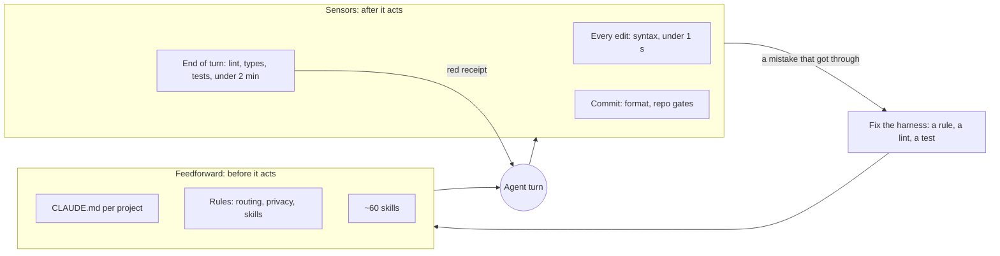
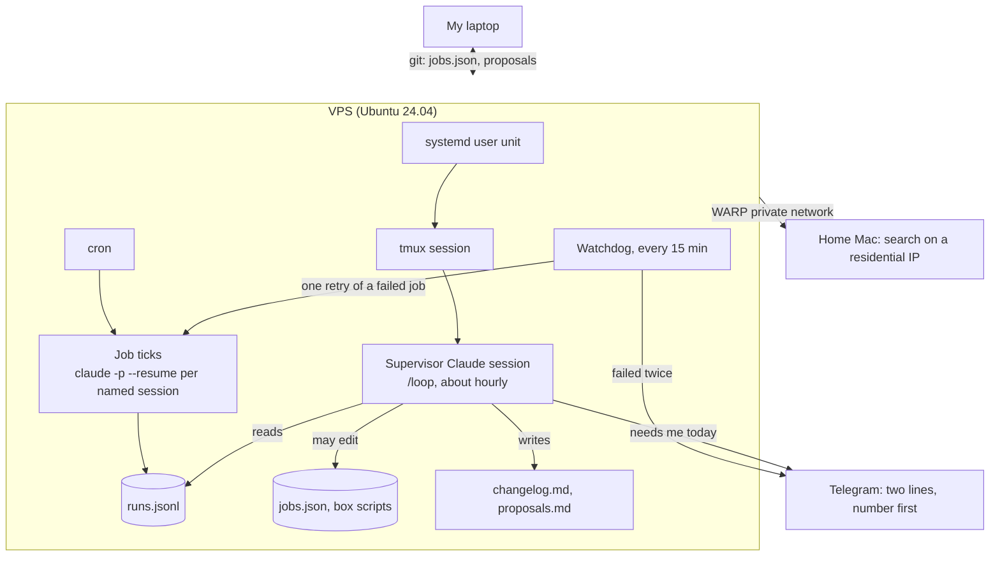
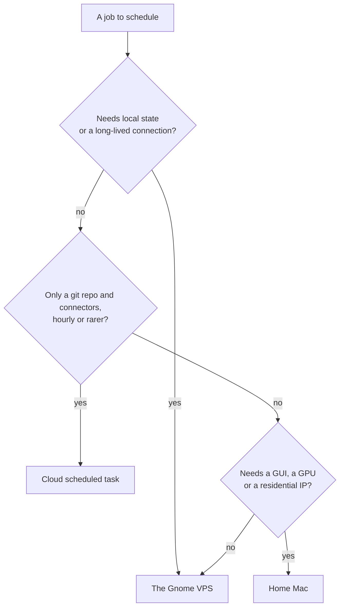
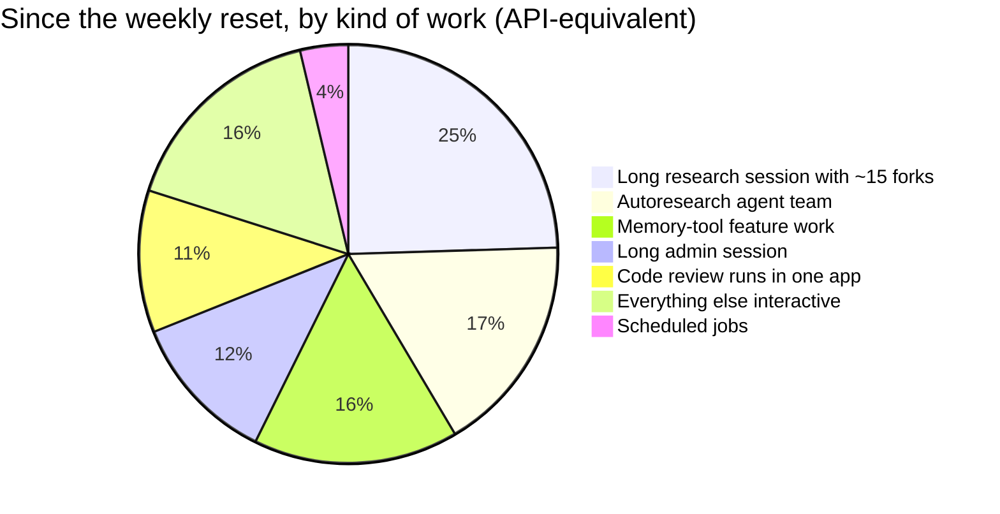

# My agent harness, and a Gnome that never sleeps

## The short version

I run most of my work through Claude Code agents: code, research, mail, grant applications, posts like this one. Two things make that workable.

The first is a **harness**: the rules, skills and checks around the agent, so that it does the right thing more often and cannot quietly claim it finished when it did not. The second is a set of **scheduled jobs** that run without me: an inbox sweep every hour, a morning and evening standup, a daily post for a Telegram channel, health checks.

Those jobs live on my laptop today, and a laptop sleeps, travels and loses Wi-Fi. So I am moving them to a small server I call the **Gnome**: one long-lived Claude session in `tmux` under `systemd`, plus cron jobs and a watchdog, on a VPS that costs $54 a year.

| | What | Number |
|---|---|---|
| Harness | rules + skills before the agent acts, sensors after it acts | the end-of-turn gate blocks a red receipt; it caught 11 of 24 planted defects |
| Scheduled jobs | inbox sweep, standup, channel post, health checks, indexes | 13 jobs; **3.8%** of my weekly usage |
| The Gnome | supervisor session + cron ticks + watchdog on a VPS | OVH VPS-1, 2 vCPU / 4 GB, **$4.54/month** on a 12-month term |
| Where usage really goes | subagents and huge contexts, not the jobs | subagents **56%**, re-reading cached context **52%** of cost |

The surprise of the week was the last row. I went looking for a server because my weekly limit ran out, and the server turned out to have nothing to do with it.

## What I mean by a harness

A coding agent is a model plus everything around it. The model I cannot change; everything around it is mine. I split it into two halves.

**Feedforward** steers the agent before it acts: `CLAUDE.md` files per project, rules that load in every session (routing, privacy, where skills live), and about sixty skills for recurring work, from scaffolding an app to publishing a post. When the agent makes a mistake, I fix the harness, not the prompt: a line in `CLAUDE.md`, a linter rule, a test. The same mistake should happen once ([[agent-mistake-fix-harness]]).

**Sensors** check the agent after it acts, at three points:

- on every edit, a syntax check of the one file just written, under a second;
- at the end of every turn, lint, types and tests on the files the session touched, under two minutes, and the turn **cannot end** while the receipt is red;
- on commit, formatting and repo-specific gates.

The receipt has rules of its own. "ok" alone is forbidden: every run prints what ran, what was skipped and what was left unchecked. Zero files in scope is never a pass. A missing tool turns the verdict into PARTIAL, never into green. I measured what this buys: the sensors caught 11 of 24 defects I planted on purpose. So green means "syntax, lint, types and tests passed", not "the change is correct".

On top of that sits a small **registry**: one JSON file per open topic, with whose move it is and the next action in one line. A `solo standup` command reads the registry, the to-do lists of my business repo and last night's digest of commits across all projects, and a session hook puts a two-line brief into every new Claude session.



The public half of this, the sensors and skills, is in [solo-factory](https://github.com/fortunto2/solo-factory). The registry and my personal profile stay private.

## The jobs that already run, and why the laptop is the weak point

Thirteen `launchd` jobs run on my Mac. A dispatcher script runs headless `claude -p` sessions in time slots: an inbox sweep every hour from 08:00 to 23:00 that leaves one living note in my Telegram Saved Messages, a standup at 07:30 and 21:30, a news post for my channel at 10:00, a pass over new GitHub issues every five minutes, nightly index rebuilds, a flight-price watch.

Every job is a ticker plus a slot: if the Mac slept through 10:00, the next tick after it wakes runs the 10:00 slot. That made the laptop good enough for months. It stops being good enough the moment I close the lid on a plane, or need something to keep working through a weekend while I am away from the desk.

## The Gnome

The Gnome is the same idea moved to a box that never sleeps, with one addition: a supervisor.



- **Jobs are named sessions.** Each job resumes its own Claude session (`claude -p --resume <id>`), so the ops job remembers yesterday's run and the research job does not see the ops job's context. A per-session lock stops two ticks of one job from overlapping.
- **The supervisor** is one interactive session in `tmux`, armed with a self-paced loop. Each pass it reads the run log, finds what failed or went stale, works out why, fixes what is its to fix, writes down what is not, and stays quiet when everything is green. A systemd timer restarts it weekly, because a loop has a lifetime limit. On restart it resumes its own session id, but only if that transcript really exists; a launch that died at a dialog leaves nothing to resume.
- **The watchdog** is plain code, no model: every 15 minutes it checks the services, retries a failed job once, and only then sends a Telegram message.
- **I can talk to it** from the laptop over SSH and `tmux attach`, or from the phone through Claude Code's remote control.

What it may do is written down, and so is what it may never do:

| May do on its own | Never does |
|---|---|
| Fix a job's prompt when the prompt caused the failure (wrong path, ambiguous step), then reinstall cron | Push to a git remote, post anywhere public, send email |
| Edit its own box scripts | Edit code in my project repos: it writes a proposal with the diff instead |
| Restart its own services | Write to a production database |
| Log every change: date, what, why, the evidence | Print or copy a secret; secrets come only through a runner that injects them |

`jobs.json` is a symlink into a git repo. When the supervisor edits a prompt, the edit comes back to my laptop on the next sync as an ordinary diff I can review. Telegram is only for what needs me today, two lines, the number first. Green runs and its own improvements never ping me.

## Where to run it: prices in October 2026

I wanted 2 vCPU, 4 GB of RAM (2 GB is too tight for Claude Code plus a few `claude -p` runs), 40 GB of disk that survives restarts, `systemd` and cron, ideally a US IP. Prices read on 30 October 2026:

| Option | Per month | Catch |
|---|---|---|
| **OVH VPS-1** (Vint Hill, US) | **$4.54** on a 12-month term, $5.35 with no term | older Xeons; the bigger VPS-2 to VPS-4 were out of stock |
| Hetzner CX23 / CAX11 | EUR 5.49-5.99 | not orderable since September; CPX22 is EUR 19.49 after the June price rise |
| Hetzner server auction | from EUR 72 | a whole machine, EU only |
| DigitalOcean, AWS Lightsail | $24 | fine, five times the price |
| exe.dev | $15 | built for agents: never pauses, cron works, Claude Code preinstalled |
| Sprites, Blaxel | about $4-5 with sleep | sleeps after seconds idle, which kills a `tmux` supervisor and in-box cron |
| Cloudflare Containers | about $34.50 at 24/7 | disk resets on restart unless you sync it out |
| Oracle Always Free A1 | $0 | idle instances can be reclaimed, and an agent is idle most of the time |
| Claude Code cloud scheduled tasks | included in the subscription | at most hourly, no local state; good for repo-only jobs |

Two things in that table changed my plan. Hetzner, the default answer for years, has nothing cheap to sell right now. And the agent-native hosts that sleep between requests are cheap only if you rebuild your jobs around being woken from outside. A supervisor that lives in `tmux` does not survive that.



I took OVH VPS-1 for a year, $54.48. The first lesson came within minutes: after the payment the order went into a manual ID check, a photo of a passport, of the card and of me holding the passport, and the team that reviews it works weekdays, US Eastern business hours. I paid on a Friday afternoon. The box arrives on Monday. If you need a server for the weekend, order it on Wednesday.

## Bringing the box up

The whole first boot is one idempotent script run over SSH: a user with my key, keys-only SSH limited to that user, a firewall that lets SSH in and everything out, `fail2ban`, unattended upgrades, 2 GB of swap so a burst of agent turns does not kill the supervisor, Node 22 with Claude Code, `uv`, the Cloudflare WARP client, and lingering so user units run without an open session.

```bash
PUBKEY="$(cat ~/.ssh/id_ed25519.pub)"
ssh ubuntu@<ip> "sudo PUBKEY='$PUBKEY' bash -s" < harness/box/bootstrap.sh
```

Logging into Claude and enrolling WARP stay interactive, on purpose: no secret ever sits in the script. The rules for the box:

- **Backups leave the provider.** The VPS comes with a daily backup, stored in the same datacenter. A datacenter fire is not hypothetical at this provider, so state goes to git or to the home Mac.
- **No scraping from a datacenter IP.** Google, Bing and many Cloudflare-fronted sites answer datacenter ranges with captchas. Search goes through my home Mac over the WARP private network.
- **One host, one queue.** My subscription has one rate-limit pool. A crawler that burns it at 3 a.m. silently kills the bot that should answer at 9. A single host is the only place that contention becomes visible ([[claude-subscription-boundary]]).
- **Several agents on one box are containers, not VMs.** A VPS has no nested virtualization; Incus system containers give each agent its own `systemd`, cron and secrets.

## Where a week of agent usage actually went

All of this started because my weekly limit ran out two and a half days after it reset. Before blaming the scheduled jobs, I counted. Every Claude Code transcript stores token usage for each model response, so I summed them since the reset and priced them at API rates. The total is an API-equivalent estimate, not Anthropic's own accounting, but the proportions are what matter: about **$1,830 in 2.6 days**, over 14,800 model turns.



What the numbers said:

- **Subagents were 56%** of the spend. Forks, which copy the parent's whole context, cost $314 of that, and the parallel searches in a 400k-token session were exactly where they hurt.
- **Re-reading the cache was 52%** of the cost, writing it another 32%; the model's own output was only 16%. The main thread carried 367k tokens per turn on average and peaked at 966k, so every small follow-up re-read most of a million tokens.
- **Three multi-agent code reviews cost about $190.** One review of navigation and UI freezes alone was $113.
- **The most capable model, Fable, cost $130 (7%)** at two and a half times the Opus price per token. In one session I switched to it, and its review subagents came along: a subagent inherits the parent's model unless told otherwise.
- **The scheduled jobs were 3.8%.**

Two settings fixed most of it. `CLAUDE_CODE_SUBAGENT_MODEL=claude-sonnet-5-5` puts subagents, teammates and workflow agents on Sonnet at half the price of Opus, which matters most when the main session runs on something expensive. `"autoCompactWindow": 400000` compacts a session at 400k tokens instead of near the 1M limit. A small `claude-mode lean | full` script flips both, so I can go back to Opus subagents in a week when the limit is fresh. Forks are not covered by the subagent setting, so the remaining rule is behavioral: a search goes to a fresh subagent, and a fork only when it really needs the whole conversation.

## What's next

The Gnome takes over the 13 jobs once the box is up: the inbox sweep, the standup, the channel post, the nightly indexes. The repo-only jobs, like answering new GitHub issues or a weekly link check of this wiki, move to cloud scheduled tasks triggered by GitHub events and the clock. The laptop goes back to being a laptop.

## Glossary

- **Harness**: everything around the model in an agent: instructions, tools, checks, memory, scheduling.
- **Feedforward**: the part of the harness that acts before the agent does (rules, skills, `CLAUDE.md`).
- **Sensor**: a check that runs after the agent acts; its **receipt** says what ran, what was skipped and the verdict.
- **Supervisor session**: one long-lived Claude Code session whose job is to watch the other jobs.
- **Tick**: one scheduled run of a job, here a `claude -p --resume` call from cron.
- **Watchdog**: plain code that checks services, retries once, then alerts.
- **Subagent / fork**: a child agent; a subagent starts with a fresh context, a fork inherits the parent's whole conversation.
- **Cloud scheduled task**: Claude Code's hosted cron (formerly "routines"): runs on Anthropic's machines with a git repo and connectors, at most hourly.
- **Compaction**: summarizing a long conversation so the agent stops re-reading all of it on every turn.

Related: [[harness-engineering-summary]], [[agent-mistake-fix-harness]], [[claude-subscription-boundary]], [[cheap-compute-cpu-gpu]], [[cloudflare-computer-agent-runtime]], [[solograph-rebuilt-one-binary]].
