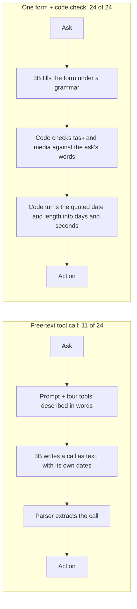
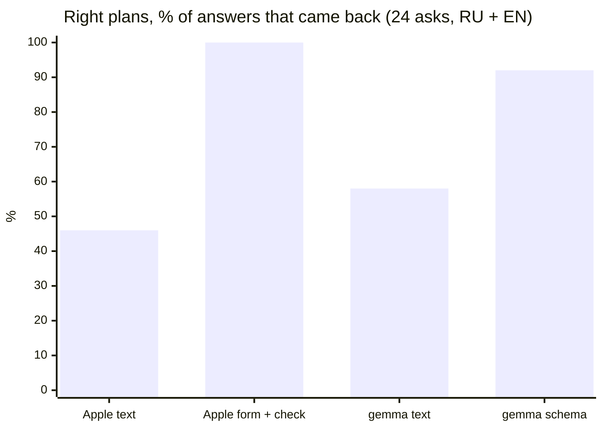
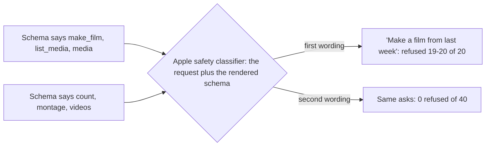
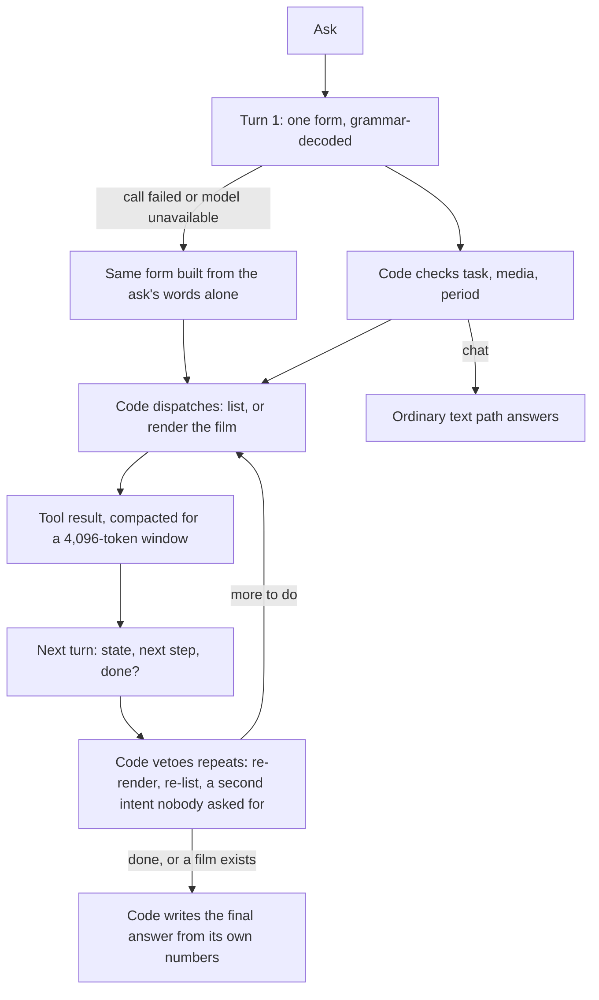

# Apple's on-device model got 11 of 24 plans right. One schema and a code check made it 24 of 24.

## The short version

[[project-life2film]] has an optional agent: you type "make a one-minute reel of yesterday" and it cuts the film. Where Apple Intelligence is available it runs on Apple's own on-device model, about 3 billion parameters with a 4,096-token window, so it needs no API key. In August 2026 I measured how often that model picks the right plan on the agent's first move. Asked the usual way, writing a tool call as free text, it got 11 asks of 24 right. Asked to fill one form whose shape a grammar enforces, with a few lines of code checking the answer against the person's own words, it got 24 of 24, in each of three runs, with no refusals.

I did not expect Apple's safety classifier to read the schema itself, and it does: a schema that said `make_film` got "Make a film from last week" refused 19 or 20 times in 20. The 24/24 also has a soft spot, stated below next to the numbers: the code was tuned on all 24 asks.

Life2Film is a personal AI film director: the Mac app (Studio, analysis on device, nothing uploaded) and an iOS app, live in the App Store since 26 Aug 2026. Everything below was measured on a Mac against the same on-device model the iPhone runs.

## Words you'll need

| Term | What it means here |
|---|---|
| **On-device model** | A language model that ships with the operating system and runs on the phone or Mac. Apple's is about 3B parameters, reached through the Foundation Models framework. Free per call, private, weak at long reasoning. |
| **Tool calling** | The model answers with "call this function with these arguments" instead of prose, and the app runs the function. |
| **Free-text tool calling** | The tools are described in the prompt, the model writes a call as text, and a parser digs it out. Works with any model; breaks when the text drifts. |
| **Grammar-constrained decoding** | The runtime only lets the model emit tokens that keep the output valid against a schema. Apple builds that grammar at runtime from `DynamicGenerationSchema`; the answer is valid JSON because nothing else was possible. |
| **Schema-guided reasoning (SGR)** | Designing that schema so the order and type of the fields walk the model through the decision: first what was asked, then what to do, then the parameters. Rinat Abdullin's [canon](https://abdullin.com/schema-guided-reasoning/); my notes in [[schema-guided-reasoning]] and [[sgr-deep-dive]]. |
| **Code check (verification)** | Plain code that checks the model's choice against the literal words of the request and overrules it when the words disagree. No model involved. |
| **Guardrail** | Apple's safety classifier, which can refuse a request before the model answers (`guardrailViolation`). |
| **Eval** | A fixed list of requests with the expected outcome, run against the model, scored by a script. |

## Two ways to ask the same model

The shipping path gave the 3B the agent's prompt plus a contract describing four tools in words. The model answered in text, and `calls_from_text` parsed a tool call out of it. The new path gave it a one-line instruction and one form:

```json
{
  "task":           "count | montage | chat",
  "source":         "videos | photos | live | all",
  "when":           "none | written | today | yesterday | last_week | last_month",
  "when_written":   "the date as the person wrote it",
  "length_written": "the length as the person wrote it",
  "reply_text":     "what to say back when task is chat"
}
```

Three closed choices and two quotations. The form never asks for a date range or a number of seconds, for a reason the first probes showed.



## The model classifies well and counts badly

The model tells a counting question from a montage request in two languages almost without a miss. Its arithmetic fails. Asked for a film of "the last month", it answered `from=2026-08-20, to=2026-09-20`: today, and a month into the future. One day came back as a range running backwards. A length nobody named came back as an invented 3,600 seconds.

So the work is split by what each side does reliably. The model picks from enums it cannot leave and copies words. `plan.rs` does every piece of arithmetic: "16 августа" becomes a day, "last_month" becomes 30 days ending today. It cannot get those wrong in the way the model does.

Then code checks the answer. Each rule below came from a measured miss:

- a montage verb with no counting question is a film, whatever the form said ("Собери ролик за вчера", *assemble a reel of yesterday*, came back `count`);
- a date found in the ask beats a default `today` (a film "за 16 августа" came back `when=today` and rendered an empty day);
- "лайв" and "live photo" are literal words, so the media type is code's call;
- "под музыку", *to music*, switches on the beat-synced cut, and the form never grew a field for it.

The misses had one shape. The model under-reports: it skips the optional length about half the time and says `none` when a month was named. It almost never invents. That is why fallbacks in code work: the words are still sitting in the request.

## The numbers, and how they were measured

`agent_eval` sends the same asks down both paths and scores what the person would get: which action, which media, which days, how many seconds. Dates are resolved by the same code in both modes, so the comparison measures the model, not the date parser. A case passes only when all four match.

| Path | Model | Right plans | Refused | Of answers that came back |
|---|---|---|---|---|
| Free-text tool call (what shipped) | Apple 3B | **11/24** | 0 | 46% |
| One form + code check | Apple 3B | **24/24**, three runs | 0 | **100%** |
| Free-text tool call | gemma-4-26b | 11/24 | 5 (network) | 58% (11/19) |
| Schema in the prompt + code check | gemma-4-26b | 11/24 | 12 (network) | **92% (11/12)** |



Three things to read before quoting the table.

**The 24/24 is a tuned number.** The eval started with 16 asks. I added eight fresh phrasings as a held-out batch, and the first honest score on them was 2/8. Every miss became a general rule in code (a month or year sitting in the ask resolves even when the form said `none`; "секунд на 30" reads as a length as well as "30 секунд"), and the batch went to 8/8. After that it was no longer held out. A real generalisation number needs new phrasings, ideally from phone logs.

**Gemma's gain is on the answers that came back.** Gemma ran through a Cloudflare gateway that dropped requests (`error sending request`), and the eval had no retries. Both modes got 11 of 24 right in absolute terms. With the schema, 11 of the 12 answers that arrived were right; without it, 11 of 19. Over HTTP the schema rides in the prompt and nothing enforces it.

**It kept holding as the eval grew.** With file operations added: 28/28 against 11/28 for text. With five categories: 31/31 twice, against 11/31. A later change gave the task enum words for what the app actually does (cut, gather, search, silence), and correct answers went from 6 of 27 to 21 of 27, mostly in languages with no word list in code at all: German and Spanish trim requests now answer `cut` three times out of three. That version passed 7 of 7 on two real iPhones, one on Apple's model, one on the gateway.

## Apple's guardrail reads your schema

This took most of a day. With domain words in the schema (`make_film`, `list_media`, `media`), "Make a film from last week" was refused 19 or 20 times in 20, in Russian and English alike. The same asks against a schema that said `count`, `montage`, `videos` were refused 0 times in 40.



Measured on the way:

- the permissive guardrail setting (`permissiveContentTransformations`) changed nothing: 5 refusals of 5 at both levels;
- refusals were not monotonic in the fields: action+media refused 3 of 4, add period_kind and it was 0 of 4, all four fields 4 of 4. That looks like a threshold over the whole prompt, not a list of banned words;
- the instruction "Copy any date word for word" was a second trigger, probably because *film* plus *copy* reads like piracy. Removing it took refusals from 1–2 a run to zero;
- a free-text Russian field in the schema was caught by the output scanner; removing it cut refusals from 3 a run to 1.

So **the schema's vocabulary is part of the safety surface.** The code translates neutral words back into domain terms at the boundary, and the model never sees the loaded ones. Every schema edit gets re-measured, because any of them can tip the prompt over the edge.

The schema also rescued Russian. Russian is not among the model's 23 supported languages, and free generation in Russian failed with `unsupportedLanguageOrLocale`. The same requests under the schema were answered. Without the form, a Russian speaker gets an error instead of a film.

## Ideas that should have helped, and didn't

Each looked obviously right; each was measured and reverted:

| Change | Expected | Measured |
|---|---|---|
| Drop `today`/`yesterday` from the period enum (fewer options) | clearer | 11/14 → **5/14**; it marked everything "written" and translated dates |
| Make every field required | fewer skipped lengths | 9/16 → **6/16** |
| Quote the period before choosing the task | better dates | 9/16 → **8/16** |
| Fully neutral vocabulary, no domain words at all | no refusals | **6/16**: the model stopped mapping "видео" to anything |
| Remove `reply_text`, which the code never reads | smaller schema | 24/24 → **22–23/24** with a refusal |

Reordering the enum did help. This model leans hard on the first option, and moving values around took one eval from 9/14 to 11/14 with nothing else touched. `reply_text` turned out to be a valve. When chat words have somewhere to go, the model picks `chat` for talk instead of forcing it into an action. The canon's "smaller schema is better" holds only until the number says otherwise.

## The loop: the model decides one thing per turn

SGR's adaptive-planning pattern asks for a fresh plan at every step and executes only its first move, so no stale plan survives. In Life2Film that is a second, mid-run form, with a field for current state, a next step and a completion flag. A field for the remaining steps was dropped: the 3B filled it with retellings, spent the window and changed nothing downstream.



The model is in the mid-run turn for one reason: to notice a second intent ("make a film AND tell me how many"). Its measured mistakes there were repeats (re-render, re-list, retry an error, and twice a `count` invented for a film-only request), and the code closes them from the transcript and the words of the request. A rendered film ends the run from code. The first version only hinted "answer done", and the model re-issued the render six times until the loop aborted with the finished film already on disk.

End to end on the Mac's real Photos library, Apple's 3B, Russian:

- "Собери ролик за вчера на минуту" (*a one-minute reel of yesterday*): 2 steps, a 60.4 s film from yesterday's 9 clips. Before this work the same ask listed a month;
- "Склей мне ролик под музыку из вчерашнего" (*a reel of yesterday, to music*): 2 steps, 29.8 s, music in the audio track;
- "Смонтируй фильм за вчера и скажи сколько у меня всего видео" (*a film of yesterday, and how many videos I have*): 3 steps, film plus count. With a known limit: the first turn's period colours both intents, so "how many in total" was counted for yesterday.

With the model gone entirely (an old device, Apple Intelligence off), the same form is assembled from the same word lists the code checks against, so the fallback cannot disagree with the checker. "Смонтируй фильм за вчера" reaches its film with no model at all.

A form costs 0.54 to 0.66 s once the model is loaded; the first call in a process pays about 2.9 s for the load. On a phone one `prewarm()` at launch should cover that, not yet measured.

## The OS changed the model under the app

On 21 August the Mac had gone from macOS 26.2 to 26.6.2. Same SDK, same 23 languages, same window, and a different model underneath. "Что я снимал на прошлой неделе?" (*what did I shoot last week?*) now came back `when: today` where it used to say `none`. Most code checks held, since they read the request, not the model. One branch of the date check had never consulted the relative-period words; the eval showed the miss, and once that branch read them the eval went back to 39/39, twice, on the new runtime. Without the eval, an OS update would have changed the app's answers with no line of the app changed.

## The same lesson on the server side

Two days later I built a model picker for people who bring their own key, and re-learned this at the catalog level. The first version listed nine models with levels measured by the text path. The app over HTTP takes actions only from native `tool_calls`, so I re-measured through the app itself, three asks per model. Seven of nine levels were wrong. Granite 4.0 H Micro, GPT-OSS 20B and Llama 4 Scout scored 0 of 3 and left the curated list. Llama 4 Scout's catalog entry says `function_calling: true`; it made zero tool calls. The app's default, Gemma 4 26B, was one of four that scored 3 of 3.

## What I'd take to the next small model

- Ask the model for **choices and quotations**, never arithmetic. Code counts days.
- **Check the answer against the request's own words** in code.
- Keep a field where talk can go, even if code never reads it.
- **The schema's words are part of the safety surface** on Apple's model. Re-measure after every edit.
- One run is noise: the guardrail flapped between 1 and 4 refusals on an unchanged schema until the cause was found. Three runs minimum, and a schema edit without a number is not an edit.
- Measure models through your own app, not a catalog flag.

This is [[apple-on-device-ai]] in practice: the framework gives you SGR natively, and the schema still has to be designed against measured failures. On grammar-constrained decoding under the hood, see [[tool-calling-four-layers]]; on why the model runs on the device in the first place, [[privacy-as-architecture]].

## How this was measured

Every number comes from the track document of 20–21 August 2026 and its commits, measured on a Mac (macOS 26.2, then 26.6.2). Commands: `make afm-eval` for the single-form eval and `cargo run --example agent_eval --manifest-path crates/va-agent/Cargo.toml -- text schema` for the A/B. Not covered yet: a fresh held-out batch, and the August numbers on a phone; the two-iPhone check came a day later, on the expanded form.
