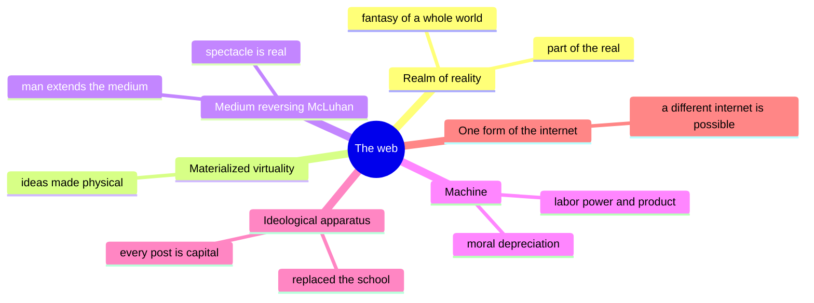
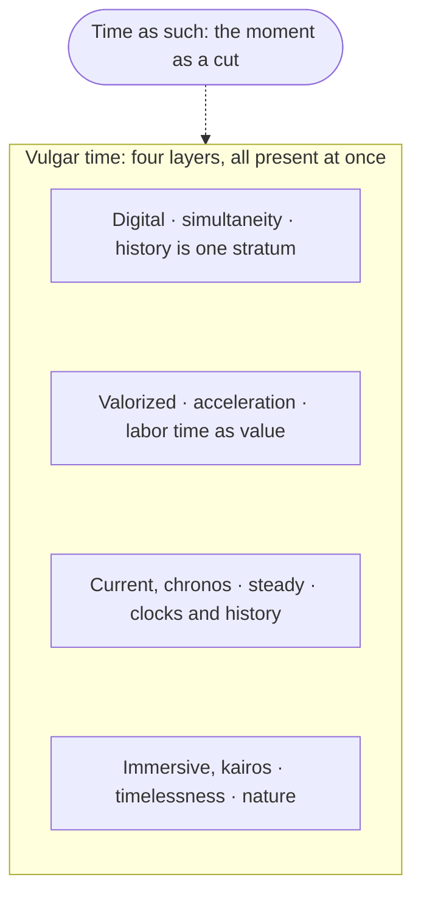
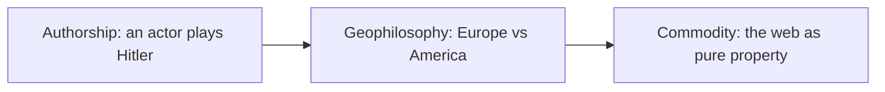
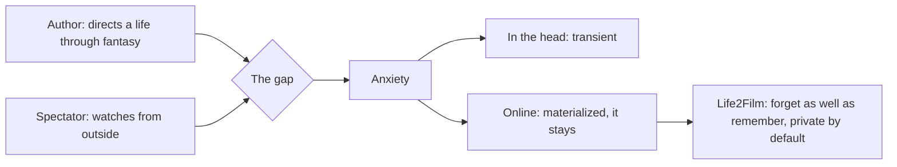
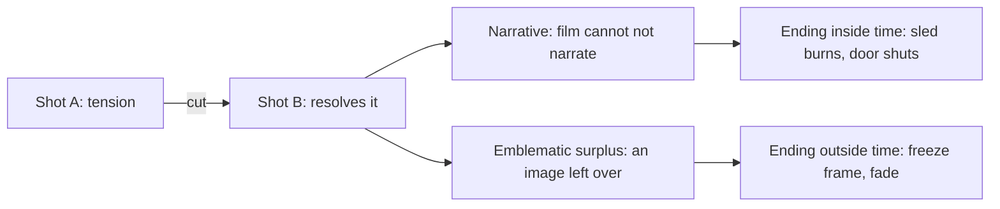

# Bara Kolenc at Stanford: we are authors and spectators of our own lives, and the internet keeps the gap from fading

I asked Bara Kolenc whether we are the directors of our own lives or only the audience. "We are both," she said. The internet and AI did not create that split, they exposed it. The gap between the one who directs a life and the one who watches it produces anxiety, and while it lives in our heads it is transient; put online, it stays. Kolenc, Gregor Moder and Jure Simoniti, philosophers from the University of Ljubljana, spoke at Stanford on 27 October 2026 in a panel called ["The Offline Dream Program: Three Takes on Film, the Internet, and Instanternity"](https://creees.stanford.edu/events/offline-dream-program-three-takes-film-internet-and-instanternity), moderated by Pavle Levi of Stanford's Department of Art & Art History. I was in the audience, and since I build [[project-life2film]], a personal AI film director, I had a stake in the question.

## The evening on one screen

| Who | Talk | In one line |
|---|---|---|
| **Bara Kolenc** | "Welcome to Instanternity: Who's the Real Alien Today?" | The web changed time itself, and it stores the split we always were. |
| **Gregor Moder** | "Lubitsch, Shakespeare and the Theatricality of Power" | Power is a performance, so comedy can puncture it; history survived its own death. |
| **Jure Simoniti** | "Image and Narrative: The Difference between American and European Cinema" | Film cannot not narrate, and it always leaves an image the story cannot absorb. |
| **Pavle Levi** | moderator | Does Hollywood closure fail anyway? Rosebud, *The Searchers*, Descartes' heated room. |
| **Me** | from the floor | Are we the directors of our lives, or the audience? |

The panel was part of the three philosophers' "Repetition and Contingency" series across US universities, moved to Oshman Hall in the McMurtry Building by campus power outages. Moder had spoken before I started recording, so his talk appears here through the official abstract and his answers.

## Six terms to hold on to

| Term | From | What it means here |
|---|---|---|
| **Instanternity** | Kolenc | *Instant* + *eternity*: the digital experience of time, and a regime in which time shapes material reality. |
| **Vulgar time** | Kolenc, after Heidegger | Time as we experience and measure it, history included. Time itself, for her, is the moment as a cut. |
| **Split subject** | Kolenc, after Lacan | A subject that never coincides with itself, built on doubt and desire, not consciousness. |
| **Moral depreciation** | Marx, via Kolenc | A machine loses value when a cheaper or better one appears. |
| **Emblematic surplus** | Simoniti | The image a film leaves over its story. |
| **Closure** | Levi and Simoniti | The classical ending that ties every thread, like Rosebud burning; Levi asked whether it ever fully works. |

## Bara Kolenc: welcome to instanternity

Her talk condensed her book *The Internet and the Subject: Reflections on Desire, Ideology, and Time in the Age of Instanternity* (Analecta, 2025, in Slovenian). She showed no clips, since "we are on our screens all the time anyway". She could have zoomed in on mass psychosis in the age of AI, she said, reading AI as mimicry the way psychotics in Lacan's account lean on imaginary identifications, but chose the book's ontological core. Her abstract frames it with "three impossible things": "a pervert without a body. Consumerism without desire. And ideology without a sublime object." And it asks: "If the human goes extinct, will the subject survive?"

### The moment is a cut

A shot is fired, one crow falls. How many are still sitting? By deduction, four, if there were five. By experience, none. Logic relies on reality being consistent, she said, and reality is not: the crows fly off, and a moment later they may be back on the wire in a different order.

For her the **moment** is a cut that slices into reality and changes it unpredictably, a gunshot that establishes reality and time together. It both is and is not. It cannot be the smallest possible duration, because it is the switch between duration and non-duration, so time has to be thought from that indeterminacy rather than from a continuous line. Reality, then, is a **constellation** established anew at every moment, not mystically and not as an illusion, but as reality *for the subject*, dialectical rather than flat.

An editor hears this literally. A cut is where one stretch ends and the next begins, and the viewer builds what happened out of those switches. Crows back on the wire in a new order is what a montage does to a day.

### Six definitions of the web

**1. A realm of reality.** The web is no artificial world split off from "true" everyday life, she said; it is part of the reality we relate to. It also feeds our fantasy of reality as one consistent, meaningful whole, the picture we call the world, which is why *global* appeals. Put simply, online life is life. The wish to keep a complete record of your own days is the same fantasy of the whole, at home scale.

**2. A materialization of virtuality.** The virtual exists as an idea, not yet actualized. On the web it is externalized, material in its composition and above all in its effects: the possible now sits on servers and has physical consequences. Life2Film started from the household version: most of the video we record sits unwatched, virtual memory on very real hardware.

**3. A medium that reverses McLuhan.** For McLuhan media extended man; with the web, man becomes an extension of the medium. She read the meeting of digital and non-digital through Debord's "reciprocal alienation" of reality and spectacle, in which reality belongs to the spectacle and the spectacle is real, so the pre-digital turns into a myth we cannot define without the digital. For anyone cutting personal footage this means there is no untouched day to go back to. The camera was already part of it.

**4. A machine.** She cited Imperva's 2025 report: 53% of all activity on the internet was automated, and with AI agents, she said, the share grows exponentially. The dream of robots working while we lie in the sun is as old as Daedalus and the self-moving tripods of Hephaestus, a master's fantasy of robotic slaves. Marx took it apart in *Capital*, and she quoted the sentence in which machinery becomes "the most unfailing means for placing every moment of the labourer's time and that of his family, at the disposal of the capitalist" (Moore and Aveling's translation). People were freed from labor by the socio-economic system around machines, never by the machines. She did not argue for going backwards: technology could serve the Enlightenment and a just, sustainable economy, once we see through the techno-ideology that treats it as naturally capitalist.

Then Marx's law of **moral depreciation**. Labor time measures value, so the faster a commodity is made, the less the work and the product are worth. A machine first embodies the labor it replaces, a worker's week done in a minute; once it runs, its value is set by the labor needed to reproduce the machine itself. In her reading the machine is a "peculiar amphibian", both labor power and product, and so is the web powered by AI agents. It also has to reproduce itself ever faster, a law of acceleration Marx found long before Moore's law. In everyday terms, automation frees nobody by itself, and the system pushes every machine to be replaced. Anyone who has watched a model or a GPU lose its price within months, because a cheaper one shipped, has seen it happen.

**5. An ideological apparatus.** For Althusser the school replaced the church as the modern state's dominant ideological apparatus. Her claim is that the web has replaced the school. Online every creed seems to have room and ideologies seem to multiply without end, and in that very appearance of plurality the web becomes a field of enjoyment, desire and the big Other. Its cunning is that the more redundant a person becomes in its mechanism, the more dependent on it they are, and the more they enjoy it. Even critiques of capitalism stay hypocritical once posted, since every post is capital. What remains is consumerism as "an ideology of ideology": consumption for consumption, capital for capital, a pure tautology. Read simply, the web teaches us what to want, and its one lesson is to keep consuming, even while we post against it. A film of your day that gets posted joins that stream.

**6. One form of the internet.** The global web as we know it is only one particular form of the internet. Hence the book's founding proposition: in search of what Badiou calls egalitarian emancipation, start from the claim that "a different internet is possible". In practice the web we have is one design among others, and a memory tool can use the internet's protocols without living inside a platform.

### Instanternity and vulgar time

**Instanternity** is both a new experience of time and a regime in which time shapes material reality. Her example was what happens to Ukraine when Musk turns off Starlink for a day.

She separates time itself, the original exposition of time, from **vulgar time**, Heidegger's term for time as humans experience and represent it, history included. For both of them time itself shows up as the moment. In her reading Heidegger's moment opens onto pure presence, while hers is a cut, temporal and extra-temporal at once, producing presence and absence together.

### Four forms of time that live side by side

The book puts forward five historicizing hypotheses, its "vulgar part", and she had time for two. First, instanternity has succeeded postmodernity, because digital technology appears to realize postmodernity's collapse of historical distinctions. Whether modernity ends with it is open, but losing even one of its pillars, the modern state or the divided subject, would signal its end.

Second, a model of four forms of vulgar time, with names she made up:

**Immersive time**, which she tied to *kairos* and deep time, belongs to prehistory. **Current time**, *chronos*, cuts into it step by step, and that is history; modernity **valorizes** it as labor time. The fourth form she described as the "valorized exponential convergence toward the limit" of current time (its name was unclear on my recording), and in it history becomes one stratum among others. Each form coexists with the older ones, and beside them sit time as such and non-temporal patterns such as particle entanglement or what Michael Levin calls bioelectricity. In most Greek usage *kairos* is the opportune moment, so take her definition from her.

### "It thinks", and who the real alien is

She closed on two words, "it thinks". We assume they describe AI, she said, and that is wrong. They describe the subject, something closer to us and more dangerous. The subject is neither the self nor self-reflection, whatever neuroscience or behaviorism posit. The self exists, but, in what she called one of Freud's most important discoveries, it is an object to the subject, built from our desires and fantasies about who we are. Subjectivity is not consciousness, and we do not fully control our desires, thoughts or deeds. "But if our thoughts are fundamentally alienated from us, who then is the real alien today?"

A film an AI makes of my day is, in her terms, the self: an image of who I think I am. The subject is whoever watches it and does not quite coincide with it.

### Doubt, desire, and an AI that would have to be split

Levi said he loves the Ljubljana reading of the Cogito, the thing that thinks, though it costs a radical reduction to the thing minus the self. Then a joke, as I heard it: Descartes found his method shut in a heated room, the *poêle*, and such a box only needs a pinhole to become a camera obscura.

Kolenc answered that the subject of psychoanalysis is Cartesian because it begins where thought is put in doubt, not where thought meets itself. Doubt defines the subject, so to ask whether an AI could be one, look at whether it doubts and how it acts. And for Lacan *desidero* is the Freudian cogito: the subject is built on desire. The question about AI then becomes whether it is a **split subject**. Split subjects are "not at home" in themselves and always depend on others, so intersubjectivity comes first. That, she said, is also the fundamental proposition of the internet, which is or was a society, with the potential to be society itself in a new medium. "But what is it now? It is a capitalist machine."

### The internet is not the web

So she separates the internet, the protocols by which computers connect, from the World Wide Web, which from 1991, in her account, took that structure over and monopolized it. Without the web the internet could have a different future: "internet that is not a consumption machine". Its material effects, she said, run from materials and energy to our psyche and brains to the environment.

An audience member read the whole panel as one story about representation:

The middle step is Deleuze and Guattari's term for thought tied to territory. Kolenc took up the last one, property. Authorship is a modern invention tied to ownership and copyright, and "we don't own ideas": they should be held in common. On the web as spectacle, she said, we end up like marbles that reflect each other without really connecting.

### The books behind the talk

Her English book, *Repetition and Subjectivity: Kierkegaard, Freud, Lacan* (SUNY Press, 2026), is the theory underneath and explains the series' name. Per the publisher, she treats repetition as an ontological principle of duality and lays out four matrices of repetition, deflation, reformation, inflation and formation; formation underlies the modern subject. Along the way she reworks the Greek *anámnesis* (remembering), the death drive and *jouissance*. Her earlier books, in Slovenian, are *Figura dvojnika: Od komedije k psihozi* (The Figure of the Double: From Comedy to Psychosis) and *Ponavljanje in uprizoritev: Kierkegaard, psihoanaliza, gledališče* (Repetition and Staging: Kierkegaard, Psychoanalysis, Theatre), and she co-edited *Master/s* with Moder and Simoniti.

Re-watching your own edited day is a repetition in this sense. In Kierkegaard's *Repetition*, Constantin Constantius goes back to Berlin to repeat a trip and finds he cannot. The book sets repetition against recollection: recollection repeats backward, genuine repetition is "recollected forward". A film of a day is recollection. Whether watching it again can work forward is the open question for my tool.

<!-- VIDEO: Rustam's question, t≈60:27 -->

## I asked: are we the directors of our lives, or the audience?

I said I am building Life2Film, a personal AI film director: you shoot video through the day, and it makes a film of your life automatically. Then I asked two things. Are we the directors of our lives, or just the audience? And now that AI edits the video, who is the director, still me or the machine?

Kolenc took the first half: we are both, "the authors and the spectators at the same time", and the internet, digitalization and AI only exposed what we already were. We keep directing our lives through a fantasy of who we are, projecting what our life will be, and we are always outside it too, watching. That split produces the anxiety, the pressure. In our heads it is transient and it works. Materialized online, it stays, and that, she suggested, is probably why we have so much more anxiety and so many more psychic problems.

She did not take up the machine, but her answer bears on it. If AI only exposes a split we already had, the editing machine is no rival director; it puts the old gap on a screen and makes it last. Fiction has tried this. In *The Final Cut* (2004) Robin Williams plays a "cutter" who edits a dead person's lifetime of implant recordings into a memorial film, and in *Black Mirror*'s "The Entire History of You" (2011) an implant that records everything turns replay into jealousy. A director that records everything and plays it all back widens the stored half of that gap, so it should help us forget as well as remember: keep the few shots that carry the day and let the rest go. And if every post is capital, a film of someone's life should stay private by default rather than feed a platform. That is the rule of [[privacy-as-architecture]]: if we cannot see your footage, we cannot leak it or sell it. Life2Film runs everything on the Mac and uploads nothing. We can hand the editing to a machine, but not the memories.

## Gregor Moder: the theatricality of power

Per his abstract, Lubitsch's *To Be or Not to Be* (1942) follows a theatre troupe in occupied Poland and asks what makes a convincing performance; early critics found its human, joking Nazis disrespectful. For Moder political action and the metaphysics of performance are linked, as in Shakespeare, and "there is no defeating Nazism without a thorough understanding of the theatricality of power as such".

Levi turned the question backwards in time: if Lubitsch teaches us about Shakespeare, what does Shakespeare teach about Lubitsch, and what can Hitler teach us about his impersonators? "I hope not very much," Moder said, then called it the clever question. Lubitsch and Chaplin both knew that fascism has an affinity with theatricality and exists through public performance of its program; he mentioned a paper finding the same element in how Milošević held power. Whether that theatricality has changed is open. We learned to talk about power with ideas from the Second World War and from Shakespeare, and Donald Trump, "very hard to avoid", makes a claim to power that is similar and also quite different.

### History survived its own death

On temporality he spoke personally. The 1990s were painful for him: war and genocide near his own country, mostly in Bosnia, while people spoke of the end of history. Fukuyama had argued that after the Soviet collapse liberal democracy was the best and only way to live, so wars had no reason left. "And yet, you know, there were." Steven Pinker kept arguing that war has receded. History does not work that way, Moder said. The end of history of the 90s was pure fantasy, and history "survived its own death pretty well". Someone noted that Fukuyama has since changed his view.

### Comedy against the cult of the leader

Later he added why comedy handles the authority figure so well. The Führer insists on being the one unique figure who holds the nation together, and because everything is invested in him, comedy can show at once that he is "just a random guy with a mustache". One of the things that pushed Chaplin to make *The Great Dictator*, Moder said, was that he wore the same mustache: wait, I could be that guy. That is why, for him, the best films on how Nazism worked are comedies. How representation works today he called "very volatile", without claiming an answer.

Kolenc has a book on this figure, *Figura dvojnika*. Going by the title alone, it spans the evening: the double as Chaplin's comedy, and the double as the psychotic's imaginary identification she linked to AI. Deepfakes have made the double cheap, so which way it falls is now a practical question.

### Shylock, cut before revenge

Someone asked him about Lubitsch, a European liberal of his generation, reading Shylock's monologue as a humanist declaration when in the play it is nastier, tied to the pound of flesh. Moder agreed. In *The Merchant of Venice* the speech answers the question of what Shylock wants with the flesh at all: it will feed his revenge on Antonio, who has been cruel to him throughout. The Nazis staged their own Shylocks; later Jews and Israelis reclaimed him as a man wronged. Whether the play is antisemitic or plays with antisemitism is, he said, unclear.

What matters for the film, he said, is that Lubitsch cuts the monologue off before the revenge: eyes, organs, senses, passions, and never the line about revenge. *Hamlet*, the film's other reference, is a failed revenge tragedy. Even in Shylock, though, revenge is not a Jewish eye for an eye set against Christian mercy. Shakespeare's point is that "even in revenge we are just like you".

## Jure Simoniti: film cannot not narrate

His abstract defines film as "the art of the transcendental, that is, irresolvable dialectic between image and narrative" and draws the line this way: "American cinema employs the image to produce a narrative, while European cinema employs narrative to produce an image." The burning sled of *Citizen Kane* stitches the film into one story; the dead fish at the end of *La dolce vita* stays an icon, and "woman's films" such as *Persona* or *Queen Margot* raise the woman into an Icon no narrative resolves.

I heard the end of his reading of *Queen Margot*. Adjani's face, he said, lacks the stoic internalization of loss that Garbo shows in *Queen Christina*. She suffers, a tear rolls, yet her lover's death cannot be written into her face as psychology or biography. La Mole's death is "the price the narrative pays" to give back the innocence her face lost at the wedding. The severed head in her lap stages two faces, one carrying the weight of the story and one standing above it, while her younger brother opposite watches her become an Icon. She rises from the ashes of her narrative "as an image through which no story can any longer pass".

### Levi's challenge: does closure fail?

Simoniti's examples of narrative came from classical Hollywood, where narrative means **closure**. Levi's counter-case: Ethan at the end of *The Searchers*, left outside as the door shuts. In a thought experiment, a habit of the Ljubljana school he said he loves, a European director might have ended on Ethan walking away. Wouldn't that lingering image belong more to the narrative than one cut off so abruptly? And isn't the burning Rosebud a failed closure, since learning that it was a sled is not enough? Even insistent closure may leave images beyond it.

Simoniti's answer: a film is a sequence of images, and one image following another is already a minimum of narrative, so film "cannot not narrate". But the next shot always resolves a tension contained in the previous one, and so film always produces an "emblematic surplus" over the narrative; neither side cancels the other. Is the end of *The Searchers* beautiful because it puts the story to rest, or because of the lone man in the doorway? Probably the image, he said.

This is the Kuleshov effect seen from the editing table. Every cut asks and the next shot answers, so a machine that orders clips is already telling a story whether it means to or not.

### Endings inside time and outside it

The last audience question: in his American examples the resolution falls on one discrete moment, the sled catching fire, while *Queen Margot*, *The 400 Blows* and *Run Lola Run* fade or freeze. Is the resolution there outside of time? He partly agreed. Narrative cinema ties its ending to the story and puts it into time; the "European touch" leaves an atemporal icon at the end. The historical Marguerite de Valois lived on and wrote her *Memoirs*, published in 1628, which are mostly what she is remembered for. The film still ends on the icon, and the story is brought to a halt by being revealed rather than resolved.

A personal film has to respect that gap. A life goes on and writes its own story, and a cut freezes it into someone else's. The film of a day can make an icon of a moment, but the person in it should stay the Margot who writes the memoirs.

## Who goes further on this

These writers go deeper on single roads across her map, with more cases and data.

- **Bernard Stiegler**, *Technics and Time* (1994–2001), vol. 3 above all, *Cinematic Time and the Question of Malaise*. Tertiary retention is memory externalized in technical objects, and he reads consciousness as selecting and editing like cinema. The closest thinker to Life2Film, and more precise than the talk on how stored memory reshapes the one who remembers.
- **Daniel Kahneman**, *Thinking, Fast and Slow* (2011): the experiencing self and the remembering self, and the peak-end rule from Redelmeier and Kahneman's 1996 colonoscopy study. We judge an experience by its peak and its end, not its length. An experimental "author and spectator", and literally an editing rule.
- **Roland Barthes**, *Camera Lucida* (1980): the *punctum*, the detail in a photo that pricks you and that no caption explains, Simoniti's surplus in a family album. With it, Hito Steyerl's "In Defense of the Poor Image" (*e-flux journal*, 2009), on images that circulate as compressed copies.
- **Wade, Garry, Read and Lindsay**, "A picture is worth a thousand lies" (*Psychonomic Bulletin & Review*, 2002), in the line of Elizabeth Loftus's false-memory research: doctored childhood photos led adults to recall events that never happened. The ethics problem for any AI that edits memories.
- **Viktor Mayer-Schönberger**, *Delete: The Virtue of Forgetting in the Digital Age* (2009). Digital storage turned forgetting from the default into the exception, and he proposes expiration dates for information. A design answer to "help us forget".
- **Gordon Bell and Jim Gemmell**, *Total Recall* (2009), the MyLifeBits case for recording everything, read against José van Dijck, *Mediated Memories in the Digital Age* (2007), on memory made with media rather than stored in them.
- **Sherry Turkle**, *Alone Together* (2011): years of interviews behind the marbles that reflect each other without connecting.
- **Reinhart Koselleck**, *Zeitschichten* (2000; English, *Sediments of Time*, 2018): history as layers of time moving at different speeds, long before "history is one stratum among others".
- **Lev Manovich**, *The Language of New Media* (2001): database and narrative as "natural enemies". A camera roll is a database; a film is a narrative.
- **Douglas Rushkoff**, *Present Shock* (2013), and **Byung-Chul Han**, *The Scent of Time* (2009) and *In the Swarm* (2013): a present without duration, with more everyday cases and less system than instanternity.
- **Mark Fisher**, *Capitalist Realism* (2009) and *Ghosts of My Life* (2014), on the "slow cancellation of the future", and **Jonathan Crary**, *Scorched Earth* (2022), who wants a life beyond the internet complex rather than a different internet. Her thesis, tested from both ends.
- **Shoshana Zuboff**, *The Age of Surveillance Capitalism* (2019): the documented mechanics behind "every post is capital".
- **The Ljubljana core**: Slavoj Žižek, *Hegel in a Wired Brain* (2020); Alenka Zupančič, *What Is Sex?* (2017); Mladen Dolar, *A Voice and Nothing More* (2006). Where her vocabulary comes from.

## Further reading

**The subject**

- Lacan, "The Mirror Stage" (1936/1949): why the self is an image, behind "the self is object to the subject".
- Lacan, *Seminar XI* (1964): "desidero is the Freudian cogito", the split subject and the big Other.
- Freud, "On Narcissism" (1914) and "A Difficulty in the Path of Psycho-Analysis" (1917): the ego "not master in its own house".
- Lichtenberg, *Waste Books*: say "it thinks", as one says "it lightens"; the old objection to "I think".
- Kierkegaard, *Repetition* (1843) and *The Concept of Anxiety* (1844): repetition "recollected forward", and the moment where time touches eternity.
- Kolenc, *Repetition and Subjectivity* (SUNY Press, 2026): the theory under the talk; I bought it after the panel.
- Žižek, *The Sublime Object of Ideology* (1989) and *Hegel in a Wired Brain* (2020): the Ljubljana starting point, and its take on brain–computer interfaces.
- Zupančič, *What Is Sex?* (2017), and Dolar, *A Voice and Nothing More* (2006): the rest of the Ljubljana vocabulary.

**Memory and the self**

- Stiegler, *Technics and Time*, vol. 3 (2001): tertiary retention, memory stored in technical objects; the closest theory to Life2Film.
- Kahneman, *Thinking, Fast and Slow* (2011), with Redelmeier and Kahneman (1996): the remembering self and the peak-end rule, an editing rule in disguise.
- Loftus and Pickrell, "The Formation of False Memories" (1995), and Wade, Garry, Read and Lindsay (2002): suggestion and doctored photos can plant memories; read these before letting AI edit the past.
- Mayer-Schönberger, *Delete* (2009): expiration dates for data, a design for forgetting.
- Bell and Gemmell, *Total Recall* (2009): the lifelogging case for keeping everything, from MyLifeBits.
- van Dijck, *Mediated Memories in the Digital Age* (2007): memory made with media rather than stored in them.

**Time**

- Heidegger, *Being and Time* (1927), §81 and the *Augenblick*: the vulgar time and the moment she reworks.
- Koselleck, *Zeitschichten* (2000; *Sediments of Time*, 2018): layered historical time, a precursor of "history is one stratum".
- Rushkoff, *Present Shock* (2013), and Han, *The Scent of Time* (2009): the present without duration, in plainer prose.
- Descartes, *Discourse on the Method* (1637), part two: the heated room behind Levi's joke.
- Michael Levin, "Technological Approach to Mind Everywhere" (2022): her example of a non-temporal pattern.

**Images, montage, narrative**

- Barthes, *Camera Lucida* (1980): the *punctum*, the detail no story explains.
- Steyerl, "In Defense of the Poor Image" (2009): what circulation does to an image.
- Manovich, *The Language of New Media* (2001): database against narrative, camera roll against film.
- Kuleshov's montage experiment (around 1920): the next shot decides what a face means.
- Bordwell, *Narration in the Fiction Film* (1985): how classical narration closes.

**Media, capital, ideology**

- Debord, *The Society of the Spectacle* (1967), thesis 8: "reciprocal alienation"; short, read it whole.
- McLuhan, *Understanding Media* (1964): the thesis she turns around.
- Marx, *Capital*, vol. 1, ch. 15 (13 in German), section 3b: moral depreciation and the "unfailing means" sentence.
- Althusser, "Ideology and Ideological State Apparatuses" (1970): the school as apparatus, to test her claim that the web replaced it.
- Badiou, *The Communist Hypothesis* (2009): the egalitarian emancipation behind "a different internet".
- Foucault, "What Is an Author?" (1969): authorship born with ownership.
- Deleuze and Guattari, *What Is Philosophy?* (1991): geophilosophy.
- Zuboff, *The Age of Surveillance Capitalism* (2019): how behavior becomes product, the mechanics of "every post is capital".
- Fisher, *Capitalist Realism* (2009), and Crary, *Scorched Earth* (2022): no alternative in sight, or a life beyond the internet.
- Turkle, *Alone Together* (2011): interviews on connection without contact.
- Imperva, *Bad Bot Report* (2025): the source of her 53%; check it before reusing.

**Power, comedy, history**

- Benjamin, "The Work of Art in the Age of Its Technological Reproducibility" (1935/36), epilogue: fascism as aestheticized politics.
- Bergson, *Laughter* (1900): the mechanical encrusted on the living.
- Zupančič, *The Odd One In: On Comedy* (2008): the Ljubljana book on comedy.
- Fukuyama, *The End of History and the Last Man* (1992), and Pinker, *The Better Angels of Our Nature* (2011): the two positions Moder argued against.

**Films from the evening**: *Queen Margot* (Chéreau, 1994), *Queen Christina* (Mamoulian, 1933), *Citizen Kane* (Welles, 1941), *La dolce vita* (Fellini, 1960), *Persona* (Bergman, 1966), *The Searchers* (Ford, 1956), *To Be or Not to Be* (Lubitsch, 1942), *The Great Dictator* (Chaplin, 1940), *The 400 Blows* (Truffaut, 1959), *Run Lola Run* (Tykwer, 1998).

**Films about recorded memory**

- *The Final Cut* (Omar Naim, 2004): Robin Williams as a "cutter" who edits people's lifetime implant recordings into memorial films. A personal-film director, ethics included.
- *Black Mirror*, "The Entire History of You" (2011): a grain behind the ear records everything, and replaying it breeds jealousy. Kolenc's gap, materialized.
- *Eternal Sunshine of the Spotless Mind* (Michel Gondry, 2004): a clinic erases a former lover from memory. The case for and against forgetting.
- *Total Recall* (Paul Verhoeven, 1990), from Philip K. Dick's "We Can Remember It for You Wholesale" (1966): memories implanted as a product.
- *Strange Days* (Kathryn Bigelow, 1995): recorded experience sold as black-market clips.

## Ideas to keep

- The moment is a cut that creates reality and time at once, and reality is rebuilt for the subject at every moment. *Kolenc*
- Every post, even one against capitalism, is capital, and a different internet is possible. *Kolenc*
- Ask of an AI whether it is split, whether it doubts and desires, rather than whether it is conscious. *Kolenc*
- We are both the authors and the spectators of our lives; online, the gap between them stays. *Kolenc, answering my question*
- Power is theatrical, so comedy can show the leader is "just a random guy with a mustache". *Moder*
- History survived its own death, and the end of history was a fantasy. *Moder*
- Film cannot not narrate, and every cut leaves an emblematic surplus. *Simoniti*
- In the edit, keep one shot the story cannot explain, and choose whether the ending sits inside time or outside it. *My reading of Simoniti and Levi*
- A personal film tool should have no feed and no hook ([[manifest-summary]]), should forget as well as remember, and should keep films on the owner's device ([[privacy-first]]). *My reading of Kolenc*

## How this was put together

I transcribed the panel from the audience with supervox, a local speech recognizer; there is no video of the talks. Moder's talk and Simoniti's Kane and *La dolce vita* examples come from the official abstracts. Names mangled by speech recognition are corrected from context; where a word could not be recovered, such as the name of Kolenc's fourth form of time, I say so. Quotes are short, the rest is paraphrase, numbers are as the speakers gave them, and audience members are not named. Book descriptions come from her publisher.

Related: [[neu-wave-ai-film-festival-2026]], where generation got cheap and directing did not; [[neon-personal-agents-life2film-director-2026]]; and [[creative-video-with-claude]], how I cut films with an assistant.
