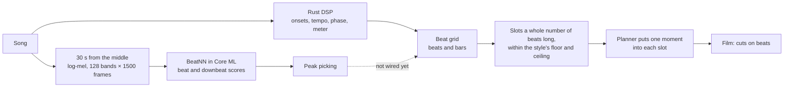
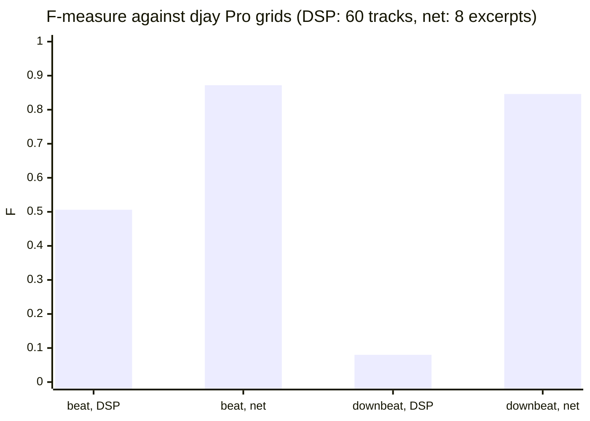
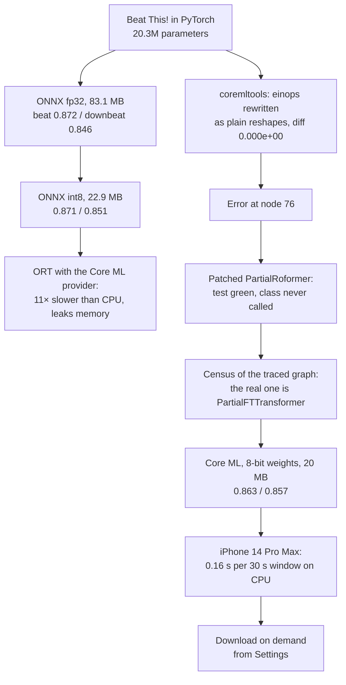
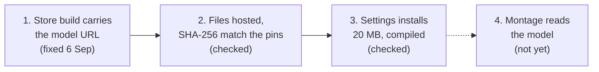

# My beat tracker missed nine downbeats in ten. A 20M-parameter net on the iPhone fixes it, and my app doesn't use it yet

## Short version

- Life2Film cuts films to music, and the cut lands hardest on the downbeat, the "one" of each bar.
- My DSP detector, scored against djay Pro's beat grids on 60 tracks, reaches beat F 0.506 and downbeat F **0.080**: fewer than one downbeat in ten.
- Beat This!, an open 20.3M-parameter transformer from ISMIR 2024, scores beat F 0.872 and downbeat F **0.846** on eight 60-second excerpts with djay grids.
- Converted to Core ML with 8-bit weights it weighs 20 MB and keeps 0.857 on downbeats. An iPhone 14 Pro Max reads a 30-second window in 0.16 s on the CPU, twice as fast as the Neural Engine.
- Thirty seconds from the middle of a song is enough, so a library of 100 songs costs 16 seconds of inference on the phone.
- Since 1.5 the model downloads from Settings. The montage still cuts on the DSP grid: with the model installed and without, the film came out byte for byte the same. Three steps remain, and the app now says so.

## Why an editor cares about the "one"

Pop music counts in fours: one, two, three, four. Each count is a beat, four of them make a bar, and the first beat of the bar is the downbeat. The crash cymbal and the chorus land there, and the viewer's body expects the picture to change there too. Cut on the beat and a film feels edited. Cut on the downbeat and it feels intended. Cut on three while the music turns over on one, and the film is slightly drunk.

[[project-life2film]] is my personal AI film director: a Mac app, Studio, and an iPhone app that has been on the App Store since 26 August 2026. Both analyse footage on the device and upload nothing. When you give a film a song, the engine lays a grid of slots on the beats and puts one moment of footage into each slot. Everything downstream trusts where the detector says the beats and bars are.

The errors that matter are tens of milliseconds. A comment in the grid code records an older version measured on a 30-second travel montage at 206 BPM: cuts sat 121–129 ms off, "almost exactly the half-beat", and 1 cut in 14 was on the music. The fix merges every slot to the next real beat.

For ground truth I borrowed from DJs. djay Pro analyses every imported track and stores the tempo, the full beat grid, the first downbeat and the time signature. A DJ then plays on that grid for hours, so a wrong one gets noticed and corrected. My script `scripts/beat_eval.py` reads those grids from my own library and scores our detector against them. djay's own analyser is a neural network: its model is named `ARDeepBeatTrackerModel1011_9`.

## Words used below

| Term | Plain meaning |
|---|---|
| **Beat / downbeat** | The pulse you tap your foot to / the first beat of each bar. |
| **F-measure (F)** | A score from 0 to 1 that punishes both misses and false alarms. A mark counts if it lands within ±70 ms of the reference, the usual tolerance in music research. When a detector marks about as many downbeats as the song has, F is roughly the share it got right. |
| **DSP** | Classic signal processing: hand-written maths over the waveform, no training. Ours is written in Rust. |
| **Log-mel spectrogram** | The song as a picture: 128 frequency bands, 50 frames a second. This is what the net reads. |
| **ONNX / ORT** | A portable file format for neural nets, and ONNX Runtime, the engine that runs it on almost any platform. |
| **Core ML / ANE** | Apple's on-device runtime, which can run a model on the CPU, the GPU or the Apple Neural Engine, a chip made for ML. |
| **int8** | Storing each weight in 8 bits instead of 32: a quarter of the size, sometimes at a cost in accuracy. |

## The measurement

Command: `python3 scripts/beat_eval.py --limit 60 --seed 11`, our detector against djay Pro grids on 60 tracks, 18 August 2026.

| | DSP, old | DSP, current | Beat This! |
|---|---|---|---|
| tempo right | 38/60 | 40/60 | 7/8 on the subsample |
| beat F | 0.450 | **0.506** | **0.872** |
| **downbeat F** | 0.049 | **0.080** | **0.846** |
| meter right | 30/60 | 49/60 | — |

The Beat This! column comes from a smaller set: eight 60-second excerpts with djay grids, the reference set every model variant below is scored on. The two columns are not the same sample, but a tenfold gap on downbeats does not hide in sampling noise.

After the latest fixes the DSP's tempo, phase and meter were acceptable, and they are in production. The downbeat at 0.080 means it does not work. I did not expect more hand-written maths to fix it when the tool I use as ground truth gets its own downbeats from a trained net.

The candidate was [Beat This!](https://github.com/CPJKU/beat_this) from CPJKU at Johannes Kepler University Linz ([arXiv:2407.21658](https://arxiv.org/abs/2407.21658), ISMIR 2024): 20.3M parameters, MIT licence for both code and weights. It reads the log-mel spectrogram and outputs two scores per frame, "beat here" and "downbeat here". A small peak-picking step turns the scores into timestamps.

## How much of the song the net needs

The model's native window is 1500 frames, 30 seconds, and its cost per second of audio grows with length: 0.0344 s at 762 frames, 0.0461 at 1500, 0.0844 at 3001. So the question was how much of a song we could skip. On the Mac:

| mode | per song | 100 songs |
|---|---|---|
| whole track | 10.6 s | 17.7 min |
| **30 s from the middle** | 2.26 s | **3.8 min** |
| adaptive (probe both ends, then 30 s or whole) | 6.53 s | 10.9 min, same quality as whole |

On the 17 of 24 tracks with a steady tempo, 30 seconds from the middle scored beat F 0.924 against 0.907 for the whole track. Fifteen seconds did not hold up. Inside the excerpt the detector scored a perfect 1.000, then fell apart across the song: a tempo error of 0.036% adds up to 91 ms over three minutes, past the 70 ms tolerance. From 30 seconds the error is 0.0079%, or 26 ms. Swapping in the perfect tempo at the same phase lifts one track from 0.411 to 0.982, which pins the cause.

Where you cut matters more than how much. Fifteen seconds starting at second 20 scored 0.656; the same 15 seconds from the middle scored 0.878, at the same price. Intros lie. And 7 of 24 tracks fit no rigid grid at all: the tempo really drifts, and one DJ edit reaches 117%. Two probes from opposite ends caught 5 of those 7, with one false alarm among the 17 steady tracks. Seeking straight to the 30 seconds instead of decoding the whole file took decoding from 0.64 s to 0.09 s.

## Getting it onto the phone

ONNX came first. The fp32 export was 83.1 MB; int8 shrank it to 22.9 MB with beat F 0.871 and downbeat F 0.851, so quantization cost nothing. Our chunked fp32 pipeline matched the authors' own `File2Beats` at F 1.000, and int8 at 0.973. One trap here cost time: the export silently bakes in a batch size of one, and renaming the axis gives a wrong answer instead of an error. A batch of four windows came back as one 6000-frame sequence, four chunks glued into a single attention span.

Then where to run it. Per 60 seconds of audio on the Mac: ONNX Runtime on the CPU took 2.95 s, PyTorch on the Mac's GPU 0.71 s, and ONNX Runtime handing the graph to Core ML through its execution provider about 33.6 s, eleven times slower than plain CPU. It also leaked. The process stayed alive 31 minutes after returning a result, the log full of `Context leak detected`, and on a later run it swelled to 41 GB. The graph breaks wherever an operation is unsupported, and tensors shuttle between the CPU and the Neural Engine at every seam.

That left native conversion with Apple's coremltools. The model builds its tensor shapes through einops, a library that passes Python integers around, and the converter cannot follow those. Every einops layer was rewritten as an explicit transpose or reshape, each checked for exact equivalence: max abs diff 0.000e+00. Then the converter stopped at `converting 'int' op` on node `m/frontend/blocks/0/partial/76`.

The next fix patched a class called `PartialRoformer`, and its equivalence check passed perfectly. It passed because nothing ever called that class. The attribute `blocks.N.partial` held a neighbour from the same file with a similar name, `PartialFTTransformer`. A census of the traced graph showed it: every remaining shape operation sat inside the `blocks.N.partial` scope. With the shapes captured as constants on a first run and the rotary helper rewritten with slices, the trace held no shape operations and the conversion went through. A green test over dead code is the lesson I keep from the whole port.

Scored on the same eight djay excerpts:

| | MB | beat F | downbeat F | Mac, s per 60 s of audio (CPU) |
|---|---|---|---|---|
| ONNX fp32 (ORT, CPU) | 83.1 | 0.872 | 0.846 | 2.95 |
| Core ML fp16 | 39 | 0.864 | 0.861 | **0.43** |
| **Core ML, 8-bit weights** | **20** | 0.863 | 0.857 | 0.44 |

Native Core ML on the Mac's CPU ran about seven times faster than ONNX Runtime on the same CPU, and memory stayed flat at about 0.5 GB across runs.

## On the iPhone, the CPU wins

The app carries a small built-in server for measurements, and `GET /coreml_bench` on it times the model on whatever device the app runs on. iPhone 14 Pro Max, a 1500-frame window (30 seconds), median of 10:

| compute units | load | predict | per 60 s of audio |
|---|---|---|---|
| **CPU** | 0.8 s | **0.160 s** | **0.32 s** |
| CPU + GPU | 0.6 s | 0.281 s | 0.56 s |
| CPU + Neural Engine | 43.5 s (first compile) | 0.323 s | 0.65 s |
| all | 2.6 s | 0.321 s | 0.64 s |

The CPU is twice as fast as the Neural Engine and the GPU: a transformer with rotary embeddings and unusual reshapes fits the ANE badly, and its first compile there costs 43.5 seconds (the OS caches it, after which loading takes 2.6). And the phone beats the Mac, 0.32 s per minute of audio against 0.43. A hundred songs at 30 seconds each is 16 seconds of pure inference, so indexing a library is now bound by decoding and the spectrogram, not by the net.

So on Apple devices the model runs in Core ML with `cpuOnly`, and the int8 ONNX file stays for platforms without Core ML. No ONNX Runtime inside the iPhone app, and no need to distil the net into a smaller one. The model stays out of the app bundle: Settings → Beat tracking downloads 20 MB from the app's own CDN, compiles it once and can delete it again.

## The second model converted in 2.1 seconds

The next day the same method went to vocal removal, splitting a song into voice and instrumental on the phone. Seven candidates were filtered on licence (weights must allow commercial use), size after int8, quality and how easily they convert. The winner, UVR-MDX-NET Voc_FT, 16.7M parameters and MIT via UVR, is a plain convolutional network with fixed shapes, and the frequency transform lives outside the model. No einops, no rotary embeddings, nothing like node 76. `ct.convert` took 2.1 seconds with zero operations replaced.

On a 341-second song on the Mac, scored by vocal SDR (signal-to-distortion ratio, higher is cleaner) against htdemucs stems: ONNX fp32, 63.7 MB, 11.15 dB; Core ML int8, 16.1 MB, 11.18 dB, at 6.5 times real time. Once again int8 cost nothing. One trap: the reference stems sat 1015 samples off a fresh ffmpeg decode, and a correct separation scored −3.27 dB until both were aligned by cross-correlation. This model is wired in: the music deck installs it and switches to stems. For the Mac-side use of the same idea, removing radio from travel footage with Demucs, see [[creative-video-sound]].

For beats, the model worth having was a rotary transformer, and graph surgery was the price. For stems, choosing a convolutional network made the conversion a matter of seconds.

## What actually shipped

On 26 August 1.4 went on sale with this in the store description: "the beat tracking from a neural model that runs on the phone's own chip". The next weeks checked that claim link by link.

**6 September, link one.** The App Store build did not carry the model's URL at all. URLs travel from `.env` through the Makefile into the build, and the archive had been made with a bare `xcodebuild`, a door the Makefile did not cover. In every build anyone tested, Settings offered the download; in the one on sale it had nothing to offer. A `make archive` target fixed it.

**Links two and three, same day.** The hosted files were checked against SHA-256 pins compiled into the binary (`weight.bin`, 20.48 MB, matched), and pressing the button put a compiled `BeatNN.mlmodelc` of 20 MB on disk.

**Link four, the question nobody had asked: does the film change?** Same day of footage, same track, a 60-second film, a fresh simulator. Without the model: 169 beats, 3 sections, three variants of 22, 59 and 53 shots, 59.5 s. With the model: the same, byte for byte. The only code reading the installed model was the benchmark endpoint. The montage calls `detectBeatsPcm`, which goes to the Rust DSP.

That was not a bug, and the task document had said as much. Its list "what's left before production" had four items, and only delivery was crossed out:

1. Log-mel on the device, matching the reference `LogMelSpect` down to the detail. Any mismatch in the mel filters silently eats F.
2. ~~Delivery.~~
3. The "minimal" peak picking, ported to Rust.
4. Wiring into the beat pipeline: 30 seconds from the middle in, the same grid format as the DSP out.

The product problem was real all the same: the app offered a 20 MB download described as a working feature. The caption in Settings now reads "Neural beat and bar detection. The montage does not use it yet — installing it now only puts the model on the phone." The same claim came off the "How it works" card, and the 1.5 store text dropped the sentence. Three of my own planning documents had called Beat This! "deployed", "Shipped" and "the detector it replaced". They took the conversion for the feature.

On 27 October, with 1.15 in review, I checked the code again: outside Settings, the benchmark is still the only reader. What users got in the meantime runs on the DSP grid. In 1.6, choosing a different track re-cuts the draft to "its beats, its sections, the second it starts on". In 1.14, "a track with no beat is cut to the picture, with the music underneath". The grid itself kept being fixed as well. A September review found one style placing 23 shots in a 29-slot grid because a gap-filler spent moments the planner had reserved for later slots; with that fixed, the film went from 23 to 29 shots on both test days.

## For anyone taking a model to a phone

- Judge quantization by the task's own metric, not by tensor differences. The stem model's int8 differed by 8.2% on random noise and scored the same as fp32 on a real song.
- Measure on the device. Mac numbers say nothing about the Neural Engine; on the phone the CPU won by a factor of two, and the phone beat the Mac.
- An equivalence test on code that never runs is green over nothing. Check that the path you patched is the live one.
- "Installed" is not "used". Before calling a model shipped, swap it in and see whether the output changes.
- Prefer architectures that convert. A convolutional net went through in 2.1 seconds, while the rotary transformer needed graph surgery.

The method became a public skill, [model-shrink](https://github.com/fortunto2/solo-factory/tree/main/skills/model-shrink), in solo-factory. Next for the beats are the three open items, log-mel parity first, before the 0.85 reaches a single film.

Related: [[project-life2film]], [[creative-video-agent-cut]] on how the films get cut, and [[apple-on-device-ai]] on Apple's own on-device language model, which the app's agent uses where the phone supports it.
