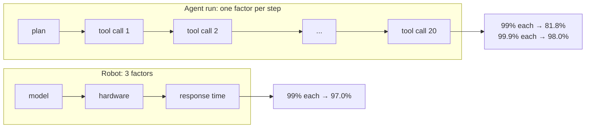
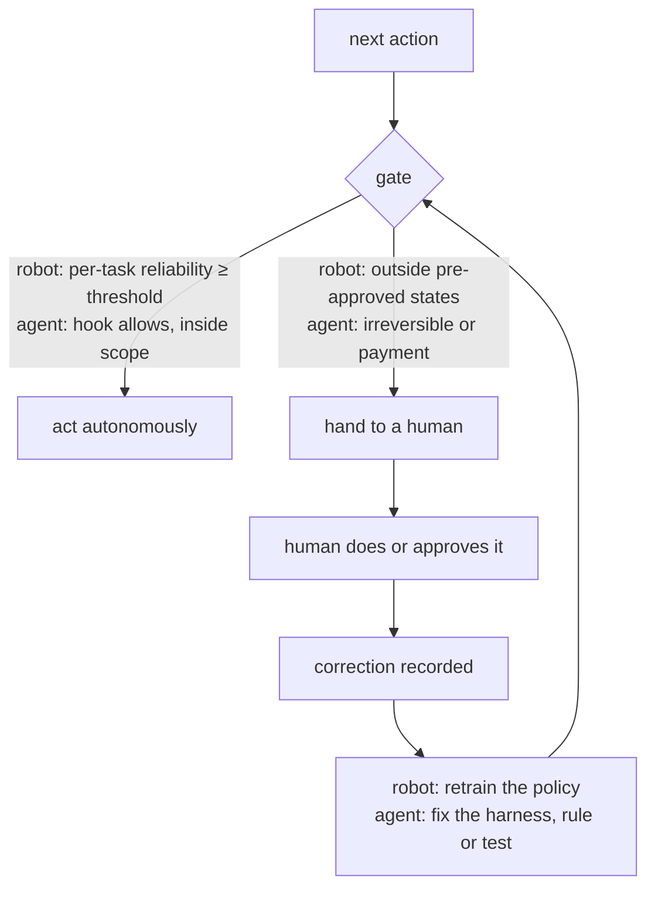
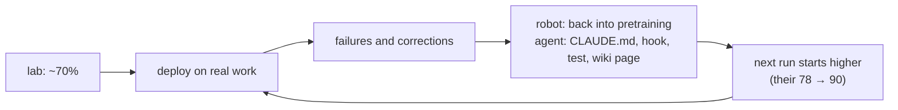

# Robots break at the hands, agents break at the connectors

Two robotics panels, back to back at one conference: the first about why anyone buys a robot, the second about what breaks once it is on site. I did not watch them. I read the [analysis by ARLI Research](https://arliwork.com/blog/), the same people whose write-up of the Rootly agents panel I used in [[running-production-with-agents-2026]]. They worked from two automatic transcripts so garbled that they deliberately left every person and company unnamed and marked every number as the speaker's own claim. I keep both rules here. Read their piece for the full picture; this page is the part that maps onto my own work, which is software agents, not robots.

The surprise is how little translation it needs. Swap "robot" for "agent", "hand" for "connector", "factory floor" for "the open web", and most of the panel describes my week.

## Short version

| Who (by role) | Claim | What it means for agents |
|---|---|---|
| Robots-as-a-service operator, ~150 US factories | The buyer pays for total cost of ownership, not the sticker; a safety fence doubles the investment | The integration around an agent costs more than the model call |
| Investor | 85% uptime in a lab is a failure; overall uptime is model × hardware × response time | A 20-step agent run at 99% per step finishes 82% of the time |
| Fleet operator, investor | Sell transferred risk: no proof-of-concept, the vendor carries uptime, spares, financing | Price the outcome, and only where you control enough of the environment to carry it |
| Data-centre robotics founder | Hands and force-torque sensors break first; "the world is not friendly to automation" | Connectors break first: MCP servers, OAuth tokens, browser bridges, captchas |
| Same founder | A CI/CD gate before every action; below a reliability threshold the action goes to a human | Hooks before every tool call; payment and deletion stay human |
| Foundation-model founder | 70% in the lab, 90% after deployment, ~4 months to production; the next task starts at 90, not 78 | Every correction from real use is training data for the harness |
| Hand-hardware founder | More degrees of freedom, more failures: the 31-DoF hand broke on day one | More tools, more failures: I cut my search server from 12 tools to 5 |
| Audience question | "About 280 hours before a breakdown"; a week without one is the hard part | Measure how long an agent loop runs untouched, not how clever one run is |

## Glossary

- **TCO**, total cost of ownership: everything the buyer pays over the robot's life, not just the price.
- **RaaS**, robots as a service: the buyer pays per month or per result; the vendor owns the machine and the risk.
- **PoC**, proof of concept: a pilot to show it works, usually unpaid and outside real production.
- **Force-torque sensor**: the sensor in a robot's wrist that feels how hard it is pushing; it lets a hand insert a cable without crushing it.
- **DoF**, degrees of freedom: independent joints. A human hand has more than 20.
- **Teleoperation**: a person drives the robot remotely; the recorded motion becomes training data.
- **World model**: a model that predicts what happens after an action, used here to check a step before it is taken.
- **Hot-swap**: replacing a server part while the system keeps running.

## What the panels said

**A robot is sold as transferred risk.** The deal closes on total cost of ownership: can it run without a fence (where a fence is required, the speaker said, the investment "suddenly doubles"), does the financial case close, and what happens to the line when it stops. Proofs of concept were refused on principle: innovation teams want "backflips and nice drinks" for their managers, the pilot is not a production environment, and a large buyer will switch to a cheaper vendor the moment one appears. Instead the vendor takes performance, uptime, maintenance, teleoperation, repair and spare parts onto its own balance sheet: "we do not get paid if it does not work." The cloud analogy carried the argument: nobody runs their own data centre because "I want AWS to answer when it goes down." The investor then broke his own picture: most large buyers "just want to buy", because a one-off capex line is easier to approve than years of service. RaaS fits small, fast, desperate buyers: small and medium manufacturers who must cut ~30% of cost or lose the next order.

**Uptime multiplies.** "If you are not at three nines, it is simply unacceptable." Overall uptime is the product of model, hardware and response time, so a weak factor drags the rest. A robot doing 10,000 cycles a day cannot have "hundreds of failures". The factory operator claimed 99.96% across his fleet, ~70% of problems fixed remotely, ~10 minutes to respond and ~2 hours to resolve, and only with enough sites close together: "one robot here, one robot there is very hard."

**Deployment is a duration, not an event.** Shipping a robot proves nothing; still running at 12, 24, 36 months does. One speaker's proof is "money in the bank". The investor's counter-metric is hours of use, tracked daily, because revenue lags: a customer can prepay and leave the robot idle.

**The hardware breaks first.** Panel two's founders said the same thing from three directions. "We used to think the model was the hardest part." Hands and force-torque sensors fail first. Data centres are "not friendly to automation at all": zip-tied cables, servers heavier than the robot can lift, rails that differ by vendor, and a service company has no right to demand the room be rebuilt. Integration is the long pole, not model generalisation, because the team rebuilds the site in the lab and collects data there first.

**A gate before every action.** Learned policies carry no safety layer of their own, so the data-centre team runs every action through an internal check. Below a per-task reliability threshold the action goes to a person: an offshore teleoperation team, with the customer's consent. A world model in the loop refuses any next step outside pre-approved states, because "who will pay for a damaged, very expensive and fragile server". For simple, safety-relevant motions they use deterministic control, not a probabilistic model; routing between the two is "the central engineering problem".

**Deployment data is the moat.** A data centre "will never hand over petabytes of data", so the only way to get data is to deploy. The foundation-model founder's numbers: ~70% accuracy in the lab, ~90% after deployment, production quality in ~4 months, and the next instance of the same task starts at 90 instead of 78 because deployment data flows back into pretraining.

**Capability fights robustness.** A 15-DoF hand could not grip a thin bracket; the 31-DoF hand could, and broke on the first day and went back to China for repair. "Complexity and failure rate rise together, almost exponentially." An ex-Tesla and Apple founder put a number on the gap: an assembly worker opens and closes a hand about 70,000 times a day, two years of that is ~2,000,000 cycles, and today's hands last hundreds of thousands, about three months.

**The sceptical anchor.** From the audience: a leader who expects "no more than about 280 hours from his robot before a breakdown", about ten days, and a founder for whom a whole week without a breakdown is the hardest thing. The panel agreed that humanoids today are mostly performance and entertainment, and that the answer is a narrow task, not a general machine. On data as a business: pretraining data is getting cheap fast; post-training still needs quality, and a pure data company is "a doubtful bet".

## What I take from it for agents

### 1. Reliability multiplies along the chain

The investor's arithmetic is harsher than he stated it. For three factors to multiply to 99.99%, each has to be about 99.997%, not "above 99": at 99% each the product is 97%. Agents have the same arithmetic with more factors, because every tool call is one.

| Steps | 95% per step | 99% per step | 99.9% per step |
|---|---|---|---|
| 5 | 77.4% | 95.1% | 99.5% |
| 10 | 59.9% | 90.4% | 99.0% |
| 20 | 35.8% | 81.8% | 98.0% |

Two practical rules follow. Shorten the chain where you can: a deterministic script for the fixed part, the model only where judgement is needed, which is exactly the panel's split between deterministic control and learned policy. And make each link observable, so a failure is a loud stop rather than a quietly wrong result three steps later.

### 2. The connectors break first, not the model

"We thought the model was the hard part" is the line I would have said a year ago. In one travel day of running my own agents from a laptop, nothing failed in the model. What failed was the hands: three MCP servers timed out on connect (30 s each), a Gmail OAuth token expired mid-trip, the bridge to my real browser dropped and needed a human click to come back, an SMS relay was off at the phone, and mobile coverage disappeared in the mountains. None of these is interesting, and every one of them stops a run.

The fix is the robotics one: fleet maintenance, not heroics. My inbox watcher prints `UNREACHABLE <mailbox>: <reason>` instead of an empty result, because "no new mail" and "could not read the mail" look identical otherwise; that is the panel's "~70% fixed remotely" in miniature, with a reason attached so the fix is one command. Health checks run on a cadence (`solo systems due`), and a check only counts as OK with two numbers in it.

### 3. The world is not friendly to automation, and you may not rebuild it

The data-centre founder cannot ask the customer to cut the zip ties. I cannot ask a website to drop its captcha. The web is my data centre: a support form that shows its required fields only after you pick a subject, then does nothing at all when they are empty, no error, no request; an invisible captcha that scores the browser before it lets a submit through; a store that answers HTTP 541 to a burst of automated lookups; a search engine that suspended my instance for hours after ~80 queries in five minutes. Each was found during deployment, as she said, and each was worked around, not demanded away: fill what the form actually wants, run sensitive submits from the real browser instead of the automation one, pace the queries, measure with 10 not 80.

Her other point applies too: she came to the problem from the data-centre side, not the robotics side. The people who build durable agents for a site know the site.

### 4. A gate before every action, and a human for the last percent

Their readiness pipeline maps line for line onto how I run agents.

| Their layer | My layer |
|---|---|
| Internal CI/CD gate before every action | A syntax sensor on every edit, lint, types and tests at the end of every turn; a red receipt blocks the turn |
| World model refuses steps outside pre-approved states | A guard hook on irreversible commands (force-push, remote deletes, recursive `rm` outside temp dirs): ask, or deny with the command to run by hand |
| Offshore teleoperation for what autonomy cannot do | The agent fills a booking to the payment step; the card is always typed by a person |
| Customer consents to teleoperation | Messages in my name stay drafts unless I authorised that thread |
| Crash-test the policy before full autonomy | Planted-defect runs: the sensors catch 11 of 24 planted defects, and the receipt says so instead of claiming correctness |

The confidence gate is the same pattern I built at a hackathon: a small local model acts on its own above 0.8 and asks the human below it ([[superset-hackathon-consentshield-2026]]). The robotics version adds one thing worth stealing: the threshold is per task, not global. A gate that is right for reading mail is wrong for paying a bill.

### 5. Deployment data is the moat, and corrections are the cheapest kind

"78 → 90 on the next instance" is the robotics form of the harness ratchet ([[agent-mistake-fix-harness]]): every mistake I catch becomes a rule, a linter, or a test, so it happens once. The corrections I give an agent during real work are my deployment data, and they are the only data nobody else has. I keep them: a stop hook flags correction candidates in each session, and the durable ones land in the wiki with the session they came from.

Their teleoperation versus exoskeleton argument has an agent version too. A correction is teleoperation: I steer the agent, and the data is shaped by its body, not mine. Watching how I do a task myself is the exoskeleton: natural motion, richer, harder to collect. Most of what I have is the first kind.

### 6. Fewer degrees of freedom

The 31-DoF hand that broke on day one is every tool list I have let grow. My search server had 12 tools; it now has 5, after the usage log showed agents reached for it in 1.8% of sessions and the structural graph had answered zero structural questions in four months ([[project-solograph]]). Web search lives in a separate server because one broken import there used to take every tool down at once. A tool you add is a joint that can fail; it has to earn the failure rate it brings.

### 7. Hours of use, not money in the bank

Revenue lags; hours of use lead. My own product's most quoted number, a million registrations, is the lagging kind, and I had to learn to stop quoting it as users ([[life2film-v1-from-the-inbox]]). The analytics I run now count what happens each day per install, with revenue taken only from the store reports ([[superduper-analytics]]). For agents the leading indicator is the same shape: how many runs finished without a human today, not how many were started.

### 8. A narrow job switched on a few times a day

The data-centre founder's best line was about scope: a robot "switched on a few times a day" for a known routine, not "a butler on 24/7" in an apartment that differs from every other. My always-on agents work the same way. The ones that survive are narrow and scheduled: an inbox pass every hour, an event-application loop every two hours, a watcher on one chat every five minutes. The general "run my day" assistant is the home humanoid: impressive in a demo, and the thing that needs me most.

### 9. Sell the result only where you control the room

"We do not get paid if it does not work" is a strong position, and it is only safe because the factory operator controls the robot, its maintenance and its spares. For agent work sold to a client the lesson cuts both ways: outcome pricing wins the deal, but only for the part of the environment you can carry. A workflow that runs through someone else's captcha, someone else's token expiry and someone else's form is a fence you did not build.

## Caveats

- I read an analysis of two machine transcripts, not the recording, and was not in the room. Names and companies are withheld on purpose; product names in the source are partly guesses.
- Every robotics number above is the speaker's own claim, unaudited: 99.96% uptime, 98% retention, 4,800 hours, 70 → 90%.
- The panels never named a price, a payback period or a failure count in money; neither does this page.
- The agent figures are mine: the chain table is arithmetic, the connector failures are from one day of my own runs, the 11 of 24 planted defects is my own harness measured on my own test set. They show the shape, not a benchmark.

## Links

- ARLI Research blog, where their panel analyses are published: https://arliwork.com/blog/
- The previous panel read the same way: [[running-production-with-agents-2026]]
- The harness this maps onto: [[harness-engineering-summary]], [[agent-mistake-fix-harness]]
- The confidence gate in practice: [[superset-hackathon-consentshield-2026]], [[laya-open-jev-on-mac]]
