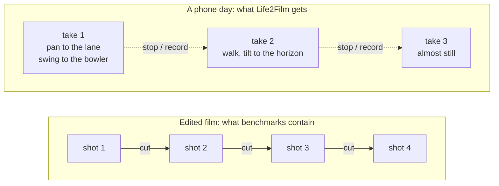
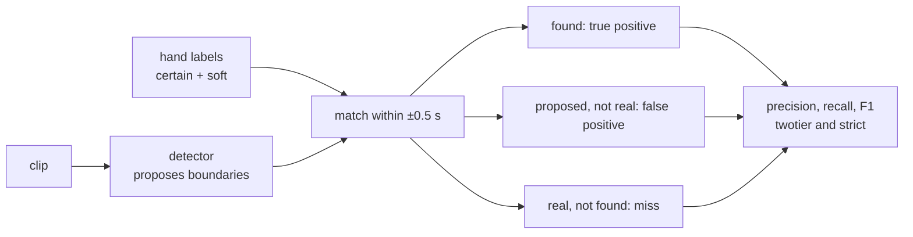
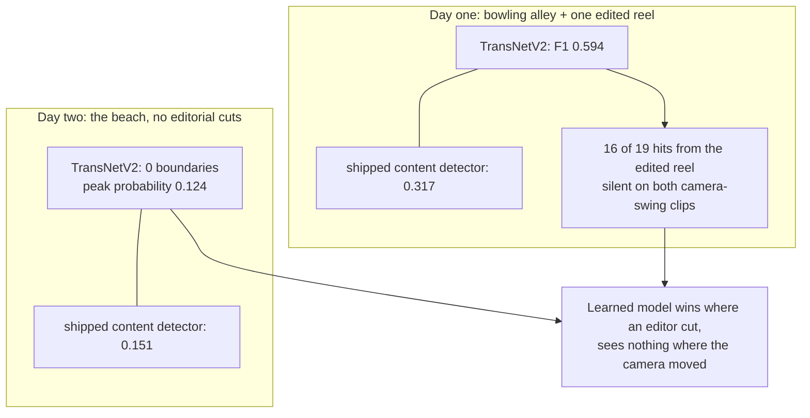
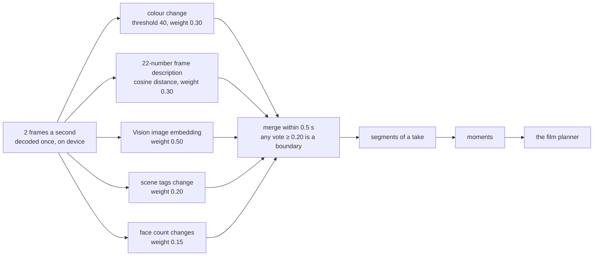

# A cut detector found zero cuts in a day at the beach. Phone footage has none to find

I gave a well-known learned shot-boundary detector 103 seconds of my own handheld phone footage from a day at the beach. It proposed zero boundaries at every threshold from 0.2 up. The highest confidence it reached anywhere in the day was 0.124, a quarter of its own decision threshold. The same model, on another day of mine, beat the detector [[project-life2film]] was shipping at the time, 0.594 to 0.317.

Both results are right: shot detection answers a question my footage never asks.

## The short version

- **Shot-boundary detection finds where an editor cut.** Its benchmarks are made of edited video. A day on a phone is a handful of continuous takes, and the places worth cutting are where the camera turns.
- **I labelled two of my own days by hand** and ran sixteen classical detectors, TransNetV2 and OmniShotCut on them. The bowling day had one edited reel in it; the beach day had no editorial cut at all.
- **On the bowling day TransNetV2 won**, F1 0.594 against 0.317, and 16 of its 19 correct answers came from the one clip somebody else had edited.
- **On the beach day it returned zero boundaries.** Peak probability 0.124; seven of nine clips never went above 0.006.
- **Both learned models were measured and refused** as replacements. Life2Film segments takes instead: a stricter colour-change threshold plus a vote of several cheap signals the phone already computes.

Every number below was measured on those two hand-labelled days unless I say it comes from a public benchmark.

## Words used here

| Term | What it means in this post |
|---|---|
| **Shot** | A piece of video between two edits. |
| **Cut** | The edit itself: the frame where one shot ends and the next begins. |
| **Take** | One continuous recording, from pressing record to pressing stop. A phone day is mostly takes. |
| **Shot boundary** | Where a detector says a cut is. Here, also where a take changes enough to cut. |
| **Certain / soft** | A *certain* mark is where any viewer would cut. A *soft* one is a judgement call, like a slow pan landing on something new. |
| **F1** | One score from precision (the share of proposed boundaries that were real) and recall (the share of real boundaries found). 1.0 is perfect, 0 is nothing found. |
| **Twotier / strict** | Two ways to score. *Twotier*: certain marks must be found, soft ones neither count for nor against. *Strict*: both kinds must be found. |
| **Threshold** | The cut-off for a detector's score. A model outputs a probability per frame; at 0.5, anything above 0.5 becomes a boundary. |
| **Ensemble** | Several detectors voting, merged into one answer. |
| **2 fps** | Two frames per second, the density the Life2Film phone app analyses at, instead of all 30. |

## What shot detection is for

A detector of this kind answers one question: where did an editor cut? The classic method compares neighbouring frames and calls a boundary where colours or pixels jump. The learned ones, like TransNetV2 (2020) and OmniShotCut (2026), are trained on edited video, or on synthetic splices where the cut frame is known exactly.

On that task the learned models are good. On SHOT, a public benchmark of 200 short user videos with 2,516 transitions, TransNetV2 scores F1 0.799 and AutoShot 0.841. We reran both from their own released predictions and got their published numbers digit for digit. Our best classical detector scored 0.614 on the 180 test videos we could download; the family of cheap centre-pixel detectors topped out at 0.170. Every one of those videos had been edited by someone.

A phone day has no editor. Each clip is one take. Inside a take the camera swings or tilts and settles on something new, and that is where a person editing the day would cut. The pixels change slowly across half a second instead of jumping in one frame. A model trained to find splices has no reason to call that a boundary.

## Two days, marked by hand

No benchmark is a camera roll, so I marked two of my own days. The labels were drawn from contact sheets at 2 frames per second with the frame number burned in, and committed to git before any detector ran on them, so no prediction could leak into the marking.

| | Day one: the bowling day | Day two: the beach day |
|---|---|---|
| Clips, seconds | 8 clips, 156.1 s | 9 clips, 103.0 s |
| Certain + soft marks | 24 + 18 | 4 + 13 |
| Certain marks per second | 0.154 | 0.039 |
| Editorial cuts | 17, all in one clip | none |
| What it is | handheld takes at a bowling alley, camera swinging between bowler and lane, plus a 61-second reel somebody else edited that landed in the camera roll | continuous handheld takes on a beach and indoors; every boundary is a pan or a tilt |

The two days are opposite ends of the same library. Day one has four times the boundary density of day two, and most of it sits in that one reel. The shipped detector fired at about the same rate on both: 1.03 boundaries a second on day one, 1.22 on day two. Day two simply had a quarter as much to find.

Scoring is the same for every detector: a predicted boundary counts if it lands within half a second of a hand mark.

## The sixteen classical detectors

Life2Film's analysis core had sixteen hand-built detectors: twelve that read only the centre column of pixels (histograms, edge density and the like), two ports of PySceneDetect's colour-change detector, and two that compare a 22-number description of each frame.

On the bowling day their failure was precision. The best of them found most of the certain boundaries but proposed boundaries all through the continuous takes, where a viewer sees one scene: the shipped content detector made 109 proposals for the day, 77 of them false. On handheld video the hard part is staying quiet between cuts, and none of them could.

Two of the sixteen answered nothing at all. One of those, the adaptive variant of the content detector, wants the ratio of a frame's change to its neighbours' to reach 3.0. The tallest ratio on either day was 2.374. On a handheld clip every frame moves, so nothing stands out against its neighbours.

Smarter rules over the same signal (hysteresis, a robust median-based threshold, a local-peak test) were tried and refused: 0.143, 0.121 and 0.279 against 0.481 for the best plain threshold. On six of the eight bowling-day clips, the *typical* frame-to-frame change already sat above the shipped threshold of 27. There is no quiet baseline for a cut to stand out from: at a phone's sampling density the signal carries a level and no shape.

## The learned models on the bowling day

TransNetV2 is a 7.6-million-parameter network from 2020, still the baseline new papers compare against. OmniShotCut is a 34.49-million-parameter transformer from April 2026, trained on 11.9 million synthetic transitions. Both have public weights, so both ran on my days at full frame rate, as their authors intended.

On day one TransNetV2, at its published threshold of 0.5, scored twotier F1 **0.594** against the shipped detector's **0.317**. OmniShotCut scored 0.521. Both won by proposing less. TransNetV2 proposed 48 boundaries to the shipped detector's 109 and still found eleven more real ones.

Per clip, the picture changes. Sixteen of TransNetV2's nineteen correct boundaries came from the edited reel, where it found 16 of the 17 hand-marked cuts. On five of the seven continuous takes it proposed nothing. Two of those five held *certain* boundaries, camera swings landing on a new subject, and it missed all of them. OmniShotCut went silent on the same two clips. Two architectures, from 2020 and 2026, blind in the same place.

OmniShotCut had one more problem. Inside a long continuous stretch of the reel it emitted 12 boundaries at almost regular spacing. Its inference script processes 100-frame windows and stitches them, and no predicted shot came out longer than about 150 frames, around five seconds. On a camera roll where a minute-long take is normal, that chops every long take into pieces.

## The beach day: nothing

Day two has four certain boundaries and thirteen soft ones, every one of them a camera move.

| TransNetV2 threshold | boundaries proposed in 103 s |
|---|---|
| 0.7 | 0 |
| 0.5 (published default) | 0 |
| 0.3 | 0 |
| 0.2 | 0 |
| 0.1 | 1 |

The shipped classical detector scored 0.151 twotier that day. The learned model scored 0.000 from zero proposals.

Its highest transition probability anywhere in 103 seconds was **0.124**, on a 17.5-second clip. Seven of the nine clips never went above **0.006**. The same split showed up on day one: the clips where it fired peaked at 0.929, 0.982 and 0.991; the silent ones peaked between 0.0007 and 0.106. The output is bimodal on "was there an edit", with nothing in between. A threshold can't help when there is no signal to threshold.

The app reads 2 frames a second, and a model trained on every frame should, in theory, see each half-second jump as a cut and flood. At 2 fps and the published threshold, TransNetV2 proposed 5 boundaries on day one and none on day two. Sparse frames made it quieter still.

## Two candidates, measured and refused

**OmniShotCut on the phone: rejected.** At full frame rate on my Mac it ran at 0.17 to 0.69 times realtime, which is 2 to 6 times the cost of Life2Film's *entire* analysis pass (about 0.09 times realtime for scoring, segments and strips together). There is no PyTorch on iOS, so it would need a Core ML port of a transformer. It misses camera-move boundaries, which are the main boundary type in the product's footage, and it cannot hold a shot longer than about five seconds. It stays useful as a Mac-side labeller for training data: about ten seconds per minute of footage, MIT-licensed.

**TransNetV2 as a replacement: skipped.** At full frame rate it costs 2.8 to 3.9 times the whole analysis pass, because it decodes and processes every frame. The size of the model was never the obstacle: 7.6 million parameters is under 8 MB quantised. The full-rate decode is what the 2 fps pass exists to avoid. Riding the phone's own 2 fps frames, inference alone would cost 0.030 to 0.038 times realtime, which is affordable.

One cell nearly changed the answer. At 2 fps with the threshold dropped to 0.02, TransNetV2 beat the classical detector on both days, 0.529 against 0.297 on the beach day's strict reading. But 0.02 is one fortieth of the model's calibrated threshold, picked by looking at these same two days. Day one alone would choose 0.10, day two alone 0.02. Two days can't fit a constant. At that setting the network reads its own noise floor on frames half a second apart, not cuts. It stays parked until a third day, labelled blind, says the same.

## What Life2Film segments on instead

In Life2Film everything downstream starts from segments. Moments are cut from them, the planner chooses among moments, and the film is built from what the planner chooses. A missed boundary is a moment that spans two scenes; a false one splits a take in half. So the job is to find where a take changes enough to cut there, which the shot-boundary literature does not measure.

Two changes went into the analysis core's defaults, both graded on the two labelled days.

**A stricter colour threshold.** The content detector's threshold went from 27 to 40, a value fitted on SHOT's training split rather than on my days. At the phone's density it lifted day one from 0.244 to 0.395 twotier F1 with false boundaries down from 113 to 37, and day two from 0.085 to 0.103 with false boundaries from 86 to 33. Higher values were refused: 45 and 50 looked best on day one and scored 0.000 on the beach day, where the whole clip turned into one segment. The films were checked too. The pool of moments on day one fell from 122 to 66, and the films cut to music came out identical on both days: 31 shots, 29.5 seconds.

**A different second vote.** The phone runs an ensemble: the colour detector, one more detector over the 22 numbers it already computes per frame, Apple Vision's image embedding, scene-tag changes, and changes in face count. Since 15 October the second vote is a cosine distance over those 22 numbers instead of the centre-column detector. With three of the five votes measurable from my desktop harness, it went up in all four cells: day one 0.319 → 0.429 twotier and 0.410 → 0.430 strict, day two 0.083 → 0.167 and 0.244 → 0.345. It costs nothing on the phone, because those numbers already exist for every frame.

It is still a union: any single vote except face count can call a boundary alone. Raising the bar so that two votes must agree lifted the bowling day's twotier score and took the beach day's to zero, the same sign flip again. None of this needs a network. The frames are decoded once, on the device, and nothing is uploaded: the Mac app analyses locally, and so does the iPhone app, in the App Store since 26 August 2026.

## What I take from it

- **The benchmark and the product wanted opposite ends of the same dial.** The fitted threshold moved the benchmark by ±0.01 and my day by +0.15 at the phone's density: the benchmark rewards recall on dense edits, a phone day bleeds false positives.
- **Label your own days, and mark them blind.** Two days, 42 and 17 marks, settled questions that 2,516 benchmark transitions could not, and refused two values that looked best on one day alone.
- **Count the proposals, not only the score.** "F1 0.000" reads like a failure to tune. "Zero proposals, peak 0.124" says the model answers a different question.
- **Learned models win on cuts.** If Life2Film ever has to split an edited reel somebody saved into the camera roll, TransNetV2 is the cheaper of the two teachers. For takes, the next step is a better signal, trained partly on labelled takes, not a cleverer threshold over this one.

Related: [[project-life2film]] for what the product is, [[creative-video-agent-cut]] for how the films get cut once the segments exist, [[privacy-first]] for why the analysis stays on the device.
