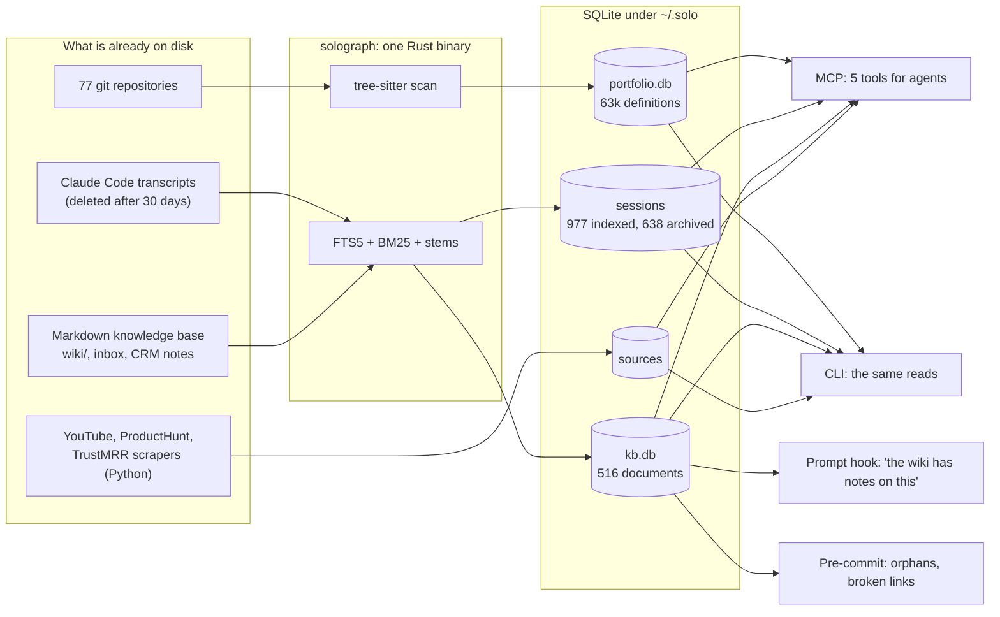
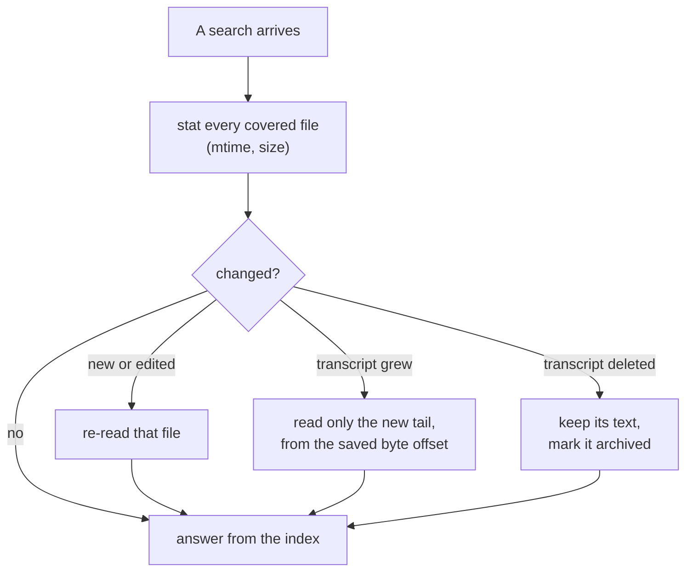
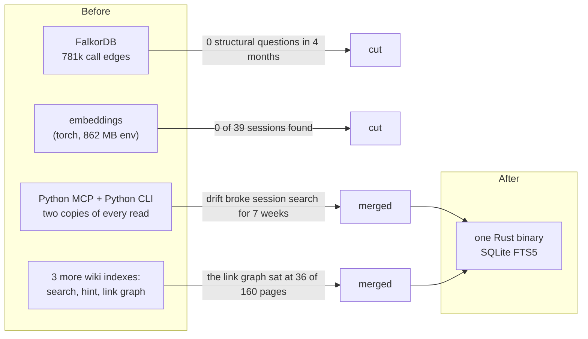

# Solograph, rebuilt: one Rust binary over SQLite instead of a graph database and vectors

## The short version

[[project-solograph]] is the memory my coding agents share: where something is defined across 77 of my repositories, what was said in about a thousand past Claude Code sessions, what my wiki already knows. Until this October it was a FalkorDB code graph with vector search on top, served by Python. It looked impressive and did not work: session search had failed on every call for seven weeks, the nightly scan had indexed zero projects for 70 nights while logging "done", and knowledge-base search took 14 seconds cold.

Over two days I measured every part of it, cut what the numbers did not defend, and rewrote what was left as one Rust binary over SQLite. It now answers in milliseconds and finds what it used to miss.

| | Before (Feb to Oct 2026) | Now (0.10) |
|---|---|---|
| Moving parts | FalkorDB, an embedding model (torch), a Python MCP server, a Python CLI, three separate wiki indexes | one 34 MB binary, a few SQLite files |
| Python environment | 862 MB | 34 MB, scrapers only |
| Sessions found, 39 with a known answer, top 5 | 0 | 32 |
| Knowledge-base search | 14 s cold | 12 ms median |
| Russian question for an English wiki page, top 5 of 22 | 0 | 21 (19 of 22 on a set written after tuning) |
| Prompt hook that points at the wiki | 74 ms, a Python wrapper | 19 to 35 ms, the binary itself |
| Nightly scan | scanned 0 projects for 70 nights, said "done" | fails loudly, checked every morning |

The whole thing is open source: [fortunto2/solograph](https://github.com/fortunto2/solograph), MIT.

## Words you'll need

| Term | What it means here |
|---|---|
| **MCP** | Model Context Protocol: how Claude Code and other agents call outside tools. Solograph is an MCP server with 5 tools (12 when this was written; 0.17 cut them, see [[project-solograph]]). |
| **tree-sitter** | A parser library with grammars for most languages. Solograph uses it to read function, class and protocol definitions out of 15 languages. |
| **SQLite FTS5** | SQLite's built-in full-text index. No server, one file, and it ranks matches with BM25. |
| **BM25** | The standard ranking formula of lexical search: a match on a rare word counts more than a match on a common one, and a long document does not win just by being long. |
| **Stemming** | Cutting a word to its stem, so "графами" finds "граф" and "indexing" finds "index". Snowball does it for Russian and English. |
| **Alias table** | A hand-kept list of other spellings of a term the wiki uses: `[песочница, sandbox]`. It is how a Russian question reaches an English page without embeddings. |
| **Known-answer eval** | A fixed list of queries with the right answer next to each one. Every ranking change has to move its numbers, or it does not ship. |
| **Hook** | A command Claude Code runs on an event. A UserPromptSubmit hook sees every prompt before the model does. |

## What it is now

One binary does four jobs: it is the MCP server agents talk to, every read as a terminal command (with `--json` for the exact answer the agent would get), the hook that points a prompt at the wiki, and the nightly scan. Everything it knows sits in SQLite files under `~/.solo/`.



There is no reindex step to forget. Before answering, each index checks the files it covers by modification time and size and re-reads only what changed. Transcripts only ever grow, so a grown one is read from the byte where the last read stopped; live transcripts reach 400 MB and a resync costs about 10 ms. When Claude Code deletes a transcript after 30 days, the index keeps its text and marks it `transcript: deleted`, so session search is the only copy of those conversations left anywhere.



## What was cut, and the number behind each cut

**The vectors.** Session search with embeddings found 0 of 39 sessions that had a known answer; FTS5 found 32. The vector index held 640 sessions and the disk held 633, with zero overlap: Claude Code had deleted the old transcripts and nothing re-read the disk. Knowledge-base search took 14 seconds cold, and its "relevance 1.0" on every top hit turned out to be rank position. Source search hung past two minutes.

I had written the opposite advice myself a month earlier, in [[graphify-vs-solograph]]: keep embeddings for the Russian-language knowledge base, because a graph cannot index prose. The measurement disagreed. A table of 315 alias groups took Russian questions to English pages from 0 of 22 to 20 of 22, with nothing to download and nothing to drift.

**The structural graph.** 781,000 call edges, plus imports, inheritance and session-to-file edges. In four months agents called it five times, and every call was "list the projects" or stats. To check whether a better graph would change that, I ran [colbymchenry/codegraph](https://github.com/colbymchenry/codegraph), the cleanest of the current code-graph servers, against plain Grep and Read on a 1,100-file Rust and Swift app, with `claude -p` and the method from its own README. Same accuracy in all 8 runs. It saved 16% on the one question that needed exploration ($1.73 against $2.07) and nothing on the other. Inside one repository, grep is enough; what grep cannot do is look across 77 repositories at once, so that part stayed. The survey of 15 such tools is in [[code-graph-mcp-landscape]].

**The second implementation.** For a day the same 12 tools existed in Rust and in Python. Two implementations of one search drift, and drift is exactly what had kept `session_search` broken for seven weeks (a return-type annotation that did not match what the function returned, with tests that never went through the protocol). Every read moved into the binary. Python kept only the scrapers that fill the sources index.



## The knowledge base: one index for search, links and the hint

My wiki follows Karpathy's [LLM wiki](https://gist.github.com/karpathy/442a6bf555914893e9891c11519de94f) pattern: raw sources stay as they are, and an agent maintains interlinked pages on top. Until this week the same pages were indexed four times, by four tools that disagreed: solograph for agents, a Python index for `make wiki-search`, a third for the prompt hint, and a JSON link graph a script rebuilt by hand. The link graph had 36 nodes, frozen since February, while the wiki passed 160 pages.

Now one SQLite index serves all of it. Search ranks the title and a page's one-line summary twice as high as its body. The link graph is read from the same pass over the files, so `solograph kb-graph --check` (orphan pages, broken links, pages missing from the catalog) is always as fresh as search, and its exit code is the pre-commit gate. The hint is the binary itself, registered as a UserPromptSubmit hook: when a prompt names something the wiki is specifically about, the session gets one line pointing at the page, and otherwise nothing.

```mermaid
flowchart LR
    Q["'песочница для агента<br/>на маке'"] --> ST["stems:<br/>песочниц*, агент*, мак*"]
    ST --> AL["alias table:<br/>песочница → sandbox"]
    AL --> M["FTS5 MATCH<br/>its own words OR sandbox*"]
    M --> RK["BM25, weights 2 / 2 / 1:<br/>title, summary, body"]
    RK --> SC["scope: the wiki folder<br/>(.solograph.yaml)"]
    SC --> OUT["wiki/agent-sandboxing.md"]
    OUT -. "optional" .-> NB["+ up to 3 pages<br/>linked from the hits"]
```



Every layer stayed only if it moved a known-answer set. The sets were built from the wiki itself (three content words of a random page, three words of its summary line), plus 22 Russian questions for English pages and 10 real queries agents had sent.

| Layer | body words, #1 of 40 | summary words, #1 of 25 | real agent queries, #1 of 10 | Russian → English, top 5 of 22 |
|---|---|---|---|---|
| title + body index (before) | 29 | 18 | 7 | 0 |
| title, summary, body as fields, BM25 2-2-1 | 31 | 22 | 7 | 0 |
| + alias table, one way | 31 | 22 | 8 | 4 |
| scoped to the wiki folder | 33 | 22 | 9 | 21 |

Two things did not survive. Aliases in both directions sent English queries to Russian documents (top-1 on the English set fell from 31 to 24), so they expand one way only: from the other spellings to the term the wiki writes. And the weights the knowledge agent I built at Epiphan used, 5-3-1, lost to 2-2-1, as did every title weight from 1 to 12. To check that the Russian result was not tuned to its own test, I wrote 22 new Russian questions afterwards and ran them once: 19 of 22 in the top 5.

The engine no longer knows anything about my folder layout. A knowledge base states it in `.solograph.yaml`: where the wiki is, where stack templates live, what to skip. Skipping one gitignored client checkout, which was 949 of the 1,187 directories every search walked, took search from 60 ms to 12.

## What I took from other repositories

Almost everything here exists elsewhere in some form. The field converged on tree-sitter plus SQLite FTS5 with embeddings optional, as the survey in [[code-graph-mcp-landscape]] shows; solograph arrived at the same place by measuring its own failures. What came from where:

| From | What it gave |
|---|---|
| [DeusData/codebase-memory-mcp](https://github.com/DeusData/codebase-memory-mcp) | Split identifiers on camelCase and snake_case before indexing, so "montage profile" finds both `resolve_montage_profile` and `MontageProfile`. Also the proof that a single static binary is enough. |
| [colbymchenry/codegraph](https://github.com/colbymchenry/codegraph) | The benchmark method: `claude -p` with only the tool's MCP server against no MCP at all, same questions, answers checked against ripgrep. It is what retired my call graph. |
| [trailhq/Trail-Code](https://github.com/trailhq/Trail-Code) | Every query tops the index up first. That is the sync-before-read above, and why there is no reindex command to forget. |
| [Graphify-Labs/graphify](https://github.com/Graphify-Labs/graphify) | Put the reminder in a hook, not in a rule: Graphify intercepts file reads to suggest its graph. My version is the prompt hook pointing at the wiki. The broader principle is [[agent-mistake-fix-harness]]. |
| [probelabs/probe](https://github.com/probelabs/probe) | "Agents don't need embedding search": BM25 over the right fields is enough for code and notes. |
| The knowledge agent I built at Epiphan | Field-weighted BM25, a term-alias table instead of embeddings, linked pages capped at 3, and the rule that each layer ships only with its measured delta. |
| [Karpathy's LLM wiki](https://gist.github.com/karpathy/442a6bf555914893e9891c11519de94f) | The shape of the knowledge base being searched. |
| [oraios/serena](https://github.com/oraios/serena) | Not taken, on purpose: exact references through language servers are a complement for deep work in one repository, not a replacement for a portfolio index. |

## Set up the same for yourself

You need Claude Code (or any MCP client) and macOS or Linux. The commands below were run on a clean home directory before this was published.

**1. The binary.** Either a prebuilt one from the [latest release](https://github.com/fortunto2/solograph/releases/latest):

```bash
mkdir -p ~/.solo/bin
curl -fL -o ~/.solo/bin/solograph \
  https://github.com/fortunto2/solograph/releases/latest/download/solograph-macos-arm64   # or solograph-linux-x86_64
chmod +x ~/.solo/bin/solograph
```

or built from source, a few minutes with a Rust toolchain:

```bash
cargo install --git https://github.com/fortunto2/solograph solograph --root ~/.solo
```

**2. Give it to your agent**, pointing it at the folder that holds your notes:

```bash
claude mcp add -s user solograph -e KB_PATH=$HOME/notes -- ~/.solo/bin/solograph
```

**3. Index your projects**: every git checkout under the folders you name.

```bash
CODEGRAPH_SCAN_PATH=~/projects ~/.solo/bin/solograph scan
~/.solo/bin/solograph symbols "auth middleware"      # what the agent will get
```

Sessions need nothing: the index reads `~/.claude/projects` on the first search. For new code by morning, add both steps to cron or launchd: `0 4 * * * ~/.solo/bin/solograph registry && ~/.solo/bin/solograph scan`. `registry` adds checkouts that appeared; `scan` only reads the registry, so a project you removed from it stays out.

**4. A knowledge base**, if you keep one: a folder of markdown with YAML frontmatter, the linked pages in `wiki/`. If your layout differs, say so in `.solograph.yaml` at its root:

```yaml
kb:
  pages: wiki/                 # [[links]], index.md, _aliases.yaml live here
  exclude: [archive, drafts]   # a bare name anywhere, or a path from the root
```

```bash
cd ~/notes
~/.solo/bin/solograph kb --pages "privacy architecture"
~/.solo/bin/solograph kb-graph --check    # orphans, broken links; exit 1 when any
```

If you write in two languages, add `wiki/_aliases.yaml`, one group per line, the term your pages use last: `- [песочница, sandbox]`.

**5. The prompt hint** (optional), in `~/.claude/settings.json`:

```json
"hooks": {
  "UserPromptSubmit": [
    { "hooks": [ { "type": "command", "timeout": 3,
      "command": "$HOME/.solo/bin/solograph kb-hint --hook --kb-path $HOME/notes" } ] }
  ]
}
```

It stays silent unless a prompt names something your wiki is specifically about, and it never blocks a prompt: any failure is silence.

## What is still open

- **Russian over the whole knowledge base is better, not solved.** Inside the wiki a Russian question finds its English page 21 times in 22. Across everything it was 6 in 22, because Russian notes elsewhere matched first; since 0.13 a search with no scope takes the whole KB and the wiki in turn, and finds it 16 times in 22 (14 of 22 on questions written after tuning), while 40 questions about notes outside the wiki lose one place in the top 5. A boost for wiki pages was tried first and dropped: the page was not even in the top 30.
- **The alias table is kept by hand.** 315 groups today, added by the skills that write wiki pages. A missing group is a silent miss.
- **The evals are wiki-shaped.** Most queries were generated from wiki pages, and only 10 are real agent queries. Since 0.11 every MCP call and hook run is logged (`solograph usage`: calls per tool, the queries that found nothing, the slowest), so the next eval set can come from real queries; grading them is still to do.
- **Old pieces linger.** Six MCP servers started before the rewrite still read the previous index file until their sessions end.
- **Graphify's other ideas are still untaken:** marking which links were written and which were inferred, and short and long versions of a project summary so an agent can stop early.

Neither failure was visible from the outside. The vector index answered every query, and the graph held 781,000 edges. Both came out the day I wrote down the right answers to 39 session questions and 75 wiki queries and ran them.

## How this was measured

- **Sessions:** 39 past sessions with a known answer (later 37 after two transcripts were deleted), recall in the top 5, against the vector index and FTS5 on the same machine on 26 Oct 2026.
- **Knowledge base:** `scripts/kb_eval.py` in my knowledge-base repo: 40 body-word queries and 25 summary-word queries generated with a fixed seed, 22 hand-written Russian questions, 10 real agent queries from transcripts, plus 22 Russian questions written after tuning and run once. Recall at 1 and 5 and MRR; every change compared against the previous binary on the same corpus.
- **Code graph:** codegraph 1.6.2 against Grep and Read, `claude -p --strict-mcp-config`, two questions, two runs per arm, answers checked against ripgrep, 27 Oct 2026.
- **Latency:** median of repeated runs on an M-series Mac under normal load, with other agents running.
- **Fresh install:** the binary installed from GitHub, run with an empty home directory, one demo repository and a three-page wiki, 28 Oct 2026.

## Related

- [[project-solograph]]: the project page, with the full history from February
- [[code-graph-mcp-landscape]]: 15 code-graph MCP tools and what they converged on
- [[graphify-vs-solograph]]: the closest neighbour, and the advice this rewrite overruled
- [[codegraph-guide]]: how the portfolio index is used day to day
- [[agent-memory-architecture]]: where session, reference and code memory fit
- [[decision-traces-compound]]: why past sessions are worth keeping at all
- [[rag-patterns]]: the retrieval patterns this one is the plainest of
