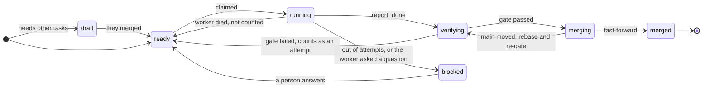
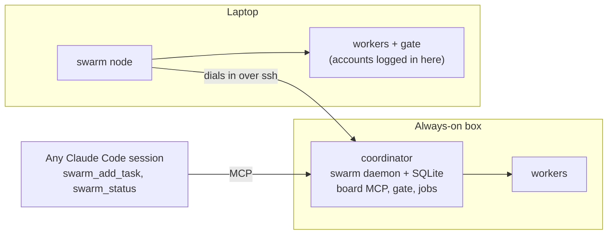
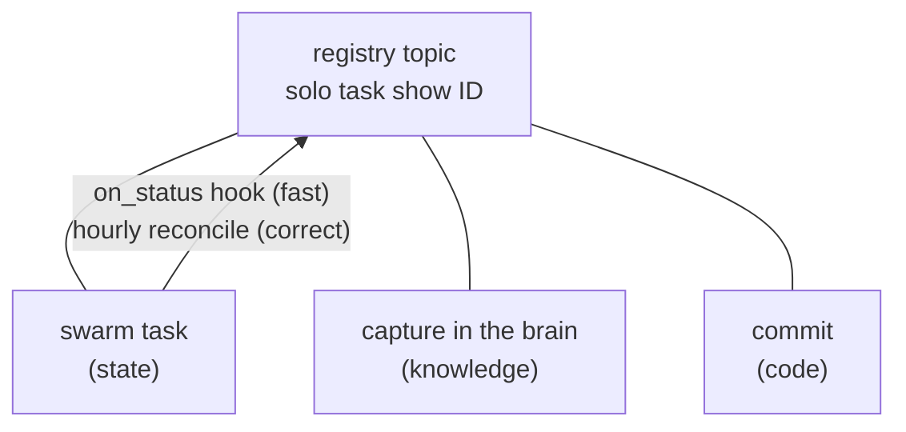

# swarm: coding agents on my own subscriptions, and a gate that decides what is done

## The short version

`swarm` is a daemon that takes a queue of coding tasks, gives each one its own git worktree
and a Claude Code or Codex worker, and merges the result into `main` only after the repo's
own tests pass. The worker never decides it is done. A gate does: the files it touched must
be the ones the task claimed, no test may be deleted or skipped, the test command must pass,
and optionally another account reviews the diff. Several machines share one queue: the
coordinator lives on an always-on box, and my laptop joins over ssh.

I wrote it in three days, 15-17 November 2026, with Claude Code doing most of the typing:
92 commits, about 16,500 lines of Go with tests included, 171 test functions. It is public
and MIT: [github.com/fortunto2/swarm](https://github.com/fortunto2/swarm).

| | |
|---|---|
| What it runs | the official CLIs I already pay for: Claude Code and Codex, one worker per task |
| Who decides "done" | the gate: claimed files, no weakened tests, the repo's test command, optional review |
| What it never does | push to a remote, put a model in the dispatch loop, wrap a subscription's login in a proxy |
| Where it runs | one coordinator (SQLite) on an always-on box; laptops dial in as nodes |
| First numbers | 14 tasks on two profiles, 12 merged, 8 of them within two attempts |
| When it pays | a batch of independent tasks a test can check. Not one-off work: it spends the same quota |

## Why I built it

One agent session hits two ceilings: one context window and one rate limit. The obvious
move is to open ten sessions. Ten sessions on one repository step on each other's files,
report "done" without running the tests, and burn a week of quota by Wednesday. I had
done all three.

The tools that already existed split into two camps. **Worktree managers** like Conductor,
Superset or Claude Squad ([[conductor-parallel-agents]]) give each agent its own checkout
and a nice UI, but a person still decides what is finished and merges it. **Agent operating
systems** like Ruflo ([[ruflo-orchestration]]) put models into the coordination itself:
planners, routers, a hundred agents, vector memory. I wanted the opposite of both: a dull
program with no model in the loop that claims tasks, starts workers, reaps the dead,
retries, and merges, plus a gate that cannot be talked into anything.

Two rules shaped it from the start. Only official CLIs: no proxy that turns a subscription's
OAuth into an API, no third-party harness logged in with a Claude subscription. And
everything that differs between my worlds (accounts, repos, merge policy, secrets) lives in
a profile's `swarm.toml`, so the personal profile and the client one run the same binary.

## How a task moves

A task is a title, a spec, acceptance criteria and the files it may touch. The daemon
claims it atomically (50 goroutines racing for one task, one winner, checked under the race
detector), creates a worktree outside every repo, and starts a worker with a one-time token.
The worker reaches the system through one small MCP server, the board, and that token is
the only identity it has, so it cannot speak as another task.

When the worker says it is done, the commit goes to the gate. A failure that is the model's
(the gate said no, the wall clock ran out) counts as an attempt, and the tail of the failing
log goes into the next attempt's prompt. A failure that is the infrastructure's (a crash, a
lost lease, a daemon restart) does not count against the model. Every status change goes
through one transition table, guarded in the same SQL `UPDATE` by the status the writer
expected, so a late failure cannot overwrite a submission that arrived a moment earlier.
That race existed in the first version, before the table: about fifteen untyped status
writes, none of them guarded.

## The gate

The gate is the whole point. It runs in a throwaway worktree, in this order:

1. **Static checks.** Every changed file is inside the task's claims. No test was deleted,
   skipped, focused, or quietly neutralised (a `TestMain` that exits, a pytest collection
   hook, a test file that shrank).
2. **The repo's own test command**, killed as a process group on timeout. A failed command
   is rerun once, and the rerun is reported, because a flaky test should be visible rather
   than silently forgiven.
3. **Review, if the repo asks for it.** Another account reads the task and the diff with
   read-only tools and ends with a verdict. A rejection is a gate failure, and its findings
   go into the next attempt.

Then a fast-forward into `main`, or for repos where a person signs off, a delivery branch.
Nothing is ever pushed.

The first real task on the laptop node was gated there, and the gate failed it. The broken
test was not the worker's: it was in a commit of mine. That was the moment
the design paid for itself.

## What the reviews found

I ran three review rounds on the first day, one of them as an attacker playing a hostile
worker, and then mutation testing. The parts worth repeating:

- **Claude Code read a file outside its worktree without asking.** Explicit deny rules
  stopped that, and I measured it: `Read`, `cat` and `Write` to a denied path all refused.
- **Deny rules bind Claude's own tools, not the code it runs.** `go test` executes the
  worker's code, which reads whatever it likes. The fix was Claude Code's native OS sandbox
  around every worker's shell, measured live: a read of a denied file gave `Operation not
  permitted`, `curl` got a 403 from the sandbox proxy.
- **A file named `[a]_test.go` hid its own diff** from the gate, because git read the name
  as a pattern. The daemon's git now runs with literal pathspecs and no external diff,
  textconv or attributes, and it never runs hooks a worker could plant in the shared `.git`.
- **Mutation testing: the suite caught 49 of 107 planted bugs.** That number is why tests
  for the gaps that matter most were added the same day: transition table, attempt counts,
  rebase conflicts, orphan kill by pid.

Then a decision: I trust my workers and work in a small group, so security must not slow
the work. The default, `trusted`, keeps every guard against mistakes. Everything that treats
the worker as an attacker (the OS sandbox, user-level settings only, an environment
allowlist, files required on every task) sits behind `safety = "strict"`, for the night a
swarm runs code nobody vouched for.

## One queue, several machines

The original plan said "move to Postgres when workers move to a server". I built the
opposite. The database stays one SQLite file with one writer, the coordinator, on the box
that never sleeps (the same box as the Gnome in [[agent-harness-and-always-on-gnome]]).
Other machines join as nodes: they call out over ssh, so a laptop behind NAT works, and ssh
already authenticates the link. A node runs the workers of the accounts logged in on it, and
gates can run there too. When the laptop sleeps, its tasks lose time, not work. A shared
database would have given every machine a writer, which breaks the rule that only the daemon
writes state.

Each account is a provider in the profile with a daily budget, a priority and a role
(worker, reviewer). Every attempt records tokens and dollars from the CLI's own final event;
on a subscription those dollars are a list-price estimate of the quota used, not money
billed. An account that hits its limit cools until the reset time the CLI printed, and the
others take the work. One that is not logged in leaves the rotation on the first try instead
of burning retries.

The same daemon also runs scheduled jobs: a shell command or an agent prompt on a cron line,
on the coordinator or on a node, with every run recorded.

## How it fits with the rest

swarm is one of three stores, and none of them copies another's state. swarm owns a task's
state, the registry owns why the work exists and whose move it is, and the brain owns what
was learned. A registry topic is the link:

`swarm task add --topic <id>` ties a task to a topic. A status hook writes each transition
into the topic, and an hourly job reconciles from swarm's own task list, because a hook can
be lost (a 15-second timeout, a daemon restart). Both are idempotent. The first end-to-end
run on 17 November went `started`, then `delivered` with its commit, into the topic's log
without a person touching it. The whole model is in [[company-brain]].

Workers find their way through [[project-solograph]]: the same index of code and past
sessions I use, added as a read-only MCP server and reindexed after every merge.

Any Claude Code session can drive it after one command,
`claude mcp add swarm -- swarm mcp --profile <dir>`: the session, its subagents and its
agent-team teammates get `swarm_add_task`, `swarm_status`, `swarm_list_tasks`. A planning
session queues the work, the workers do it, and only the gate says it is finished.

## Numbers so far

Measured on 18 November 2026, both profiles:

- **14 tasks**: 3 on the personal profile, 11 on the client one. 12 merged, 2 cancelled by
  me, none stuck.
- **8 of 12 merged within one or two attempts (67%).** The PRD set 70% as the target. The
  other four took 3 to 5. A sample of 12 says little yet.
- The client profile's tasks ran on both machines, 5 of them on the laptop node.
- **The first live Claude run**, a testbed task, went from `ready` to `merged` in 12 seconds.
- **Cost**, list-price estimate: the selftest feature, 731 lines with tests, took about 15
  minutes of worker time and $3.76 on Opus; a one-function task, $0.19.

## When it does not pay

swarm does not create quota. Its workers spend the same subscriptions my own sessions do,
and on the day of the first live runs the weekly limit was already at 80%. A worker also
costs start-up time, a gate run and a fresh context that has to rediscover the repo. For a
small fix, or work that needs judgement more than tests, doing it inline in the session is
faster and cheaper.

So the rule I wrote down after the first day: work inline by default; use swarm for a batch
of independent tasks whose acceptance the repo's tests can check, or when I ask for it. A
gate with no real tests behind it proves nothing, so a repo without tests is not a swarm repo
yet.

## Why Go, when everything else is Python or Rust

My default is Python for CLIs and Rust where speed matters. swarm is the exception on
purpose: it is a process supervisor. It runs dozens of child `claude` and `codex` processes,
with timeouts, signals, process groups and ssh links to nodes. Goroutines, channels and one
static binary for both macOS and the Linux box make that cheap. There is no hot path where
Rust would win, and async Rust would make the supervision code harder to read. The harness
around it stays Python, and [[project-solograph]] stays Rust.

## What is not built

- **A model lead.** The lead is the calling Claude Code session: it splits the work into
  tasks with dependencies and file claims. A lead model of swarm's own waits for a load that
  needs it.
- **The gate's own sandbox and per-task build caches.** Strict mode sandboxes the worker,
  but the gate still runs the worker's tests on the host, and shared build caches can be
  poisoned. Needed before swarm runs code from strangers.
- **Codex against the real CLI here.** The adapter is built and tested end to end with a
  stand-in `codex`; the client profile keeps Codex off its code until access is granted.
- **Pull requests.** Opening one means pushing to a remote, which swarm never does. A
  delivery branch plus a person's push is that path.

## Glossary

| Term | Meaning here |
|---|---|
| Worktree | a second checkout of the same git repo in its own folder, so two agents never share files |
| Worker | one CLI process (Claude Code or Codex) working one attempt at one task |
| Gate | the checks a commit must pass before it can reach `main`; the worker cannot skip them |
| Claims | the files a task says it will touch; the gate fails any change outside them |
| Coordinator | the machine holding the database and deciding what runs where |
| Node | another machine that dials in and runs workers for the coordinator |
| Fast-forward | moving `main` to the gated commit without a merge commit, so `main` gets exactly what passed |
| Reconcile | periodically comparing the real state with the recorded one and fixing the record |
| Mutation testing | planting bugs in the code on purpose to see whether the tests notice |

## Connections

- [[company-brain]]: the memory swarm writes its task state into, through a registry topic
- [[agent-harness-and-always-on-gnome]]: the harness around the agents and the box the coordinator runs on
- [[project-solograph]]: the code and session index workers search
- [[conductor-parallel-agents]]: worktree managers with a person at the merge
- [[ruflo-orchestration]]: the opposite bet, models in the coordination loop
- [[dsewiki-agent-collusion]]: what a swarm does with shared state when nothing gates it
- [[agent-harness]]: hub
