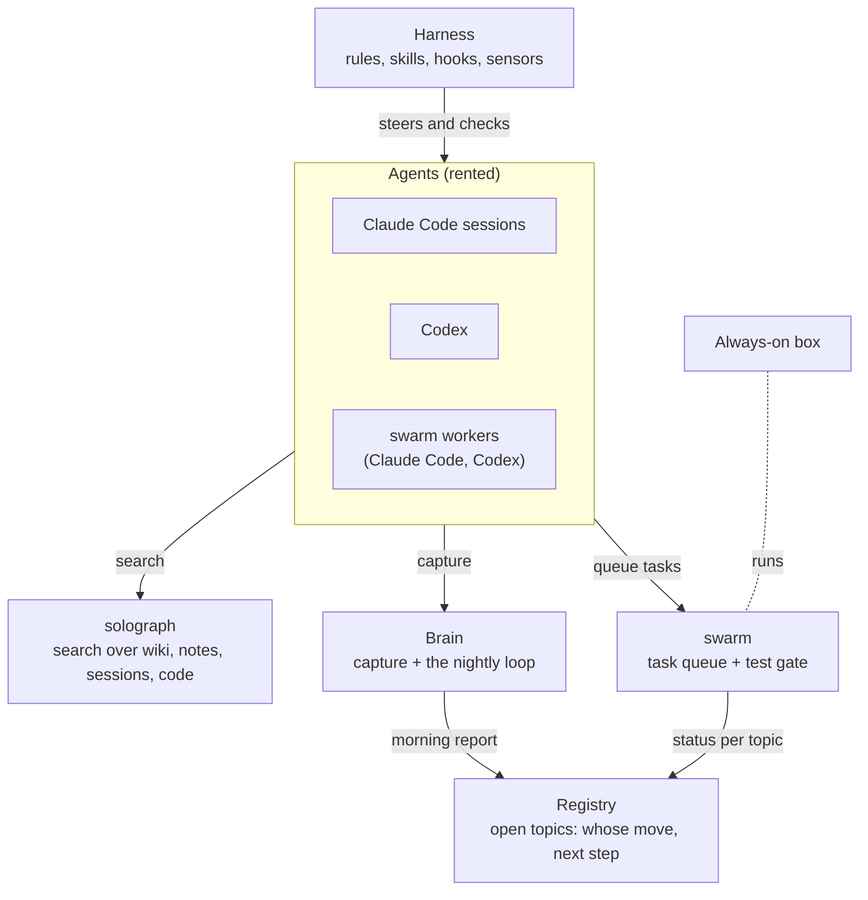
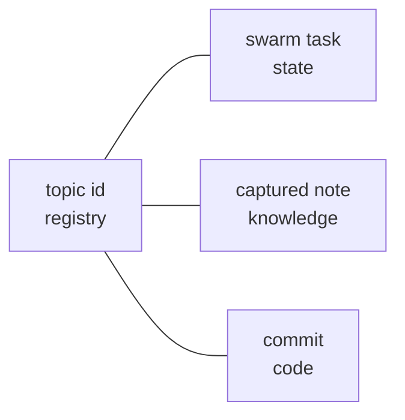
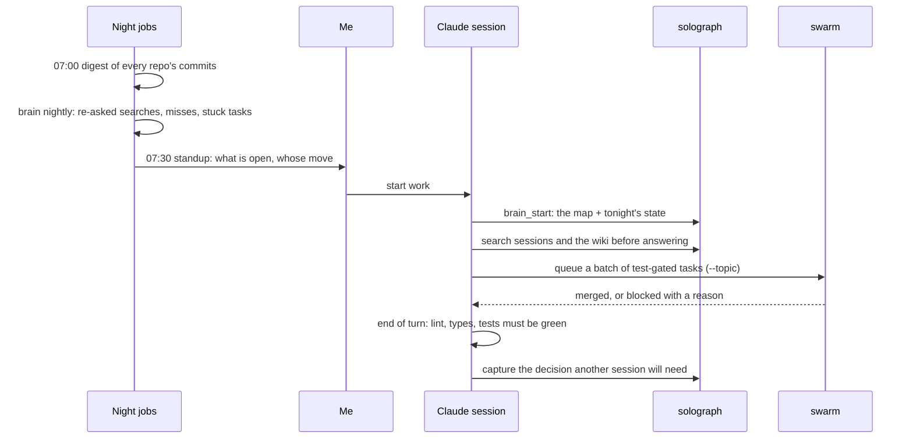

# How my agent stack fits together

This is the entry to a short series. Each piece has its own post; this one is the map: what
the pieces are, what each one owns, and how a piece of work moves through all of them in a
day. Read it first, then go deep wherever you need to.

## The short version

I run most of my work through Claude Code, and some of it through Codex. Around the agents
there are five pieces I built or assembled, and one rule that keeps them apart.

| Piece | What it does | Owns | Language | Deep dive |
|---|---|---|---|---|
| Harness | steers the agent before it acts, checks it after | rules, skills, hooks | shell + Python | [[agent-harness-and-always-on-gnome]] |
| Registry | one file per open topic: why it exists, whose move, the next step | intent | Python (harness-core) | [[harness-registry]] |
| solograph | one index any agent searches: wiki, notes, every past session, symbols in 68 projects | the index (derived, rebuildable) | Rust | [[solograph-rebuilt-one-binary]] |
| Brain | agents write decisions and findings back; a nightly loop reads what went wrong | knowledge | wiki + Python | [[company-brain]] |
| swarm | many coding agents in parallel; only tested code reaches `main` | task state | Go | [[project-swarm]] |
| Always-on box | runs what must not stop when the laptop sleeps: today the client profile's swarm coordinator; my personal box is ordered, not up | uptime | Linux server | [[agent-harness-and-always-on-gnome]] |

How settled each piece is matters when you read the rest: the harness and solograph have run my
work for months, the registry since 22 October 2026; the brain and swarm are from November and I
am still breaking them in, so their posts carry first numbers, not verdicts.

The rule: **rent the agent, own the memory.** The models and their CLIs are rented and get
swapped. Everything they read and write is mine: files in git, SQLite indexes, plain JSON.

## One link, three owners

The first versions of these pieces knew nothing of each other. swarm had its tasks, the
registry its topics, the brain its notes, and I was the glue. The fix was not a shared
database. It was a shared key.

A registry topic (`life2film-10k`, or one item of it, `life2film-10k#3`) is the unit of work.
A swarm task names it with `--topic`, a note names it in its frontmatter, a commit names it in
its message. Each kind of state has exactly one owner:

- **swarm owns a task's state** (twelve states, its own transition table).
- **the registry owns why the work exists and whose move it is.** It keeps a read model of
  its swarm tasks (`T7 -> merged`), written by a hook on every transition and by an hourly
  reconcile from swarm's own list. Both are idempotent, so a lost hook costs an hour, never
  a wrong record.
- **the brain owns what was learned.** solograph indexes it; nothing else copies it.

`solo task show <topic>` prints all three together: the topic, its swarm tasks, the notes
that name it. Why not one database: it would need migrations in three languages, and the
line between my client work and my own would turn from separate files into a row filter.

## A day in the system

- **Morning.** A digest of the night's commits across every repo, then the brain's nightly
  pass: which searches were asked twice, which found nothing, which topics went stale, which
  swarm tasks are stuck. It writes a report only on a night with something to decide. The
  standup orders what is open by whose move it is.
- **Session start.** A hook puts a two-line brief into the session: open topics, overdue
  checks, last night's digest. The agent can call `brain_start` for the map of the memory.
- **During work.** On a prompt that leans on earlier work, a hook nudges the agent to search
  past sessions and the wiki first. Every edit is syntax-checked in under a second. A turn
  cannot end while lint, types or tests are red on the files it touched.
- **Many tasks at once.** A batch of independent tasks with tests behind them goes to swarm.
  Workers run in their own worktrees; the gate decides; each transition lands in the topic.
- **Before the context runs out.** A hook reminds the agent to capture what the next session
  will need: one note per subject, titled the way someone would search for it.
- **Night.** Indexes rebuild, the reconcile runs hourly, and the loop starts again. For my own
  profile all of this still runs on the laptop under `launchd`, so it waits while the lid is
  closed; that is what the always-on box is for.

## Two profiles, one codebase

Everything above runs twice: once for my own projects and once for client work. Same code
(harness-core, solograph, swarm), separate stores, separate configs, separate accounts. A
client's registry, notes and sessions never reach my personal brain, and the other way
round. The separation is by directory and by config file, which is why no piece is allowed
to merge stores.

## Why several small tools

Each piece is replaceable on its own, and each one stores plain files or SQLite, so the
state outlives any tool. Each language is chosen for the job: Python for the harness (the
CLIs and hooks change weekly and want Pydantic schemas), Rust for solograph (it runs on every
prompt and every search, 19-35 ms median for a hook), Go for swarm (a supervisor of dozens of
child processes, timeouts and ssh links, as one static binary).

What it does not have, on purpose: a vector database (removed in October 2026: slow, stale,
ranked junk first), a model in swarm's dispatch loop, a server for my documents (git holds
one or two people fine), and a remote entry to the memory (built, then switched off the same
day because nothing used it).

## Numbers

- Sensors caught 11 of 24 defects planted on purpose; green means "lint, types and tests
  passed", not "correct".
- solograph, 14 days to 17 November: 366 agent searches, 99% found something, 28 (8%) were
  the same question asked again.
- swarm, first four days: 14 tasks, 12 merged, 8 of them within two attempts.
- The registry: 30 open topics today, each with one line saying what happens next.

## The series

1. **This page**: the map.
2. [[agent-harness-and-always-on-gnome]]: the harness (rules, skills, sensors, the registry
   and standup), the scheduled jobs, and the box that never sleeps.
3. [[harness-registry]]: the registry: one file per open topic, whose move it is, the standup,
   checks, hooks, and one core shared by two profiles.
4. [[solograph-rebuilt-one-binary]]: the memory engine, from a graph database to one Rust
   binary over SQLite. Reference page: [[project-solograph]].
5. [[wiki-feedback-loop]]: how corrections and unanswered questions flow back into the wiki.
6. [[company-brain]]: one memory any agent plugs into, agents writing back, the nightly loop.
7. [[project-swarm]]: many coding agents on my own subscriptions, and the gate.

Related, outside the series: [[agent-mistake-fix-harness]] (the rule that grows the
harness), [[claude-subscription-boundary]] (why every job that spends the quota should queue
on one machine), [[agent-memory-architecture]] (the memory landscape this is one point in).

## Glossary

| Term | Meaning here |
|---|---|
| Harness | everything around the model that steers it before it acts and checks it after |
| Sensor | an automatic check after the agent acts: syntax, lint, types, tests |
| Topic | one open piece of work in the registry, with whose move it is and the next step |
| Capture | an agent writing one note (a decision, a finding, a handoff) into the inbox folder |
| Read model | a copy kept only for reading, rebuilt from the owner's data, never edited by hand |
| Reconcile | comparing recorded state with the real one on a schedule and fixing the record |
| Gate | the checks a commit must pass before it reaches `main`; the agent cannot skip them |
| Profile | one world (personal or a client) with its own config, stores and accounts |
