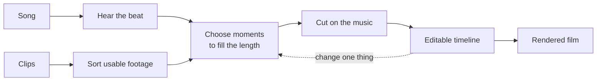
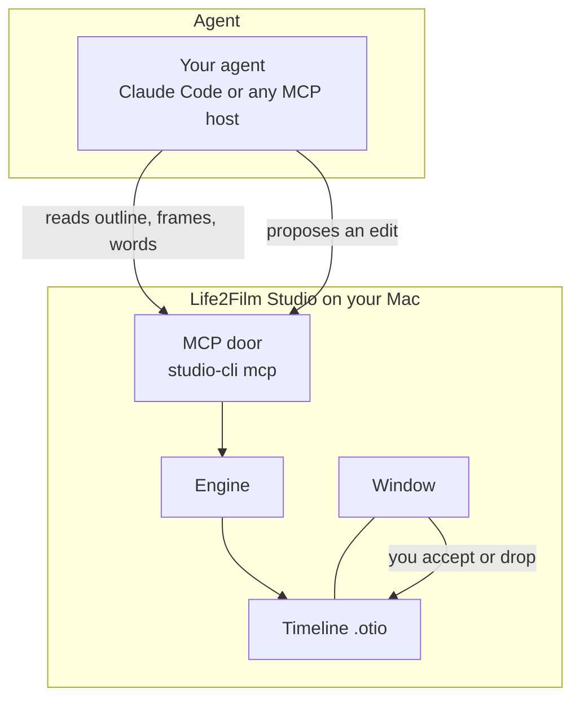

# How a machine cuts a film on the beat

You have forty clips from a trip and a song. A good editor would spend an evening turning them into three minutes that feel like the trip. An auto-montage engine tries to do the same in under a minute. This page explains what such an engine has to do, in plain words, and what we learned building one. It doesn't publish our engine's internals. If you want the result rather than the theory, the last section shows how to hand the job to your own agent.

## The short version

| Job | The question it answers | Why it is hard on phone footage |
|---|---|---|
| Hear the music | Where are the beats, and how strong is each? | Real songs drift, swing and have quiet intros |
| Sort the footage | Which seconds are worth showing? | Half of a phone roll is pocket, floor and shake |
| Choose the moments | Which pieces fill this length best, without repeating? | Many good moments, one fixed length |
| Cut on the music | Where exactly does each piece start and stop? | Edits that drift by a fraction of a beat feel wrong |
| Leave it editable | Can a person or an agent change one thing without redoing everything? | A rendered file is a dead end |

## The five jobs



**1. Hear the music.** A beat tracker turns the song into a grid of moments where a cut feels natural. The textbook way: measure how suddenly the sound changes, find the repeating period in those changes (the tempo), then lay a grid that lines up with the strongest hits. Every introduction to music information retrieval covers this; it is a weekend of work to get right on a metronome and a long road to get right on real music.

**2. Sort the footage.** Before anything is chosen, the engine has to know which seconds are usable at all: not dark, not blurred, not the inside of a pocket, not the same view filmed five times. Cheap signals (how much the picture moves, how sharp it is, how bright) get you surprisingly far. Faces, speech and scene understanding get you the rest of the way.

**3. Choose the moments.** Now there is a length to fill and more good moments than fit. This is a packing problem: each moment has a value and a duration, and the total must come out exact. The naive version takes the best moments in order and ends up with three nearly identical shots of the same sunset. Any real engine adds a sense of variety and of order, so the film tells the day rather than ranking it.

**4. Cut on the music.** The music decides where the edits fall, not the clips. A cut that lands a tenth of a second off the beat reads as a mistake even to people who can't say why. Sound needs care too: a hard cut in the middle of a waveform clicks, so every edit should get a tiny fade.

**5. Leave it editable.** The output should be a timeline, not just a video file. A timeline can be opened, a shot swapped, a chapter shortened, and the film re-rendered in seconds. A baked file can only be thrown away.

## What we learned building one

We have worked on Life2Film's engine since 2014 and rebuilt it in Rust for the phone and the Mac. Six principles survived every rewrite.

1. **Phone footage has no cuts to find.** Shot-boundary detectors are trained on edited films. A day at the beach filmed on a phone is one long take after another, so "find the shots" is the wrong question; "find the moments worth keeping" is the right one. We measured this: [[shot-detection-phone-footage-no-cuts]].
2. **Music is optional, rhythm is not.** A film without a song still needs a pace. If there is no beat to follow, the footage sets the rhythm.
3. **Analyse where the footage lives.** Private videos should be analysed on the phone or the Mac they are on. It is slower to build and it is the only version people trust with their family footage.
4. **Nothing invented.** The engine chooses and orders what you filmed. It doesn't generate frames that never happened, so the film stays your memory and not a nicer version of it.
5. **Measure the result, not the plan.** A plan can say the cut lands on the beat while the rendered file drifts by a frame per minute. Every check that matters runs on the finished film: is the picture in sync with the sound, how loud is it, did any piece go missing.
6. **An agent reads a film; it doesn't watch it.** Thousands of frames are noise to a language model. A short text outline (what is where, what was said, how loud) plus a few frames at the moments that matter is enough to edit well, and costs a fraction as much.



## Use our engine instead of writing one

Life2Film's engine runs in two places you can use today.

- **On iPhone**, inside [Life2Film](https://apps.apple.com/app/id6761656888): pick clips or a period, get a film cut on the beat. The montage is free.
- **On the Mac**, inside [Life2Film Studio](https://life2film.com/studio/), with a door for agents. Studio holds no model and no key. Your agent connects over MCP, reads the film, looks at frames and proposes edits; nothing is written until you accept.

Connecting Claude Code takes two commands, both from [the agent guide](https://life2film.com/studio/agent/):

```bash
claude mcp add --scope user studio -- "/Applications/Life2Film Studio.app/Contents/MacOS/studio-cli" mcp
mkdir -p ~/.claude/skills/life2film-studio && cp "/Applications/Life2Film Studio.app/Contents/Resources/skill/life2film-studio/SKILL.md" ~/.claude/skills/life2film-studio/
```

The first registers the door, the second installs the skill that tells the agent how to work there: the order to read a film in, how pieces are named, what to check before asking you. Then ask in plain words, for example "make a film from ~/Movies/trip/day1 and propose a three-minute cut" or "chapter 3 drags, propose a version two minutes shorter". Any other MCP host works with the same program and the argument `mcp`.

For the whole workflow from a day of footage to a published film, see [[creative-video-with-claude]]. The project itself: [[project-life2film]].
