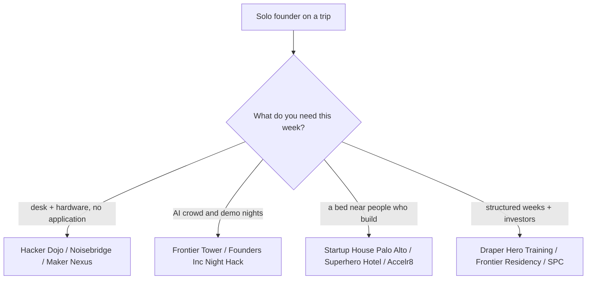

# Bay Area hackerspaces, hacker houses and founder communities (Oct 2026)

Written for a solo founder from abroad on a short US trip who builds AI agents, iOS apps, Rust tools and video AI. Everything below was checked against a live page or a dated news item on 28 Oct 2026. Prices change monthly; re-check before you pay.

## Short version

| Place | City | What | Access / price | Live there? |
|---|---|---|---|---|
| Hacker Dojo | Santa Clara (moved from Mountain View on 12 Oct 2026) | Oldest Valley hackerspace (2009), coworking + events | $150/mo, rising to $180 on 1 Nov; student $75; 24/7 | No |
| Noisebridge | SF, Mission (272 Capp St) | Anarchist hackerspace, labs, laser cutter, woodshop | Free to enter, donations ($160/mo suggested) | No |
| Sudo Room | Oakland (Omni Commons) | Free hackerspace, weekly Tuesday open house | Free, open membership | No |
| Ace Makerspace | Oakland | Full shop + 24/7 coworking | $200/mo; free monthly maker social | No |
| Maker Nexus | Sunnyvale | 28,000 sq ft woodworking, metal, 3D print, laser | $160/mo, 10:00-22:00 daily | No |
| Counter Culture Labs | Oakland | Volunteer biohacker lab | $100/mo, sliding scale | No |
| BioCurious | Santa Clara | Community molecular biology lab | monthly plan + $120 one-time setup | No |
| Frontier Tower | SF, 995 Market St | 16 floors: AI, crypto, bio, robotics; 3+ events/day | Citizen $190/mo or $1,800/yr, application, refund if rejected | Via Superhero Hotel / Frontier Residency |
| Founders, Inc. | SF, Fort Mason | 42,000 sq ft campus, $150K first checks, Night Hack | Night Hack: apply on Luma, free; campus = accepted founders | No |
| AGI House | Hillsborough (and SF) | Hackathons, talks, 15,000-person community | Invite/apply per event | **No residency** (they say so) |
| South Park Commons | SF, NYC, Bangalore | Founder club, $1M fellowship | Fellowship: apply twice a year; Member Residency: 6 months, no cost, no equity | No |
| Draper University + Hero City | San Mateo | 5-week Hero Training, dorm-style housing, coworking | Program is paid; Hero City coworking from ~$100/mo (old price list) | Yes, during a cohort |
| Startup House | Palo Alto, Menlo Park, SF | Co-living for founders | Shared room $60-65/night (quoted Oct 2026), long stays reportedly ~$45/night; apply on site | Yes |
| Accelr8 / Mission Control / 20mish | SF | Community hacker houses | $1,500-2,500/mo, interview | Yes (30 days to 12 months) |
| The Residency | SF, Berkeley | Cohort hacker houses, demo days | $1,800 shared / $3,000 private per month, 3-6 months | Yes |
| Edge City / Edge Esmeralda | Healdsburg (popup) | 4-week popup village | 2026 edition ended 27 Jun; Edge City Bhutan 11-19 Nov | Yes, during the event |

## Hackerspaces and makerspaces

**Hacker Dojo (Santa Clara).** Silicon Valley's longest-running hackerspace opened in 2009. On 12 Oct 2026 it left 855 Maude Ave, Mountain View, for 3200 Patrick Henry Dr, Suite 250, Santa Clara, double the floor area; the old building is scheduled for demolition. Membership is $150/mo (student $75, veteran $135) with 24/7 access, and goes to $180 on 1 Nov 2026. About 150 members now, down from ~400 before the pandemic. Hosts open hack nights, Meetup groups (an AI artists group meets 10 Nov) and a spring 2026 accelerator cohort. Good for a quiet desk and Valley meetups; it is not an AI-founder scene on its own. The mv-voice piece says larger private rooms and paid hackathons are planned. Note the old Mountain View address still appears on Yelp and LiquidSpace. Source: [Mountain View Voice](https://www.mv-voice.com/business/2026/10/12/hacker-dojo-leaves-mountain-view-for-larger-spot-in-santa-clara/), [pricing](https://hackerdojo.org/pricing/).

**Noisebridge (San Francisco, Mission).** 272 Capp St, 6,000 sq ft. No membership fee; anyone is "already a member". In Nov 2025 it said it had about three months of cash against ~$12,000/mo costs and a ~$6,000/mo deficit and might close or start charging. It is still running in 2026: Global Game Jam site in Jan, monthly open-mic nights, a fundraiser on 12 Jun. Best for electronics, laser cutter, woodshop and strange company, not for focused work or a founder crowd. Visit with a bit of cash for the donation jar. Sources: [Mission Local](https://missionlocal.org/2025/11/noisebridge-financial-crisis/), [Future Events](https://www.noisebridge.net/wiki/Future_Events).

**Sudo Room (Oakland).** Free hackerspace inside Omni Commons, North Oakland, with a weekly Tuesday open house and events through Sep 2026 (including an "AI Tea Salon"). Open membership, no dues. The East Bay Express covered it in July 2026. [Site](https://sudoroom.org/).

**Ace Makerspace (Oakland, 6050 Lowell St).** The best-equipped East Bay shop. Full membership $200/mo or $2,000/yr (two months free on annual), 24/7, financial assistance form exists. Free public maker social once a month. [Membership](https://www.acemakerspace.org/membership/).

**Maker Nexus (Sunnyvale).** Nonprofit, 28,000 sq ft: woodworking, metal, 3D printing, laser cutting. Full shop access $160/mo, 10:00-22:00 seven days. Closest real hardware shop to Palo Alto and Mountain View. [Join](https://www.makernexus.org/join-maker-nexus).

**Counter Culture Labs (Oakland) and BioCurious (Santa Clara).** Biology labs, relevant only if you drift into biotech. CCL is $100/mo with sliding scale and a safety training; BioCurious (3108 Patrick Henry Dr, next door to Hacker Dojo's new building) charges a monthly plan plus a $120 setup fee. Both run Meetup events open to the public. [CCL](https://www.counterculturelabs.org/join/), [BioCurious](https://biocurious.org/membership/).

## AI hacker houses and residencies

**Frontier Tower (SF, 995 Market St).** The most active building for your profile. 16 floors, 740-800+ "citizens", more than three events a day (hackathons, demo nights, dinners). Citizen membership $190/mo or $1,800/yr, by application, refunded if rejected. Floor 10 is Immersive Commons, a members-run applied-AI lab. Next door in spirit: Superhero Hotel (825 Sutter St, 10 minutes' walk), a 110-room founders' hotel bookable directly at about $2,400 for four weeks, with Frontier Tower access. The **Frontier Residency** is 8 weeks for 10 teams, housing at Superhero Hotel, 3% equity, demo day. Open houses run on Luma. [Site](https://frontiertower.io/), [residency](https://frontiertower.io/residency).

**Founders, Inc. (SF, Fort Mason).** 42,000 sq ft campus that writes $100-250K first checks (site headline: $150K). Its **Night Hack** is the open door: a five-hour, live-demos-only hackathon (50 teams at the first, 100 at the second), accepted via Luma, Anthropic credits as prizes ($5,000 and $3,000). One local guide calls it the highest-signal recurring event in SF; I could not confirm the schedule beyond the Luma page. Fits an AI-agent, video AI or hardware builder well. [Site](https://f.inc/), [Night Hack](https://luma.com/nighthack3).

**AGI House (Hillsborough, and an SF site).** Famous for hackathons (80+, claims credit for Lovable and Perplexity beginnings) and 15,000 subscribers. Read carefully: agihouse.org states there is **no residency** and the founder house-share ended in 2024; agihouse.ai (SF) calls itself a residency and hackathon house. These are two competing organisations that were in a trademark dispute in 2025. A New York Times investigation of 21 Sep 2026 reported harassment complaints and noise problems at several Bay Area AI group houses, including the Hillsborough one. Use it for events only, go with someone, do not move in. See [[aaron-levie-agi-house-2026]] for a talk recorded there on 8 Oct 2026. [agihouse.org](https://www.agihouse.org/), [NYT](https://www.nytimes.com/2026/09/21/technology/agi-house-ai-culture.html).

**Hacker houses you can book or interview for (SF).** From an Aug 2026 directory (verified by direct contact, per the author):

| House | Price | Stay | How in |
|---|---|---|---|
| Superhero Hotel | $2,400 / 4 wk | days to weeks | book online |
| Foundry (4 buildings) | from $2,290/mo | 1 month+ | book online, ~100 on waitlist |
| Accelr8 (1412 Market, Epik, Alamo Square) | $1,500-2,500/mo | 30+ days | apply, short interview |
| Mission Control | $1,500-1,700/mo | 1 year+ | apply, group interview |
| 20mish | $1,625+/mo | 12 months | apply or tour |
| The Residency (5 Bay Area houses) | $1,800-3,000/mo | 3-6 months | apply, interview |
| The Bridge (EF) | $0 | 8 weeks | Europe-based pre-team founders |
| Lightyear | $0 | 1 month | apply, interview |
| FoundHer | ~$1,000+/mo | 3 months | women only |

HF0 runs batches for repeat founders (next start 4 Jan per its site). The same directory says its "Hacker House & Space Map" is still to come. [Directory](https://www.eomag.io/article/hacker-houses-san-francisco).

**Palo Alto.** [Startup House](https://startuphouse.co/) runs three co-living houses: the AI House on Moreno Ave (Palo Alto), a Menlo Park "Robo House" on Middlefield, and an SF house on Bush St. 4.9 on Google Maps with 100+ reviews; it lists short stays, workshops and mentor sessions, but no public prices (ask). It is the nearest thing to what you already live in; the useful move is to ask for demo nights and open dinners rather than a second bed. I did not find a second Palo Alto AI house with current evidence.

**Vibe House SF.** A $4M West Portal house for exited, older founders ([SF Standard, 4 Oct 2026](https://sfstandard.com/2026/10/04/midlife-hacker-house/)). Not for a solo founder on a budget; its monthly demos are the only open part.

## Founder clubs and communities

**South Park Commons (SF, NYC, Bangalore).** Two doors. The Founder Fellowship (Fall 2026 deadline was 2 Aug; bootcamp late Sep to late Nov; $400K for 7% plus $600K guaranteed in the next round) is closed until the next call, likely early 2027. The **Member Residency** is six months, no cost, no equity, full office and programming access. For a visitor abroad the realistic step is to apply as a member and attend events. [Fellowship post](https://blog.southparkcommons.com/p/applications-open-spc-founder-fellowship).

**SHACK15 (SF, Ferry Building).** Social club for entrepreneurs, members-only, application; price not shown without applying. Good for investor-heavy evenings, weaker on building. The Bay Area World Cup committee named it its official social club in 2026. [Membership](https://www.shack15.com/membership).

**Edge City / Edge Esmeralda.** Annual popup village in Healdsburg (2026: 30 May-27 Jun, 850+ residents, an "agent village" experiment). Over now; the next listed event is Edge City Bhutan, 11-19 Nov 2026. Apply early for the 2027 Healdsburg edition. [Site](https://www.edgecity.live/).

**Stanford-adjacent and event feeds.** Stanford OpenLab and alumni groups run public talks and mixers (check their event pages); the 23-24 Oct hackathon is in [[stanford-cleantech-hackathon-2026]]. For a daily feed use Luma (Frontier Tower, Founders Inc, AGI House all publish there) and [Cerebral Valley](https://cerebralvalley.ai/events). More hackathon context: [[hackathons]].

## Programs you can live in

**Draper University and Hero City (San Mateo).** Hero Training is a five-week residential pre-accelerator at 44 E 3rd Ave: classes, housing, and coworking in Hero City downtown. Fall 2026 cohort ran 5 Oct-6 Nov; Spring 2027 is next, rolling applications, no application fee, tuition charged, optional investment of up to $100K through the DUV fund. Draper also hosts country cohorts (Korea, Central Asia) and a Cardano accelerator. Hero City coworking is open to outsiders: the membership page I found lists Sidekick $100/mo, Virtual Hero $250/mo, with day passes from about $14 on aggregators. That price list is undated; confirm in person. Draper is a school-like environment aimed at 18-28 year-olds; as a solo builder with shipped products you would get more from Frontier Tower or Founders Inc. [Slidebean summary](https://slidebean.com/startup-accelerator-program/draper-university-hero-training), [Hero City](http://www.herocity.com/membership-packages).

## What I could not verify

- Draper Hero Training tuition and room rate (site is script-rendered; only third-party pages).
- Hero City prices are undated; coworking day pass price comes from an aggregator.
- Startup House room prices; SHACK15 dues; Foundry waitlist time.
- BioCurious monthly rate (only the $120 setup fee came through).
- Founders Inc Night Hack: recurring or one-off weekly cadence.
- Noisebridge current finances after Feb 2026; it is open and hosting events, but no new update found.

## How to apply for a Feb–Mar 2027 stay

Assumes one month (about 4 weeks) on a visitor visa. Checked on the places' own sites on 28 Oct 2026. Most programs below publish no Feb–Mar cohort dates yet, so "lead time" is what the site says or what the format implies. A visitor (B-1/B-2) cannot take US employment; none of the sites address this, so keep any program that takes equity or expects you to work for a US entity out of the plan until you have read its terms.

| Place | How to get in | Lead time | Price for ~4 weeks | Note |
|---|---|---|---|---|
| Superhero Hotel (Frontier Tower team) | Book online: [superherohotel.com](https://www.superherohotel.com), "Monthly Stay" | Book when dates open; no interview | $80/night x 30 nights = $2,400 (about 17.5% tax on top, as quoted in Sep 2026) | Exactly 30 nights. Includes coworking and lounge at Frontier Tower. The only option here with a published monthly rate and no application. |
| Frontier Tower citizenship | [frontiertower.io/apply](https://frontiertower.io/apply) | Days to weeks | $190/mo | Add this if you stay elsewhere; the 30-night Superhero stay already includes access. |
| Frontier Residency | [Typeform](https://form.typeform.com/to/cXqdskGd) | Rolling, 10 teams | Housing, desk and lunch included, 3% equity | 8 weeks, Batch 1 (Oct 2026) targets European repeat founders. Too long for one month. |
| Startup House (Palo Alto, Menlo Park, SF) | [startuphouse.co/#apply](https://startuphouse.co/#apply), or message the house manager | 2–4 weeks; they advise planning ahead for busy seasons | Quoted Oct 2026 in Palo Alto: 4-person room $65/night, 3-person $65 in another house; residents say long stays go for about $45/night, so roughly $1,350–1,950 for 30 nights. A private room in Palo Alto rents for about $2,000/month locally | Short stays are normal. Palo Alto has a 3-night minimum, the SF house reportedly 7 nights. Returning guests can ask directly. |
| Foundry (4 SF houses) | Tour request or application on [foundry.today](https://foundry.today/faq), then a call | Move-in usually 1–2 weeks after applying; a waitlist of about 100 was reported in Aug | From $2,290/mo (small) or $2,690 (large) plus a deposit equal to one month | Minimum stay is one month, so it fits exactly. Weekly dinners, investor dinners. |
| Accelr8 (1412 Market, Epik on Polk, Alamo Square) | [joinaccelr8.com/apply](https://joinaccelr8.com/apply) (name, startup, move-in date, duration, three free-text answers), then an interview | 1–3 weeks | $1,500–2,500/mo | 30+ days. Includes Frontier Tower access per their site. |
| Lightyear residency | [Tally form](https://tally.so/r/mYy6xB), [site](https://joinlightyear.com/) | Cohort dates not published | $0 (per an Aug 2026 directory; verify) | One-month, HF0-incubated, Pacific Heights. Fits the length perfectly; selective. |
| Draper University + Hero City (San Mateo) | [Hero Training form](https://draperuniversity.com/apply?name=HeroTraining&FormNo=firstform) (4 steps, no fee), or ask admissions about a short stay | Rolling; Spring 2027 dates not yet published | Hero Training is paid (a 2026 partner listing quoted $10,000 for non-residents, so check); Hero City coworking from $100/mo on an old list | Hero Training is 5 weeks and housing is included. The site says accommodation varies by cohort and invites questions to admissions. No public housing-only product found. |
| South Park Commons Member Residency | [Airtable form](https://airtable.com/appxDXHfPCZvb75qk/pagIZspLSFX7QrXcn/form) | Reply in 1–3 weeks, then an interview | $0, no equity | 6 months, expects you in the office 3+ days a week, does not sponsor visas. Poor fit for one month. |
| Founders, Inc. | [campus.f.inc](https://campus.f.inc) (funding application); Night Hack via [Luma](https://lu.ma/fdotinc) | Funding reply within a month; Night Hack dates are announced a few weeks ahead | Night Hack free | Campus is for accepted founders. Night Hack 3 ran on 24 Jul 2026; watch Luma for the next. |
| The Residency | [livetheresidency.com](https://www.livetheresidency.com/apply) (10-minute application, then AI and human interviews) | Cohorts rolling | $1,800 shared / $3,000 private per month | Cohorts last 3–6 months. Too long. |
| Mission Control, 20mish | Application on their sites | Months | $1,500–1,700 / $1,625+ per month | 12-month commitments. Skip for a one-month stay. |
| Hacker Dojo, Maker Nexus, Noisebridge | Join online or walk in | Same day | $150 (→ $180 from 1 Nov) / $160 / free | Desks and shops, no beds. Combine with a house. |
| AGI House, SHACK15, Edge City | Event applications on Luma / site | Per event | Free to ~club dues | Events only. No Feb–Mar Edge City event found; its site lists India in Oct 2026. |

**Recommended timeline**

- **November.** Decide the month (Feb or Mar). Send the short messages that need an answer: Draper (ask for a one-month room plus desk), Startup House (monthly rate), Foundry (tour and waitlist position). Submit the Lightyear and Accelr8 applications. Join the Luma lists of Frontier Tower, Founders Inc and AGI House so Feb–Mar events show up.
- **December.** Pick the primary base and a fallback. If nothing has confirmed by mid-December, book Superhero Hotel's 30-night rate (non-refundable, so only once the flights are fixed). Ask SPC and Draper about their Spring 2027 dates only if you want a program.
- **January.** Pay deposits, book flights, and queue the event applications (hackathons announce about 3–4 weeks ahead). Carry proof of return travel and the product work, not a program contract.

## Russian-speaking communities

Checked 28 Oct 2026 with live pages and search snippets. For a one-month stay (about 4 weeks, Feb-Mar 2027) each entry gives the minimum stay and the monthly price where one is published. Anything marked **unverified** came from a snippet or a single source.

### DobryDom (Добрый Дом), the house you remembered

The name is DobryDom, Instagram [@dobrydomsf](https://www.instagram.com/dobrydomsf/), not "Dobro". "Dobry" is the childhood nickname and online handle of Andrey Doronichev (ex-YouTube head of mobile, ex-Google VR/AR, now CEO of Optic/BIOPTIC, AI-native biopharma). It is a co-living in his four-story, 110-year-old townhouse next to Alamo Square, SF. He and his wife Tatiana Doronicheva (LinkedIn: co-founder and CEO of DobryDom co-living since Sep 2016) live on the top floor and rent the rest. Started in 2015 after Burning Man; the NYT of 23 May 2022 counted nearly 100 Russian-speaking founders, investors and engineers (Russia, Ukraine, Belarus, Georgia, Kazakhstan) who had lived there, plus a basement banya and lectures and yoga. Doronichev also co-founded the Mesto.co community.

- **Status:** exists, but closed to newcomers. The Instagram bio says "Currently fully occupied. Applications paused for now" (6.9K followers, 56 posts; the same wording was seen in a CRM check on 27 Sep 2026, so it has not reopened in a month). I found no website, no Telegram channel for the house and no application form. dobrydom.com is an unrelated Polish home builder.
- **How in:** only by Instagram DM to the house account or a personal introduction through Mesto or a past resident. Doronichev's own Telegram channel is [t.me/dobry](https://t.me/s/dobry) (bio: personal meetings are booked via [doronichev.com](https://www.doronichev.com/)); it is about his book and life, not about rooms.
- **Minimum stay and price:** not published anywhere I could reach. **Unverified**; the NYT says rooms were rented to people he knew, not to short-term guests. Do not plan Feb-Mar 2027 around it; treat it as a lucky intro, not a booking.
- **Do not confuse** with [Alamo Square House](https://www.alamosquare.house/), a separate English-language founders' co-living in the same neighbourhood (no link to Doronichev found).
- Sources: [NYT mirror](https://www.newssniffer.co.uk/articles/2313361/versions/14240222), [doronichev.com](https://www.doronichev.com/), [Tatiana Doronicheva on The Org](https://theorg.com/org/livejournal/org-chart/tatiana-doronicheva).

### Options that work for one month

| Option | What | Minimum stay / price | Live there? | How in |
|---|---|---|---|---|
| Startup House Palo Alto (see above) | Founders' co-living, AI House on Moreno Ave | Short stays listed; price on request, **unverified** | Yes | Apply on site; ask about Russian-speaking residents |
| Accelr8, Mission Control, Foundry, Superhero Hotel (see table above) | SF hacker houses | 30+ days at $1,500-2,500 (Accelr8); Superhero Hotel $2,400 for 4 weeks; Foundry from $2,290/mo, 1 month+ | Yes | Apply or book; no language filter, but many Russian speakers in this scene |
| GOORT, Ukrainian Tech Hub | SF coworking, cafe, event space, startup hub founded by Ukrainians (SID Venture Partners, Sigma Software, Fedoriv, Kooperativ) with the Ukrainian consulate as partner | Coworking price not published; contact form only. **Unverified** whether it is open to non-Ukrainians (it says it unites "US, Ukrainian and CEE community") | No, but a partner programme uses co-living on site | [goort.cc](https://www.goort.cc/) contact form |
| YEP Accelerator SF track | 5-week SF residency with co-living and co-working inside GOORT, demo day with up to $1.8M from Ukrainian-linked funds | 5 weeks; price not published; **only Ukrainian B2B SaaS with paying customers**, applications closed 31 May 2026, so check for a 2027 intake | Yes | [Tech.eu, 15 May 2026](https://tech.eu/2026/05/15/yep-accelerator-opens-california-program-to-help-ukrainian-startups-scale-into-the-us/); not a fit for a solo AI-apps founder |
| European Startup Embassy | Landing pad and hacker house for CEE founders (Czech, Slovak, Hungarian, Polish, Ukrainian, Romanian), launched 1 Oct 2025 | Price and stay length not found; **unverified** that it still runs in 2027 | Yes (hacker house) | [europeanstartupembassy.com](https://europeanstartupembassy.com/); ask about Feb-Mar 2027 |
| Silkroad Innovation Hub | Palo Alto / Menlo Park hub for Central Asia and the Caucasus; Alchemist Silkroad residency (3 months, B2B, Delaware C-corp), Angel Club; hosted a Ukrainian founders event on 21 Oct 2026 (Eventbrite snippet) | Residency is 3 months, too long; events are the useful part | No | [silkroadinnovationhub.com](https://silkroadinnovationhub.com/) |
| Silicon Valley Tour (svtour.vc, Unicorn Factory) | Russian-language one-week tour of VCs and accelerators, Doronichev listed as a past speaker | One week, $6,900 (struck from $9,000), hotel included, flights not | Hotel only | [svtour.vc/ru](http://svtour.vc/ru); not a place to live for a month |

### Communities and chats (free, no living)

- **Mesto.co.** Non-profit online community of Russian-speaking entrepreneurs and professionals, "more than 19,000" members per [TAdviser](https://tadviser.com/index.php/Company:Mesto_(community)); co-founded by Doronichev and Yana Belova (CEO per SBS Russian). Has local groups; a Mesto event was listed in SF in 2026 (the allevents.in hit I found was a DJ with the same name, so ignore it). The signup app is [app.mesto.co](https://app.mesto.co/) (script-rendered; I could not read terms or whether it is still open). Best single door to a DobryDom intro.
- **Telegram, public:** [@sf_networking](https://t.me/sf_networking) (San Francisco chat, networking and events), [@san_francisco_usa](https://t.me/san_francisco_usa) (general SF residents), [@chat_rusrek_sanfrancisco](https://t.me/chat_rusrek_sanfrancisco) (jobs). These are general diaspora chats, quality **unverified**. A tg-cat search for "bay area" lists 44 chats, for example "Bay Area Лайф" with about 2,850 members. I found no chat explicitly named "SF Russian founders"; ask in Mesto for the live one.
- **Pavel Khegai, "Хегай Нетворк"** ([t.me/SFPavel](https://t.me/s/SFPavel), 6.7K subscribers): public Russian-language channel by a serial entrepreneur on startups in the US and a paid networking community (link in the channel bio). Posts are about AI, relocation and building a community; it is not a Bay Area-only group, so treat it as a network, not a local club.
- **Facebook:** [Russian Speaking Bay Area](https://www.facebook.com/groups/1241694580479334/) and [Russian Business Owners Group in the Bay Area](https://www.facebook.com/groups/russianbusinessowners/) (active in Sep 2026). More small-business and family than AI founders.
- **Russian Center of SF** ([russiancentersf.org](https://www.russiancentersf.org/local-events)): cultural festivals and an events calendar. **Sabantuy San Francisco** is run by the local Tatar community (a Sabantuy video is dated 3 Aug 2025), so it is a summer event, not available in Feb-Mar.
- **Event feed for AI crowd (language-neutral):** [AI Tinkerers SF](https://sf.aitinkerers.org/), [Luma SF](https://luma.com/sf), Cerebral Valley. Russian speakers show up there without a label.

### Russian-speaking VCs

I could not verify any Bay Area programme run by Flint Capital, Gagarin or AVentures that is open to walk-in founders. Flint Capital (founder Dmitry Smirnov) describes itself as anchored in Boston and Tel Aviv (LinkedIn post, Sep 2025). Treat all three as **unverified** and approach them through a warm intro, not a form.

### Best plan for Feb-Mar 2027

1. Book an anchor now: Superhero Hotel ($2,400 for 4 weeks, Frontier Tower access) or an Accelr8 room (30+ days, $1,500-2,500) or Startup House Palo Alto.
2. Join Mesto and the public Telegram chats, then ask for a DobryDom intro or a Russian-speaking founder dinner in the Valley.
3. Send a short Instagram DM to @dobrydomsf in December asking whether a 4-week room or a visit opens in Feb-Mar (not done by me; no one was contacted).
4. Add GOORT and the European Startup Embassy forms as backups.

Not verified: DobryDom price and minimum stay; whether GOORT and the European Startup Embassy accept non-Ukrainian, non-CEE founders; Mesto's current signup terms; the quality of every public Telegram chat.

## Related

- [[stanford-cleantech-hackathon-2026]]: a recent hackathon on this circuit, useful for how projects were judged.
- [[aaron-levie-agi-house-2026]]: what an AGI House talk night looks like.
- [[hackathons]]: the broader list of events and results.
