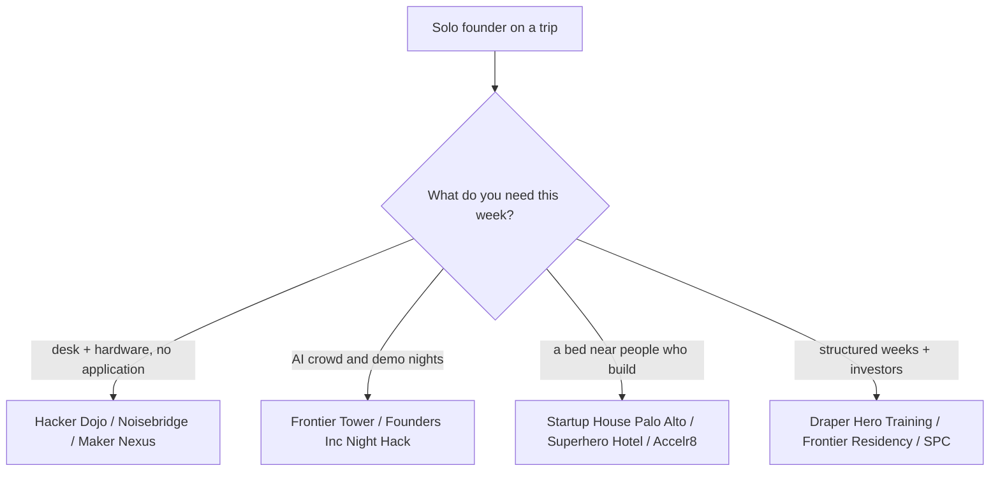

# Bay Area hackerspaces, hacker houses and founder communities (Oct 2026)

Written for a solo founder from abroad on a short US trip who builds AI agents, iOS apps, Rust tools and video AI. Everything below was checked against a live page or a dated news item on 28 Oct 2026. Prices change monthly; re-check before you pay.

## Short version

| Place | City | What | Access / price | Live there? |
|---|---|---|---|---|
| Hacker Dojo | Santa Clara (moved from Mountain View on 12 Oct 2026) | Oldest Valley hackerspace (2009), coworking + events | $150/mo, rising to $180 on 1 Nov; student $75; 24/7 | No |
| Noisebridge | SF, Mission (272 Capp St) | Anarchist hackerspace, labs, laser cutter, woodshop | Free to enter, donations ($160/mo suggested) | No |
| Sudo Room | Oakland (Omni Commons) | Free hackerspace, weekly Tuesday open house | Free, open membership | No |
| Ace Makerspace | Oakland | Full shop + 24/7 coworking | $200/mo; free monthly maker social | No |
| Maker Nexus | Sunnyvale | 28,000 sq ft woodworking, metal, 3D print, laser | $160/mo, 10:00-22:00 daily | No |
| Counter Culture Labs | Oakland | Volunteer biohacker lab | $100/mo, sliding scale | No |
| BioCurious | Santa Clara | Community molecular biology lab | monthly plan + $120 one-time setup | No |
| Frontier Tower | SF, 995 Market St | 16 floors: AI, crypto, bio, robotics; 3+ events/day | Citizen $190/mo or $1,800/yr, application, refund if rejected | Via Superhero Hotel / Frontier Residency |
| Founders, Inc. | SF, Fort Mason | 42,000 sq ft campus, $150K first checks, Night Hack | Night Hack: apply on Luma, free; campus = accepted founders | No |
| AGI House | Hillsborough (and SF) | Hackathons, talks, 15,000-person community | Invite/apply per event | **No residency** (they say so) |
| South Park Commons | SF, NYC, Bangalore | Founder club, $1M fellowship | Fellowship: apply twice a year; Member Residency: 6 months, no cost, no equity | No |
| Draper University + Hero City | San Mateo | 5-week Hero Training, dorm-style housing, coworking | Program is paid; Hero City coworking from ~$100/mo (old price list) | Yes, during a cohort |
| Startup House | Palo Alto, Menlo Park, SF | Co-living for founders | Apply on site; price on request | Yes |
| Accelr8 / Mission Control / 20mish | SF | Community hacker houses | $1,500-2,500/mo, interview | Yes (30 days to 12 months) |
| The Residency | SF, Berkeley | Cohort hacker houses, demo days | $1,800 shared / $3,000 private per month, 3-6 months | Yes |
| Edge City / Edge Esmeralda | Healdsburg (popup) | 4-week popup village | 2026 edition ended 27 Jun; Edge City Bhutan 11-19 Nov | Yes, during the event |

## Hackerspaces and makerspaces

**Hacker Dojo (Santa Clara).** Silicon Valley's longest-running hackerspace opened in 2009. On 12 Oct 2026 it left 855 Maude Ave, Mountain View, for 3200 Patrick Henry Dr, Suite 250, Santa Clara, double the floor area; the old building is scheduled for demolition. Membership is $150/mo (student $75, veteran $135) with 24/7 access, and goes to $180 on 1 Nov 2026. About 150 members now, down from ~400 before the pandemic. Hosts open hack nights, Meetup groups (an AI artists group meets 10 Nov) and a spring 2026 accelerator cohort. Good for a quiet desk and Valley meetups; it is not an AI-founder scene on its own. The mv-voice piece says larger private rooms and paid hackathons are planned. Note the old Mountain View address still appears on Yelp and LiquidSpace. Source: [Mountain View Voice](https://www.mv-voice.com/business/2026/10/12/hacker-dojo-leaves-mountain-view-for-larger-spot-in-santa-clara/), [pricing](https://hackerdojo.org/pricing/).

**Noisebridge (San Francisco, Mission).** 272 Capp St, 6,000 sq ft. No membership fee; anyone is "already a member". In Nov 2025 it said it had about three months of cash against ~$12,000/mo costs and a ~$6,000/mo deficit and might close or start charging. It is still running in 2026: Global Game Jam site in Jan, monthly open-mic nights, a fundraiser on 12 Jun. Best for electronics, laser cutter, woodshop and strange company, not for focused work or a founder crowd. Visit with a bit of cash for the donation jar. Sources: [Mission Local](https://missionlocal.org/2025/11/noisebridge-financial-crisis/), [Future Events](https://www.noisebridge.net/wiki/Future_Events).

**Sudo Room (Oakland).** Free hackerspace inside Omni Commons, North Oakland, with a weekly Tuesday open house and events through Sep 2026 (including an "AI Tea Salon"). Open membership, no dues. The East Bay Express covered it in July 2026. [Site](https://sudoroom.org/).

**Ace Makerspace (Oakland, 6050 Lowell St).** The best-equipped East Bay shop. Full membership $200/mo or $2,000/yr (two months free on annual), 24/7, financial assistance form exists. Free public maker social once a month. [Membership](https://www.acemakerspace.org/membership/).

**Maker Nexus (Sunnyvale).** Nonprofit, 28,000 sq ft: woodworking, metal, 3D printing, laser cutting. Full shop access $160/mo, 10:00-22:00 seven days. Closest real hardware shop to Palo Alto and Mountain View. [Join](https://www.makernexus.org/join-maker-nexus).

**Counter Culture Labs (Oakland) and BioCurious (Santa Clara).** Biology labs, relevant only if you drift into biotech. CCL is $100/mo with sliding scale and a safety training; BioCurious (3108 Patrick Henry Dr, next door to Hacker Dojo's new building) charges a monthly plan plus a $120 setup fee. Both run Meetup events open to the public. [CCL](https://www.counterculturelabs.org/join/), [BioCurious](https://biocurious.org/membership/).

## AI hacker houses and residencies

**Frontier Tower (SF, 995 Market St).** The most active building for your profile. 16 floors, 740-800+ "citizens", more than three events a day (hackathons, demo nights, dinners). Citizen membership $190/mo or $1,800/yr, by application, refunded if rejected. Floor 10 is Immersive Commons, a members-run applied-AI lab. Next door in spirit: Superhero Hotel (825 Sutter St, 10 minutes' walk), a 110-room founders' hotel bookable directly at about $2,400 for four weeks, with Frontier Tower access. The **Frontier Residency** is 8 weeks for 10 teams, housing at Superhero Hotel, 3% equity, demo day. Open houses run on Luma. [Site](https://frontiertower.io/), [residency](https://frontiertower.io/residency).

**Founders, Inc. (SF, Fort Mason).** 42,000 sq ft campus that writes $100-250K first checks (site headline: $150K). Its **Night Hack** is the open door: a five-hour, live-demos-only hackathon (50 teams at the first, 100 at the second), accepted via Luma, Anthropic credits as prizes ($5,000 and $3,000). One local guide calls it the highest-signal recurring event in SF; I could not confirm the schedule beyond the Luma page. Fits an AI-agent, video AI or hardware builder well. [Site](https://f.inc/), [Night Hack](https://luma.com/nighthack3).

**AGI House (Hillsborough, and an SF site).** Famous for hackathons (80+, claims credit for Lovable and Perplexity beginnings) and 15,000 subscribers. Read carefully: agihouse.org states there is **no residency** and the founder house-share ended in 2024; agihouse.ai (SF) calls itself a residency and hackathon house. These are two competing organisations that were in a trademark dispute in 2025. A New York Times investigation of 21 Sep 2026 reported harassment complaints and noise problems at several Bay Area AI group houses, including the Hillsborough one. Use it for events only, go with someone, do not move in. See [[aaron-levie-agi-house-2026]] for a talk recorded there on 8 Oct 2026. [agihouse.org](https://www.agihouse.org/), [NYT](https://www.nytimes.com/2026/09/21/technology/agi-house-ai-culture.html).

**Hacker houses you can book or interview for (SF).** From an Aug 2026 directory (verified by direct contact, per the author):

| House | Price | Stay | How in |
|---|---|---|---|
| Superhero Hotel | $2,400 / 4 wk | days to weeks | book online |
| Foundry (4 buildings) | from $2,290/mo | 1 month+ | book online, ~100 on waitlist |
| Accelr8 (1412 Market, Epik, Alamo Square) | $1,500-2,500/mo | 30+ days | apply, short interview |
| Mission Control | $1,500-1,700/mo | 1 year+ | apply, group interview |
| 20mish | $1,625+/mo | 12 months | apply or tour |
| The Residency (5 Bay Area houses) | $1,800-3,000/mo | 3-6 months | apply, interview |
| The Bridge (EF) | $0 | 8 weeks | Europe-based pre-team founders |
| Lightyear | $0 | 1 month | apply, interview |
| FoundHer | ~$1,000+/mo | 3 months | women only |

HF0 runs batches for repeat founders (next start 4 Jan per its site). The same directory says its "Hacker House & Space Map" is still to come. [Directory](https://www.eomag.io/article/hacker-houses-san-francisco).

**Palo Alto.** [Startup House](https://startuphouse.co/) runs three co-living houses: the AI House on Moreno Ave (Palo Alto), a Menlo Park "Robo House" on Middlefield, and an SF house on Bush St. 4.9 on Google Maps with 100+ reviews; it lists short stays, workshops and mentor sessions, but no public prices (ask). It is the nearest thing to what you already live in; the useful move is to ask for demo nights and open dinners rather than a second bed. I did not find a second Palo Alto AI house with current evidence.

**Vibe House SF.** A $4M West Portal house for exited, older founders ([SF Standard, 4 Oct 2026](https://sfstandard.com/2026/10/04/midlife-hacker-house/)). Not for a solo founder on a budget; its monthly demos are the only open part.

## Founder clubs and communities

**South Park Commons (SF, NYC, Bangalore).** Two doors. The Founder Fellowship (Fall 2026 deadline was 2 Aug; bootcamp late Sep to late Nov; $400K for 7% plus $600K guaranteed in the next round) is closed until the next call, likely early 2027. The **Member Residency** is six months, no cost, no equity, full office and programming access. For a visitor abroad the realistic step is to apply as a member and attend events. [Fellowship post](https://blog.southparkcommons.com/p/applications-open-spc-founder-fellowship).

**SHACK15 (SF, Ferry Building).** Social club for entrepreneurs, members-only, application; price not shown without applying. Good for investor-heavy evenings, weaker on building. The Bay Area World Cup committee named it its official social club in 2026. [Membership](https://www.shack15.com/membership).

**Edge City / Edge Esmeralda.** Annual popup village in Healdsburg (2026: 30 May-27 Jun, 850+ residents, an "agent village" experiment). Over now; the next listed event is Edge City Bhutan, 11-19 Nov 2026. Apply early for the 2027 Healdsburg edition. [Site](https://www.edgecity.live/).

**Stanford-adjacent and event feeds.** Stanford OpenLab and alumni groups run public talks and mixers (check their event pages); the 23-24 Oct hackathon is in [[stanford-cleantech-hackathon-2026]]. For a daily feed use Luma (Frontier Tower, Founders Inc, AGI House all publish there) and [Cerebral Valley](https://cerebralvalley.ai/events). More hackathon context: [[hackathons]].

## Programs you can live in

**Draper University and Hero City (San Mateo).** Hero Training is a five-week residential pre-accelerator at 44 E 3rd Ave: classes, housing, and coworking in Hero City downtown. Fall 2026 cohort ran 5 Oct-6 Nov; Spring 2027 is next, rolling applications, no application fee, tuition charged, optional investment of up to $100K through the DUV fund. Draper also hosts country cohorts (Korea, Central Asia) and a Cardano accelerator. Hero City coworking is open to outsiders: the membership page I found lists Sidekick $100/mo, Virtual Hero $250/mo, with day passes from about $14 on aggregators. That price list is undated; confirm in person. Draper is a school-like environment aimed at 18-28 year-olds; as a solo builder with shipped products you would get more from Frontier Tower or Founders Inc. [Slidebean summary](https://slidebean.com/startup-accelerator-program/draper-university-hero-training), [Hero City](http://www.herocity.com/membership-packages).

## What I could not verify

- Draper Hero Training tuition and room rate (site is script-rendered; only third-party pages).
- Hero City prices are undated; coworking day pass price comes from an aggregator.
- Startup House room prices; SHACK15 dues; Foundry waitlist time.
- BioCurious monthly rate (only the $120 setup fee came through).
- Founders Inc Night Hack: recurring or one-off weekly cadence.
- Noisebridge current finances after Feb 2026; it is open and hosting events, but no new update found.

## Related

- [[stanford-cleantech-hackathon-2026]]: a recent hackathon on this circuit, useful for how projects were judged.
- [[aaron-levie-agi-house-2026]]: what an AGI House talk night looks like.
- [[hackathons]]: the broader list of events and results.
