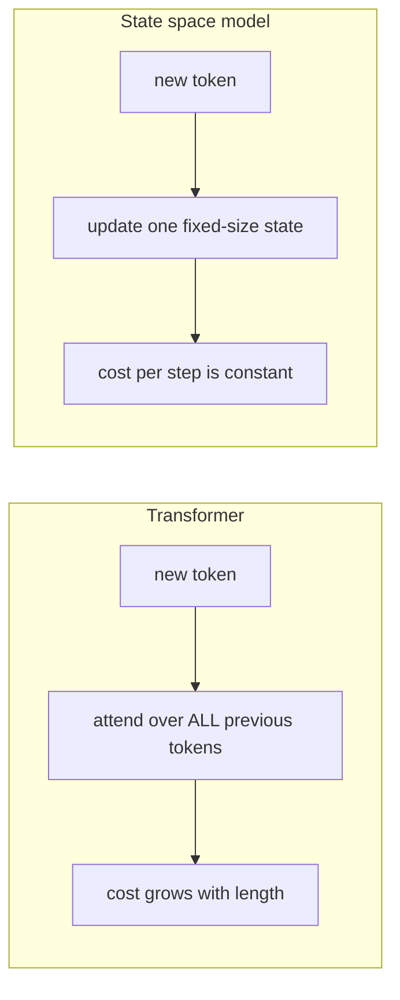
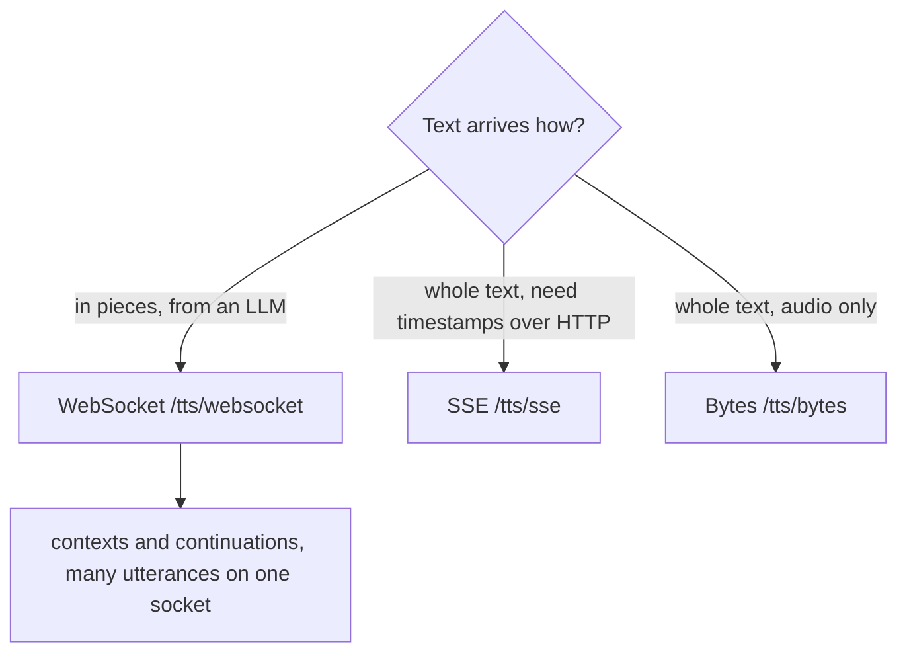
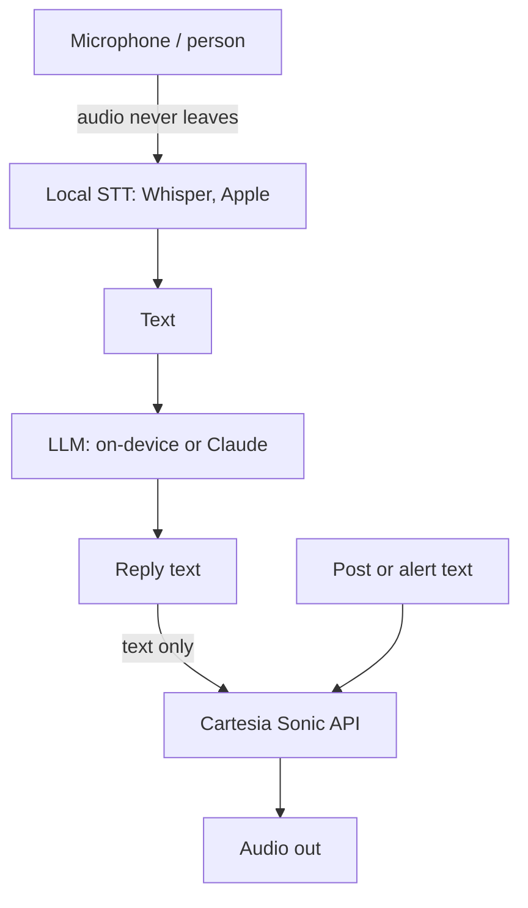

# Cartesia

Cartesia is a San Francisco company that sells speech models by API: text to speech
(Sonic), speech to text (Ink) and a hosted platform for phone and web voice agents. On
4 Nov 2026 SuperDuperAi was accepted into its Startups Grant Program: a year of the Scale
plan for free. This page covers what the company is, what the API does, how it compares,
and where the grant goes in my products. Vendor numbers are marked as their claims.

## Short version

- **What we got.** 12 months of Scale, 8M credits a month (the email says 88M characters a
  year, while the program page and 8M x 12 give 96M; I have not resolved the gap), plus $300 a
  month of agent credit. Scale concurrency, rollover up to 2x. The one condition: the
  Cartesia Startups logo on our website.
- **What it is worth in speech.** Their pricing page puts Scale at about 10,667 minutes of
  Sonic-3.6 audio a month, roughly 178 hours (vendor figure, ~750 credits per minute).
- **The catch for us.** Sonic speaks 44 languages including Russian and Turkish, but not
  Tatar or Bashkir. Ink-2, the transcriber, lists only English, French, Hindi, Japanese
  and Spanish. So Russian speech-to-text cannot go to Cartesia; speech out can.
- **First use (plan, nothing built yet).** Audio versions of rustman.org posts and the
  Telegram channel, then narration in Life2Film. Anything that hears a person stays on
  the device.

## Who is behind it

Founded in 2023 by Karan Goel (CEO), Albert Gu (chief scientist), Arjun Desai and Brandon
Yang, with Stanford professor Christopher Ré on the founding team (one source calls Ré only
an advisor; [TechCrunch](https://techcrunch.com/2024/12/12/cartesia-claims-its-ai-is-efficient-enough-to-run-pretty-much-anywhere/)
lists him with the founders). Goel and Gu met as Stanford PhD students. Gu wrote the S4
paper ([arXiv 2111.00396](https://arxiv.org/abs/2111.00396), with Goel and Ré) and, with
Princeton's Tri Dao, Mamba ([arXiv 2312.00752](https://arxiv.org/abs/2312.00752)).
Cartesia's pitch is that models of that family run faster and cheaper than transformers
at inference.

Money raised, as reported: $22M seed led by Index Ventures in Dec 2024 (TechCrunch, which
puts the total at $27M), a $64M Series A led by Kleiner Perkins in March 2025
([Fortune](https://www.fortune.com/2025/03/11/exclusive-cartesia-voice-ai-startup-raises-64-million-series-a/)),
and a $100M round with the Sonic-3 launch on 28 Oct 2025 (secondary sources only; I did
not find Cartesia's own announcement).

## Why an SSM, in plain words

A transformer re-reads everything it has produced so far for each new token. A state space
model (SSM) keeps one fixed-size summary and updates it as input arrives. For audio, which
is a long stream where the next sample depends mostly on the recent past, a fixed cost per
step is what makes "first sound in under 100 ms" plausible. TechCrunch's phrase for the
transformer side is rereading the whole book for every word.



This is the company's thesis, not something I measured. Whether the 44-language Sonic is
still a pure SSM is not stated in the docs I read.

## Products as of 5 Nov 2026

| Product | What it does | Their claim or detail | Source |
|---|---|---|---|
| Sonic-3.6 (TTS) | Text to speech, 44 languages, emotion without SSML | ~90 ms to first audio byte; ids `sonic-3.6`, dated snapshot `sonic-3.6-2026-08-27` | [docs](https://docs.cartesia.ai/build-with-cartesia/tts-models/latest.md) |
| Sonic Turbo | Faster variant, smaller input per request | 40 ms model latency at Sonic 2 (Mar 2025); secondary source only | [third-party summary](https://rywalker.com/research/cartesia) |
| Ink-2 (STT) | Streaming transcription with built-in turn detection (`turn.start`, `turn.eager_end`, `turn.end`) | en, fr, hi, ja, es; "lowest word error rate", no numbers published | [docs](https://docs.cartesia.ai/build-with-cartesia/stt/latest.md) |
| Voice cloning | Instant clone from ~10 s of audio into 40+ languages; Pro clone on Startup and up | Pro clone training is free, speech from it costs the usual credits | [docs](https://docs.cartesia.ai/build-with-cartesia/capability-guides/clone-voices.md) |
| Managed Agents | Hosted voice agent: Ink + your LLM + Sonic, tools, telephony, versions | $0.03/min call time, $0.014/min telephony, LLM billed separately | [docs](https://docs.cartesia.ai/agents/introduction.md), [pricing](https://cartesia.ai/pricing) |
| Line SDK | Python SDK for building voice agents in code ([repo](https://github.com/cartesia-ai/line), 105 stars) | The docs index now has a "migrate from the Line SDK" page, so the managed route is the current one | [docs](https://docs.cartesia.ai/agents/migrate-from-line-sdk.md) |
| On-device | `edge` library, "on-device intelligence" ([repo](https://github.com/cartesia-ai/edge), 426 stars); a Sonic On-Device beta was announced in 2024 | Docs index has no on-device page, so I treat it as not available to us | TechCrunch, GitHub |
| MCP server | `text_to_speech`, `speech_to_text`, voice clone/localize, pronunciation dictionaries, credit usage | Hosted at `mcp.cartesia.ai/mcp` | [docs](https://docs.cartesia.ai/tools/ai/mcp.md) |
| SDKs | [cartesia-python](https://github.com/cartesia-ai/cartesia-python), [cartesia-js](https://github.com/cartesia-ai/cartesia-js), both Apache-2.0; cookbook and agent skills repos | | GitHub |

For Claude Code the hosted MCP installs with one line:
`claude mcp add --transport http --scope user cartesia https://mcp.cartesia.ai/mcp`.

That route signs in through OAuth. The server also takes a plain API key as a Bearer token, which is what I use, because the browser sign-in fought with my automated Chrome. The key sits only in the macOS Keychain, and Claude Code asks a tiny script for the header on every connect (`headersHelper`), so the config file never holds it:

```sh
#!/bin/sh
# ~/.local/bin/cartesia-mcp-headers
k=$(security find-generic-password -s cartesia-api-key -w) || exit 1
printf '{"Authorization":"Bearer %s"}\n' "$k"
```

```sh
claude mcp add-json --scope user cartesia \
  '{"type":"http","url":"https://mcp.cartesia.ai/mcp","headersHelper":"~/.local/bin/cartesia-mcp-headers"}'
```

Measured here on 5 Nov 2026: the account lists 9 Russian voices; a 5.8-second Russian sentence from `sonic-3` over plain `/tts/bytes` came back with the first byte at 0.86 s and the whole file at 1.5 s. That is not the WebSocket latency they advertise, just what a one-shot HTTP call costs from a laptop.

## Three ways to call TTS



Per the [endpoint comparison](https://docs.cartesia.ai/use-the-api/compare-tts-endpoints.md),
every new HTTPS request pays TCP and TLS setup again, which the docs call often comparable
to the audio's own time to first byte. A WebSocket pays it once. Batch jobs (cached files,
notifications) use Bytes.

## Prices and competitors

Cartesia (pricing page, 5 Nov 2026): 1 credit per TTS character; STT 3 credits per second.

| Plan | $/month | Credits | TTS minutes (their est.) | Concurrent TTS | Overage per 1M |
|---|---|---|---|---|---|
| Free | 0 | 20K | ~27 | 2 | none |
| Pro | 5 | 100K | ~133 | 3 | $65 |
| Startup | 49 | 1.25M | ~1,667 | 5 | $45 |
| Scale | 299 | 8M | ~10,667 | 15 | $38 |

| | Cartesia (Scale) | ElevenLabs | Deepgram |
|---|---|---|---|
| TTS per 1K characters | ~$0.037 ($299 / 8M) | $0.04 Flash/Turbo (32 langs), $0.08 v3 (70+ langs) | $0.03 Aura-2 |
| STT per hour | $0.39 (Ink-2) | $0.22 Scribe v2, $0.39 Scribe v2 Realtime (90+ langs) | about $0.46 (Nova-3 multilingual streaming, $0.0092/min) |
| Agent per minute | $0.03 + LLM + telephony | not read | $0.050 to $0.163 all-in, depending on tier |
| Russian TTS | yes | yes | not verified |

Sources: [Cartesia](https://cartesia.ai/pricing), [ElevenLabs](https://elevenlabs.io/pricing/api),
[Deepgram](https://deepgram.com/pricing). I did not get OpenAI's realtime prices (its pricing
page did not render), so I do not compare it. Honest read: on list price the three are within
a factor of two of each other for speech out. Cartesia's case is latency and agent
plumbing; ElevenLabs wins on language count and on STT price and coverage. For our grant the
price is zero, so language coverage decides.

## Glossary

- **SSM (state space model).** A sequence model that carries a fixed-size state instead of
  attending to all history. S4 and Mamba are the best-known ones.
- **TTS / STT.** Text to speech / speech to text.
- **Time to first audio (TTFA, TTFB).** Delay from the request until the first audio byte
  arrives. "Model latency" excludes the network; end-to-end includes it. Cartesia quotes
  90 ms model and 190 ms end-to-end for Sonic-3 (secondary sources).
- **WebSocket streaming.** One open connection where text goes in and audio chunks come back
  as they are made, so speech starts before the sentence is finished.
- **Continuation.** Sending text to the same `context_id` in pieces so intonation carries
  across chunks.
- **Turn detection.** Deciding that a person has stopped talking, built into Ink-2 so no
  separate voice-activity detector is needed.
- **Instant / Pro voice clone.** A voice copied from seconds of audio / from a longer set,
  trained once and reused.
- **Localization.** Giving one voice an accent in another language (225 credits per accent).

## Where the grant fits my products

Nothing below is built. It is a plan from the wiki and the repos.

| Product | Voice need | Route | Why |
|---|---|---|---|
| rustman.org posts, @deeplearning_ru | Audio version of a post | Cartesia Sonic, Bytes endpoint, one script via the MCP | Pilot: no users at risk, tests Russian and English quality |
| [[project-superduperai]] Life2Film | Narration over a montage, maybe a cloned voice | Cartesia Sonic, Bytes | The only product where speech out is a feature users would pay for |
| VoiceJournal ([[project-superduperai]], [[apple-on-device-ai]]) | Transcribe a diary, maybe read answers back | STT on device; TTS optional, Apple's voices first | A diary is the most private audio I handle |
| [[project-supervox]] and voxkit | Live call and room transcripts | Local Whisper stays; Ink-2 does not cover Russian anyway | Privacy and coverage |
| Alliance and the Gnome box | Spoken alerts from cron jobs | Sonic over WebSocket, text only leaves the box | Text of an alert, not a person's voice |
| Robots, after [[cal-hacks-13-2026]] | Spoken confirmation | Sonic with prefetch of likely phrases | BrainSync, Fermata and others at Cal Hacks paired Claude with Cartesia |
| Bashkir material ([[genealogy-with-ai-agents]], KubizBeat) | Reading Bashkir text aloud | Not covered | Neither Bashkir nor Tatar is in Sonic's 44 languages |



The routing rule: audio of people stays local; only text I have already decided to speak goes
to Cartesia. That keeps the stance (privacy-first, offline-first) and uses the grant where
it is strongest, speech out. Cartesia says by default it uses customer data to improve its
products unless you opt out (TechCrunch, 2024, not rechecked); check that setting before
sending anything personal.

### Rough monthly budget (estimate)

| Use | Assumption | Characters per month |
|---|---|---|
| Audio posts | 20 posts x 8,000 | 160K |
| Telegram channel | 60 items x 1,000 | 60K |
| Life2Film narration, pilot | 500 films x 600 | 300K |
| Alert voices, tests, retries | | 100K |
| Total | | about 620K, under 8% of 8M |

The quota is not the constraint. The constraint is that it is a free year: on month 13 the
plan is $299 a month, or a downgrade to Startup ($49, 1.25M), which would still cover this
budget twice.

## Terms and to-do

- The grant is credits on a Scale subscription activated through Stripe with a coupon (not
  recorded here). Cartesia may use our name and logo, and may ask for a social post; they
  offer a grant-recipient card with #BuildingWithCartesia.
- Done 5 Nov 2026: the Cartesia Startups logo is in the footer of superduperai.co, all six
  languages, under "Supported by". That was the stated condition. Also set the overage switch off so nothing bills by accident.
- The fireside I attended (~28 Oct 2026, San Francisco) left no notes in the wiki beyond the date.

See also [[llm-providers-credits]], [[tools-and-infrastructure]], [[agent-landscape]].
