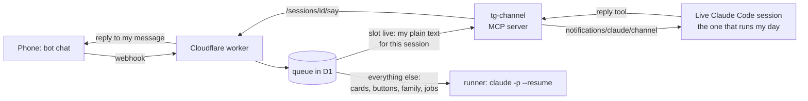
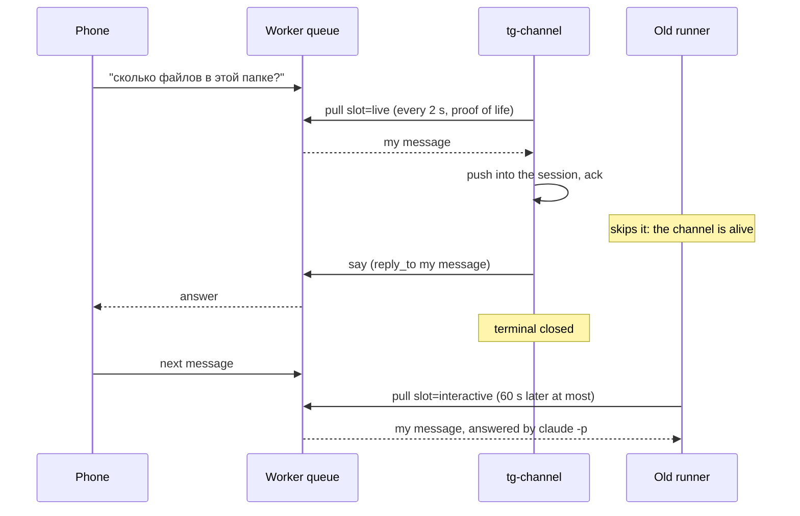
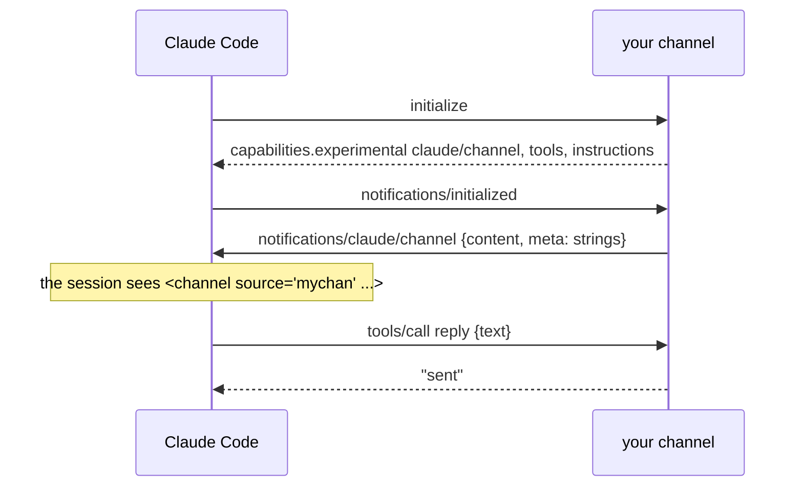

# Claude Code channels: my Telegram bot, a voice, and your own product pushed into a live session

## The short version

A **channel** lets something outside push a message into a Claude Code session that is already
open, and lets the session answer back the same way. I use two of them now. One is my
**Telegram bot**: I type in the bot chat on my phone and the message lands in the long-running
session that runs my day, with all its context, and its answer comes back as a reply. The other
is a **voice**: I talk, a local process hears when I have finished, and the session answers out
loud ([[local-voice-agent-mac]]).

| You have | Do this |
|---|---|
| Nothing yet, want Telegram | The official plugin: a new bot from BotFather, five steps, below |
| A bot that already has a backend (webhook, queue) | Your own channel that takes messages from that backend. Telegram gives a bot's updates to one consumer only |
| Your own product (a queue, CI, a call recorder) | A channel is ~40 lines of Python, skeleton below |
| A session that is already open | Channels load only at start: `/exit`, then start again with `--resume <id>` or `-c` |

Two bugs on day one, both cheap to avoid: **every `meta` value must be a string** (a number made
Claude Code drop the connection, and my process went on taking messages from the queue, so two
were lost), and **stdout belongs to the protocol** (one stray `print` from a library corrupts it).

## What a channel is

An ordinary MCP server waits until the agent calls one of its tools. A channel is an MCP server
that also talks first: it sends `notifications/claude/channel` with `{content, meta}`, and the
session sees `<channel source="telegram" message_id="…">text</channel>` as a new message. The
agent answers by calling a tool of the same server (`reply`, `say`). In the terminal you see the
inbound line and the tool call; the reply text itself appears on the other side.

How it differs from the neighbours:

| | Who starts it | Where it runs | Good for |
|---|---|---|---|
| MCP server | the agent asks | your session | reading a system on demand |
| `claude -p` runner (my bot until now) | a queue | a fresh headless run per message, `--resume` for history | jobs without a terminal |
| Remote Control | you, from the Claude app | your session | steering it from the phone |
| **Channel** | **the outside world** | **your session, live** | chat bridges, webhooks, voice, alerts |

The limits during the research preview (Claude Code 2.1.80+, 2.1.327 here): events arrive only
while the session is open, only in interactive mode (`-p` ignores channels), and only from servers
named at start. `--channels plugin:<name>@<marketplace>` takes plugins from an Anthropic-maintained
allowlist; anything else goes through `--dangerously-load-development-channels server:<name>`,
which shows a confirmation screen on every start. Neither flag appears in `claude --help`. On Pro,
Max and Ultra without an organization they just work; Team and Enterprise need an Owner to switch
them on.

## Telegram, the official way

From the [docs](https://code.claude.com/docs/en/channels). The plugin is a Bun script, so install
[Bun](https://bun.sh) first.

1. In Telegram, [BotFather](https://t.me/BotFather) → `/newbot`, copy the token.
2. In Claude Code: `/plugin install telegram@claude-plugins-official` (user scope).
3. `/telegram:configure <token>` (stored in `~/.claude/channels/telegram/.env`).
4. Restart: `claude --channels plugin:telegram@claude-plugins-official`.
5. Message your bot, it answers with a pairing code; `/telegram:access pair <code>`, then
   `/telegram:access policy allowlist` so only you can write to it.

Only allowlisted senders reach the session, and that matters more than it looks: with permission
relay on, **whoever can write to the bot can approve tool calls in your session**.

## My own bot: when Telegram already has a consumer

My control bot is not a fresh bot. Telegram calls a Cloudflare worker by webhook, the worker turns
every message into a row in a queue, and a runner on the Mac leases rows and answers each with a
headless `claude -p --resume`. Cards, buttons, family members and scheduled jobs all go through that
queue. The official plugin polls Telegram with `getUpdates`, which Telegram refuses while a webhook
is set (409), and a second bot would split the chat in two. So the channel reads from my queue
instead of from Telegram:



What changed in the worker, and why each rule is there:

- **A new `live` slot in the queue.** It leases only my own plain text addressed to that one
  session. Card buttons and replies to cards carry an item id and keep going to the restricted
  read-and-draft workflow they always had; a live channel must not widen what a card can do.
- **The old runner skips that text while the channel is alive**, so the two never race for a
  message. Liveness is a timestamp the channel refreshes on every poll (written at most every 20
  seconds, because the database bills rows written, and it polls every 2).
- **Sixty seconds without a poll and the runner takes the messages back.** If the terminal dies,
  nothing is lost: the next message is answered the old way, a minute late at worst. A clean exit
  detaches at once.
- **Permission relay.** When the session hits a tool approval, Claude Code sends the channel a
  `permission_request`; the bot shows it to me with a five-letter code, and my `yes abcde` goes back
  as `notifications/claude/channel/permission`. Whichever answers first, terminal or phone, wins.
- **One launcher**: `live-session --resume <session id>` writes the MCP config and runs
  `claude --mcp-config … --dangerously-load-development-channels server:telegram`, so reattaching
  my day's session to the phone is one command.



## A channel for your own product, in 40 lines

No SDK needed: JSON-RPC lines on stdin and stdout. Replace `events()` with your source (a queue, a
webhook relay, a log, a sensor) and `reply` with whatever sends the answer back.

```python
#!/usr/bin/env python3
"""mychan: the smallest Claude Code channel."""
import json, sys, threading, time

lock, opened = threading.Lock(), threading.Event()

def send(msg: dict) -> None:
    with lock:
        sys.stdout.write(json.dumps(msg, ensure_ascii=False) + "\n")
        sys.stdout.flush()

def push(text: str, **meta) -> None:
    # meta values must be strings: a number makes Claude Code drop the connection
    send({"jsonrpc": "2.0", "method": "notifications/claude/channel",
          "params": {"content": text, "meta": {k: str(v) for k, v in meta.items()}}})

def events() -> None:  # your product goes here
    opened.wait()      # nothing may be pushed before notifications/initialized
    n = 0
    while True:
        time.sleep(300)
        n += 1
        push(f"heartbeat {n}", kind="tick")

TOOLS = [{"name": "reply", "description": "Send text back to the product",
          "inputSchema": {"type": "object", "properties": {"text": {"type": "string"}},
                          "required": ["text"]}}]

threading.Thread(target=events, daemon=True).start()
for line in sys.stdin:
    msg = json.loads(line)
    mid, method = msg.get("id"), msg.get("method")
    if method == "initialize":
        send({"jsonrpc": "2.0", "id": mid, "result": {
            "protocolVersion": msg["params"]["protocolVersion"],
            "capabilities": {"experimental": {"claude/channel": {}}, "tools": {}},
            "serverInfo": {"name": "mychan", "version": "0.1.0"},
            "instructions": "Events from mychan arrive as <channel source=\"mychan\">. Answer with reply."}})
    elif method == "notifications/initialized":
        opened.set()
    elif method == "tools/list":
        send({"jsonrpc": "2.0", "id": mid, "result": {"tools": TOOLS}})
    elif method == "tools/call":
        text = msg["params"]["arguments"]["text"]  # hand it to your product here
        send({"jsonrpc": "2.0", "id": mid, "result": {"content": [{"type": "text", "text": "sent"}]}})
    elif method == "ping":
        send({"jsonrpc": "2.0", "id": mid, "result": {}})
    elif mid is not None:
        send({"jsonrpc": "2.0", "id": mid, "error": {"code": -32601, "message": method}})
```

Run it:

```bash
echo '{"mcpServers": {"mychan": {"command": "python3", "args": ["/abs/path/mychan.py"]}}}' > mychan.json
claude --mcp-config mychan.json --dangerously-load-development-channels server:mychan
```

The `instructions` string reaches the session as the server's MCP instructions: that is where the
channel tells the agent who is on the other side and how to answer (short, in which language, what
goes on screen). Being listed in `.mcp.json` is not enough to push; the server must be named in the
start flag.



## What broke, and the rule each bug left

- **Numbers in `meta` dropped the connection, and the messages with it.** My first Telegram bridge
  sent `message_id` and the event id as integers. Claude Code logged `Invalid params for
  notification notifications/claude/channel: meta.message_id: expected string, received number`
  and dropped the stdio connection. The process itself did not notice: it kept polling the queue,
  delivering into a pipe nobody read, and acking each message as done. Two messages were gone
  before I looked at the MCP log. Rule: stringify every meta value, and look at
  `~/Library/Caches/claude-cli-nodejs/<project>/mcp-logs-<server>/` on the first run. Still open:
  a channel cannot tell when the client stops reading, so "no answer for a minute" means `/mcp` →
  Reconnect.
- **stdout is the wire.** The voice channel imports ML libraries that print to stdout from native
  code. The fix is to duplicate fd 1 for the protocol and point fd 1 at stderr before importing
  anything; a Python-level `sys.stdout` swap does not catch native prints.
- **A channel cannot be added to a session that is already open.** For voice I added an attach
  mode: the same process runs as a local HTTP service, and the session listens to it through the
  Monitor tool, re-armed every 30 minutes, with turns queued in the process so a re-arm loses
  nothing. Telegram does not need it: `/exit` and `live-session --resume <id>` take ten seconds.
- **Plain messages are not tool approvals.** Text that looks like `yes abcde` is a verdict and is
  never shown to the model as chat; everything else is never a verdict.

## Voice, and SuperVox as the next channel

The voice channel is the same pattern with a microphone as the product: Silero VAD, a smart-turn
model that decides when I have finished, GigaAM or Parakeet for speech to text, and a cloned
VoxCPM2 voice for the answer. From the end of my sentence to the message in the session: 0.50 to
0.54 seconds. The whole build and its numbers: [[local-voice-agent-mac]].

[[project-supervox]] is my live room listener: subtitles, a rolling summary, a recording. Today an
agent follows a meeting through a Monitor on SuperVox's live stream (the first version of the
voice loop worked that way too, `talk/scripts/turns.py`), and a Monitor expires every 30 minutes.
As a channel, SuperVox would push each finished stretch of the meeting into the session on its
own, and a `panel` tool would write the evolving summary back onto its screen: no Monitor, no
re-arming.

## Glossary

| Term | Meaning |
|---|---|
| Channel | An MCP server that pushes events into an open Claude Code session and takes replies through its tools |
| MCP | Model Context Protocol: JSON-RPC between the agent and a tool server, here over stdin/stdout |
| Webhook | Telegram calls your URL with each update; while one is set, polling with `getUpdates` is refused |
| Permission relay | The channel forwards a tool-approval prompt to the remote side and returns allow or deny |
| Proof of life | A timestamp the channel refreshes on every poll; when it goes stale the old runner takes over |
| `claude -p` | Headless Claude Code: one prompt, one answer, no terminal; channels do not work there |

## Related

- [[local-voice-agent-mac]]: the voice channel, local TTS with voice cloning, and the numbers
- [[agent-harness-and-always-on-gnome]]: the scheduled jobs and the box the bot's runner lives on
- [[project-supervox]]: the room listener that becomes the next channel
- [[claude-code-anatomy]]: the agent loop the channel events enter
