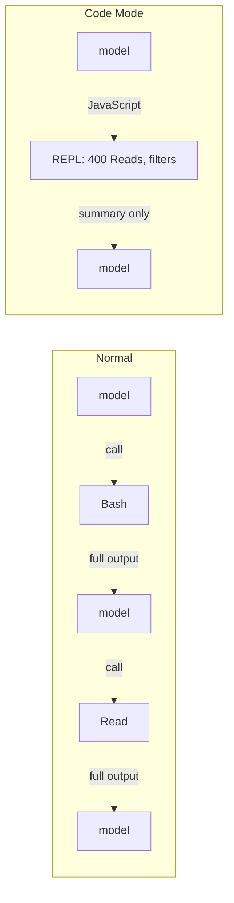

**Definition.** Without Code Mode the model asks for one tool call (Bash, Read, Edit), reads the
result, and asks for the next. Each step is a new model request that carries the whole context
again. In Code Mode the model writes a piece of JavaScript that makes the calls itself: in
parallel, feeding one result into the next, filtering output before anything comes back. Only
what the code returns reaches the context. Experimental, off by default, Claude Code v2.1.323+.

## Turning it on

`CLAUDE_CODE_EXPERIMENTAL_CODE_MODE=1 claude`, then answer "Yes, turn on Code Mode" once. Only an
interactive terminal session on the native build: not `-p`, not the Agent SDK, not cloud sessions.
A project's settings cannot turn it on (Claude Code ignores the variable there).

What it switches off: Remote Control, Claude in Chrome, computer use. A Code Mode session can be
resumed only with Code Mode on. One piece of code runs at most ten minutes unless sent to the
background. In auto mode the safety classifier reads the code once, before it runs, so it cannot
see values the code computes on the way.

## Measured (19 Nov 2026, one run each)

Task: "read every Markdown file in wiki/ and list local links whose target does not exist, write
the list to a file, then run one guarded command". 207 files, 1,080 markdown links, 1,792
wikilinks. Opus 5.5 at xhigh effort, Claude Code 2.1.328, both sessions started together.

| | Normal | Code Mode |
|---|---|---|
| Answer | 3 broken links | the same 3 |
| Model calls | 6 | 3 |
| Tool calls | 5 Bash, 1 Write | 2 REPL running 414 Read, 6 Bash, 2 Write |
| Largest context sent | 91,177 tokens | 71,844 tokens |
| Cache reads, summed | 436,115 | 132,594 |
| Output | 4,665 | 5,996 |
| Weighted units (cache read ×0.1, cache write ×1.25, output ×5) | 180,920 | 133,050 (−26%) |
| Wall time | 53 s | 129 s |

The saving came from the context: 414 file reads stayed inside the JavaScript and only the list
came back. The time went the other way because the code read the files one Read call at a time,
while the normal session wrote a Python script and read them all in one Bash call. An agent that
already reaches for a script gets little from Code Mode; one that would otherwise Read file after
file gets the most.

## Hooks keep working

Each call the code makes goes through `deny`/`ask` rules and `PreToolUse` hooks under its usual
name. In both runs the irreversible-command guard blocked `rm -rf <a directory that does not
exist>` (bypass mode, so a deny with a reason). A shell call may arrive compound, as
`cd 'app' && git push`: a guard has to check every segment. Ours splits on `;` `&&` `||` `|`, and
the shape is in its tests. A hook that matches `REPL` sees the JavaScript itself.

## Rule

- Opt-in per shell for a task with many similar calls: an edit repeated across many files, a
  search whose hits need filtering before reading, a batch of independent commands.
- Not in `~/.claude/settings.json`: Remote Control and the browser are in daily use.
- Skip it when the job is one script, and when the session must be resumable from the phone.

## Exceptions and limits

One run of one task. The weights are a rough stand-in for prices, not a bill. The feature may
change in any release; these numbers belong to 2.1.328.

Related: [[claude-code-anatomy]], [[context-engineering]], [[tool-calling-four-layers]].
