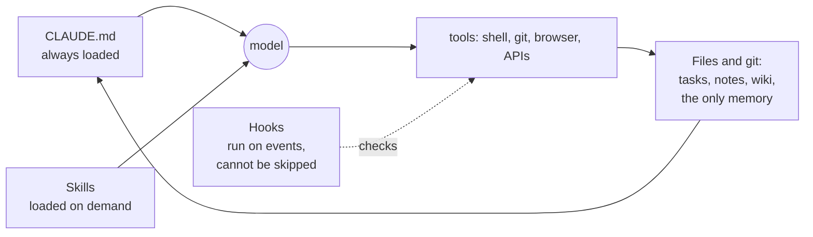

# Claude Code from zero

This is the page I send to people who have not worked with a coding agent yet. It grew out of live demos: the questions people ask in the first hour shaped every section, and the answers are the ones that landed. It is the first lesson of module 4 in the [course](/course/), and the rest of the module goes deeper on each part.

## Short version

| Question | Answer |
|---|---|
| Why does the same model work so differently for different people? | The model is the same; the **harness** around it (CLAUDE.md, skills, hooks, checks, memory in files) makes the difference |
| What do I do first? | `cd` into one project, run `claude`, type `/init`, then turn one task you repeat weekly into a skill |
| CLAUDE.md or skill? | Needed in 9 conversations out of 10: CLAUDE.md. Once a week: a skill |
| Hardest part? | Not getting the agent to do it, but understanding what it did |
| Biggest safety rule? | The agent never sees keys, never writes to production, and a human approves money, deletes and sends |



## The first half hour

1. Install Claude Code. Always start it from the project folder: `cd ~/projects/my-app`, then `claude`. The agent works inside that folder and reads its CLAUDE.md. Use a personal account for personal projects and the work account for work; an organisation admin can switch off features such as Remote Control or connectors.
2. Write `~/.claude/CLAUDE.md`: language, style, hard rules. In a project without one, type `/init` and the agent drafts it for you.
3. Turn one task you repeat into a skill (below).
4. For anything non-trivial, press **Shift+Tab** into plan mode first: the agent explores (it launches subagents for that), writes a checklist plan and changes nothing until you approve it.

## The terminal in five commands

| Command | What it does |
|---|---|
| `pwd` | where am I |
| `ls` | what is in this folder |
| `cd name` / `cd ..` | go into a folder / one level up |
| `claude` | start the agent here |
| ↑ | repeat the previous command |

Leave with `/exit`. Continue the last conversation in this folder with `claude --continue`, pick an older one with `claude --resume`. You cannot change folders inside a running session: exit and start `claude` in the other one. Same folder, clean slate: `/clear`. What fills the context window: `/context`. How much of the plan you used: `/usage`. Update when asked: `claude update`. macOS dictation (press Fn twice) works in the terminal, and typos do not bother the agent.

Why the terminal and not the desktop app: you always see which folder and whose context the agent has, one tab is one task, and hooks, plugins and custom commands are fuller there.

## CLAUDE.md and skills

- **CLAUDE.md** is what the agent needs *always*: who you are, what the project is, hard rules ("talk to me in Russian, write code and docs in English", "never touch raw-data/"). It is read in every conversation, so keep it short, within ~500 lines.
- **A skill** is what it needs *sometimes*: a procedure for one kind of task, loaded only when that task comes up, so it can be detailed.
- The files stack: `~/.claude/CLAUDE.md` for every project, one at the repository root, more in subfolders. `/memory` shows what is loaded right now. In a team, CLAUDE.md is code: it lives in git and gets reviewed.

A skill is a **folder**, not a file: `SKILL.md` with the instructions, plus scripts, templates and references the agent opens only when needed. Personal skills live in `~/.claude/skills/`, project ones in `.claude/skills/`. The agent picks a skill by its `description` field, so if it does not fire, put the phrases you actually say into the description, or call it as `/skill-name`. Make one the third time you walk through the same ~15 steps. The chat on claude.ai does not see skills on your disk; there you upload a zip under Settings → Capabilities.

## Reports: one analyst skill, one folder per client

```
.claude/skills/client-report/
  SKILL.md              # sources, metrics, format, checks
  queries/              # SQL against a read-only user
  clients/
    acme/config.yaml    # metrics, filters, recipients
    acme/template.md    # what this client's report looks like
```

After that one sentence is enough: "acme report for October". A weekly report goes on a schedule: `/schedule` in Claude Code runs a cloud agent, or system cron/launchd runs `claude -p "acme weekly report"`. Keep the skills in a git repository the team shares: a colleague can pick up your work when you are away, everyone's reports look the same, and your contribution is visible every day. A skill also needs upkeep: when the schema changes and the skill does not, it starts lying.

## Data: the database plus the logs

- The typical task: take data from the database and from the logs, match them, and build a third set that exists in neither. "Take a week of events from the logs, join them to orders in the database on user_id, compute conversion per channel." Days of manual queries before, about an hour with an agent.
- Every manager wants a different cut. Now they describe it in words and the agent builds the export or dashboard.
- If nothing records the event, nobody can compute the metric, the agent included. Fix event collection first, automate second.
- **Production is read-only for the agent.** A read-only user, better a replica, and its queries logged. An agent with write access to production can drop a table in one bad query.
- Count who uses the product today, not who once signed up.

## Ads and sales

- Through the Google Ads and Meta APIs the agent can read campaigns and metrics, find where leads drop off, and propose bids and ad copy. Start read-only; every cent of spend is approved by a human.
- Sales calls: the agent transcribes recordings, pulls out objections and what worked, and prepares hints for the next call. Transcribe customer calls locally, and record only with consent and within company policy.

## Sensitive data

- Interviews and focus groups: transcribe on the laptop (Whisper, speaker labels), so audio and text never leave it. For sensitive material make the summary locally too (a model through Ollama), not with a cloud model.
- If your company runs Databricks, Claude models are available inside the platform, so the data does not have to leave it.
- A personal literature base: a markdown wiki in [Karpathy's LLM-wiki](https://gist.github.com/karpathy/442a6bf555914893e9891c11519de94f) style, where sources go in raw and the agent compiles them into linked pages. Any agent searches it before the web.

## How not to drown

The real difficulty is not getting the agent to do things, it is understanding what it did. You hit the edge of your own knowledge fast and get tired just as fast.

- **Start from what you know**: "I'm an analyst, I know SQL and spreadsheets, explain this through that." The agent builds a bridge instead of dumping everything.
- If the explanation is also unclear, ask one level lower ("as for a school student", "on one example from my field", "draw a diagram") instead of rereading.
- Ask for a **decision log** in a file (what it did, what it chose, why) and a five-line summary at the end.
- **The first answer is a draft.** Ask it to find mistakes in its own work, then give it to a second agent with a clean context.
- **The agent misnames things with confidence.** In one pipeline it called a block "a regression" when it was a different statistical method. Only your expertise catches that, so ask it to show the line of code it relies on.
- It pays off: a pipeline of five unfamiliar scripts takes a few hours to understand instead of days.
- A weak model loops at a barrier. If the agent does the same thing a fifth time, switch to a stronger one.
- Experience still decides: a senior with an agent is several times faster, a junior collects mistakes several times faster.

## In a team

- Slack or Teams does not matter: everything lands in one inbox, the agent checks it every 5–10 minutes, takes a clear task, and drafts the reply. You review and correct.
- **Visibility is the metric.** A task quietly solved in a DM does not exist for management. Post a short update in the team channel and send a monthly "what got done" report, which the agent builds from git, past sessions and messages.
- Bring management a decision, not a question: two options, your recommendation, the cost of each.
- Many colleagues work without agents, and a demo can sound like "you will not be needed". Show it on *their* task, as help, without competing. Skepticism yields only to results.
- Adoption in a company rests on one internal champion who understands agents and wires them in everywhere. There are few such people.

## Code

- You barely need an editor: the agent writes, commits, opens and reviews pull requests with `gh` (GitHub CLI). You look at the result and the doubtful parts.
- **The line:** the agent prepares the PR; pushing to a shared branch and merging happen only with your yes. A bad merge in shared code is your reputation.
- After every feature: code, then `/simplify`, then `/code-review`. Like washing your hands.

## Safety

- **Keys never enter the agent's context**: no `.env`, no password manager, no configs with tokens. Whatever it saw can end up in a log, a commit or a reply. Keep secrets in Keychain or the 1Password CLI so a script injects them and the agent sees only the name; a hook can also mask key-like strings in command output.
- `claude --dangerously-skip-permissions` (it asks about nothing) only in a sandbox or on a separate machine, with a hook that blocks irreversible commands. To begin with, Shift+Tab's accept-edits mode is enough: it edits files freely and still asks before running commands. Experiment on a clone of the repository. More: [[agent-sandboxing]].
- **Do not install extensions and skills blind.** On 29 Oct 2026 a trojaned build of the Claude Code extension sat in Cursor's marketplace for about 11 hours. Asking Claude to write your own skill from a repository you trust is safer.
- **Prompt injection**: the agent can follow an instruction hidden in a web page or an email. Payments, deletes and sends stay with a human.
- **Own your files, not the account.** Accounts get banned (several accounts on one service is enough), and the chat history on the site goes with them. Everything that matters lives in your files and git.
- The bar for attacks has dropped: with agents, almost anyone can find a hole. Audit your own code with agents before someone else does: give it the context, the repository, and the question "where can this be attacked from", then verify every finding by hand.

## Glossary

- **Harness**: everything around the model: rules, skills, hooks, checks, memory. Literally horse tack: the model is a strong horse, the tack decides where it goes. My own is described in [[agent-harness-and-always-on-gnome]].
- **Hooks**: scripts Claude Code runs on events (before a command, after an edit, at the end of a turn, at session start). The agent cannot skip them, so they make a mistake impossible rather than merely forbidden. `/hooks` or `settings.json`.
- **Three stages**: prompt engineering ("magic spells" passed around), then [[context-engineering]] (what goes into the agent's head), then harness and loop engineering (the loops it works in on its own and checks itself). The work now is at the third.
- **Subagents**: one chat launches helpers, each with a clean context, and gets back only their conclusions.
- **Vibe coding** (Karpathy's term): accepting whatever seems to work. Fine for a prototype, not for science or production. **Agentic engineering**: directing agents and answering for the result.
- **Cron / launchd**: the schedule that lets an agent work with no window open: `claude -p "task"` every hour.
- **Computer use**: the agent works from screenshots and clicks itself. Slower and costlier than an API, so only when nothing else reaches.

## Links

- Skills I use, open source: [solo-factory](https://github.com/fortunto2/solo-factory)
- Anthropic's official skills, including skill-creator: [anthropics/skills](https://github.com/anthropics/skills)
- What the harness is for, at length: [[harness-engineering-summary]]
