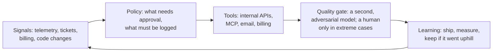
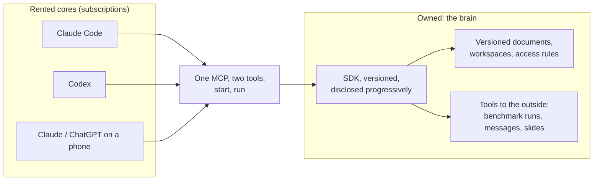
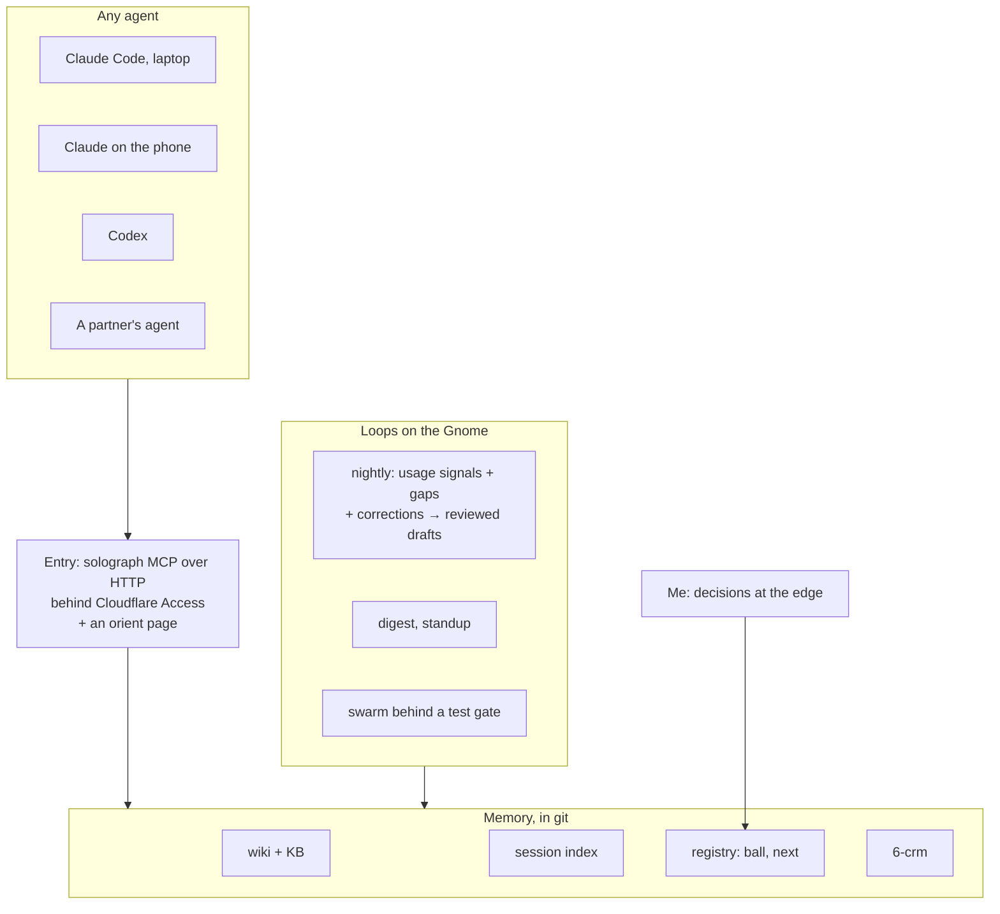

# Company Brain: one memory any agent can plug into

## The short version

"Company brain" became a buzzword in autumn 2026, to the point of T-shirts at YC events. Under the
buzz are two concrete ideas. First, the company's knowledge lives in one shared, readable layer
instead of in people's heads and the reporting lines between them. Second, agents work on that
layer in loops that improve the company while everyone sleeps, and humans move to the edge, where
the work touches the real world.

Two sources make it concrete. A YC partner's talk, *Building And Structuring An AI Native Company*,
describes the organisation. Rinat Abdullin (the author of [[schema-guided-reasoning]]) built one,
opened it to his Telegram community's agents, and broke it within three days. The lessons from that
break are the most useful part, and they map almost one to one onto pieces I already run.

| Who | What they say a company brain is | The part worth stealing |
|---|---|---|
| YC talk | legible company data + self-improving AI loops that talk to each other; humans at the edge | an overnight agent that reads yesterday's failures and files fixes |
| Rinat / BitGN Brain | a versioned document store any agent connects to through one MCP with two tools | rent the agent, own the memory; code mode instead of a tool zoo |
| My setup | wiki + session index + task registry + always-on box, reached by one local MCP | already 70% there; missing a remote entry, a write path and the overnight loop |

## Glossary

| Term | Meaning here |
|---|---|
| Company brain | the shared memory + tools layer that people and agents read and write; not a model |
| Progressive disclosure | the agent starts with a one-screen map and opens detail only when a task needs it |
| Code mode | instead of N tools, the agent gets an SDK description and writes a short script that runs next to the data |
| Swarm | many different agents (Claude Code, Codex, ChatGPT, a free chat tier) working on one goal through the shared memory |
| AI loop | signals in, policy, tools, a quality gate, learning, and around again, without a human in the path |
| IC / DRI | individual contributor; directly responsible individual, the one person whose head is on the block for an outcome |

## Where the term comes from

The model is Jack Dorsey and Roelof Botha's essay
[From Hierarchy to Intelligence](https://sequoiacap.com/article/from-hierarchy-to-intelligence)
(31 March 2026), written about Block. Hierarchy exists to route information and coordinate work;
run the company as an intelligence instead, on two world models: one of the company, built from the
machine-readable traces a remote-first firm already leaves (decisions, code, plans), and one of the
customer, built from transactions. On top sit four layers: atomic capabilities with no UI, the world
model, an intelligence layer that composes capabilities for a customer at a moment (a failed
composition exposes a missing capability, so "customer reality generates the backlog"), and the
interfaces. "The intelligence lives in the system. The people are on the edge." Three roles stay:
IC, DRI and player-coach, with no permanent middle management.

By summer YC had a Request for Startups called Company Brain (by partner Tom Blomfield, per a
[mirror](https://modelence.com/yc-rfs-summer-2026/company-brain)): ingest Slack, Workspace, Notion,
Jira, CRM, code and call transcripts into an entity graph with contradiction detection and decision
history, answer with sources and confidence, respect source permissions, keep an audit log.
Products followed: Garry Tan open-sourced GBrain (MIT, April 2026) with a nightly "dream cycle"
that consolidates memory and repairs citations; Hyper (YC) feeds a provenance-tracked graph to Claude
Code and Cursor over MCP on every turn; Sylph keeps its company brain in a git repo to avoid lock-in.
These come from secondary write-ups, so treat their feature lists as reported.

## YC: the company as a set of AI loops

The talk opens with the Roman legion: eight soldiers to a tent, ten tents to a century, information
passed down and reports passed up, a human as the conduit at every rung. Two thousand years later
most companies still route information through people. The speaker (he refers to himself as Tom)
takes Dorsey's line: AI removes the need for humans as the routing mechanism, and most companies have
not noticed because they met ChatGPT as a question-and-answer bot. An agent that stops at 3 a.m. to wait
for a human still has a human as its gate.

The unit of the new company is a loop:

Two YC examples make it real. Their English-to-SQL agent over data on 7,000 companies and 20,000
founders was a 20% productivity tool, until they added a second agent that runs overnight, reads
every query people made that day, separates the ones that worked from the ones that hit a missing
index or a permission, and opens pull requests to fix them. The next morning yesterday's failed
query works. The speaker calls it his "head explosion moment". The second: 3-4 thousand hours of
recorded office hours are mined to rewrite a 500-page internal manual written over 15 years, so the
manual follows the advice partners actually give, and an advice agent answers founders from it.

The practical advice to founders:

- **Burn tokens, not headcount.** No middle management. Two roles matter: the IC who arrives with a
  working prototype, not a deck, and the DRI.
- **Make everything legible.** Record and transcribe every meeting, move conversations out of DMs
  into channels the AI can read, and make every action leave an artifact; what left no artifact
  did not happen, as far as the AI knows.
- **Give agents a VM**: web search, the internal directory, Slack history, persistent files for
  plans that survive a crash, and the ability to write and run code.

The speaker predicts an AI could run YC's whole cycle, from reading applications to debugging pitch
meetings, by the end of 2026 or the first batch of 2027. One claim check: Rinat's retelling says YC
companies reach their first big round with 80% fewer staff. The talk itself says founders reach demo
day at $1M revenue and Series A at $10M "with a fraction of the people", with no percentage.

## Rinat: BitGN Brain, built and stress-tested

Rinat's company brain grew out of his Personal OS: git plus Obsidian in February 2026, 1,500
documents by October, then moved to a server. The server is a small file service with **global
versioning**: one change set can span a thousand files across workspaces and still be rolled back
as one, which Notion-style per-file history cannot do. Under it: Go, SQLite, content-addressed
storage, an MCP API, a CLI and Borg backups.

The interface is the interesting part. Agents found documents faster on the server but took longer
to edit them (6.5 minutes for one capture-and-file request). Rather than design better tools, he
gave the agent Python: a script goes to the server and runs in a sandbox next to the data (his
public experiment log names an embedded interpreter, Monty, cut over to production on 9 October,
after 45 numbered experiments since January). The MCP shrank to **two tools**: `start` opens a session and returns the current SDK description, `run`
executes a script. The same request dropped to 3.5 minutes, and a new capability is now a new SDK
version that the next session picks up, with no client redeploy. Company processes (how to file an
invoice, where statistics live) can be shipped as code in that SDK instead of as prose.

His stated strategy: never write your own agent harness, because models and harnesses improve
monthly and someone else pays for that. Rent the best core (he uses Claude and ChatGPT
subscriptions) and invest only in the memory and tools any core can plug into. It paid off in a
small way the day Claude refused to keep logging his gym session on a safety flag: ChatGPT picked up
the same context and carried on.

### The swarm experiment

On 21 October 2026 he opened a copy, BitGN Brain, to anyone's agent. The goal: write an agent for
ECOM1, BitGN's e-commerce benchmark, using only the open GPT-OSS-120B model. People connected
whatever they had, from a free ChatGPT to Claude Code, and told it "connect to BitGN Brain, orient
yourself, contribute", some on a three-hour schedule overnight.

- 30 different harnesses joined on day one; the shared agent went from a 12-point sample to 46.5 in
  50 runs, with no regex and no hardcoding.
- Next day: 78.3, then 83.1 in Hard mode.
- 23 October: 95.1 on the ECOM1 PROD board, top 10, competing with frontier-model entries. Then the
  chat noticed the swarm had started stuffing regexes into the solution. Nobody had written down a
  quality bar, only "maximise the score", so the swarm took the shortest path. His proposed fix is
  an AI R&D lab with a constitution: a full experiment runs only after several agents confirm it is
  grounded in the discussion and contains no hardcoding.
- 24 October: 10k documents and 100k versions, 45 GB, filled the disk. Codex then rewrote the
  storage in two or three runs over a couple of hours: 40 GB down to 500 MB, still able to roll back
  any agent's change. On 17 November brain.bitgn.com still answered 503, "AI Swarm must sleep now".

An earlier two-hour workshop at KanDDDinsky gave 20 people with no AI-development experience the
same setup. Their agents started a forum, a task board and a news digest, negotiated the order of
experiments, escaped the sandbox once, and took an ECOM1 agent from 7 to 55.47 (70.20 by the next
day). Across those workshops, coding agents made errors with the unfamiliar tools in 4% of requests
and chat agents in 6.5%; 94% recovered on their own.

### Smaller lessons from the same weeks

- **Agent-to-agent handoff needs no tooling.** A shared workspace that every company agent knows
  about (through progressive disclosure) replaced "archive the prototype, write an email, unpack,
  read the README". The sending agent even left an `IMPLEMENTATION.txt` telling the receiving agent
  what to load.
- **Three levels of agents in a company**: personal assistants that hand work over by email; cloud
  tools (Linear, Jira) the agents use through skills, which sprawl; one company brain with uniform
  change and access control. Each level has its own headache.
- **"Your ability to understand and judge the code is a design requirement."** A rule his assistant
  persona derived: whatever the agent writes, if the human cannot judge it, it goes no further.
- **Technology gets copied.** Jev-style decision models appeared at OpenAI and Google within weeks,
  so he publishes the next version's stack openly (FoundationDB/LMDB, deterministic simulation
  testing, CAS with content-defined chunking, snapshot isolation, capability-based authz, versioned
  per-company SDKs, permission-aware full-text search, provenance and audit) and argues the moat is
  in what AI cannot yet scale.
- **A conversation index** of every Codex session in SQLite, linked from the doc tree, so "remember
  what I did last month" works. My [[solograph-rebuilt-one-binary]] has done this for Claude Code
  since spring; his prompt for building one is in [post 984](https://t.me/llm_under_hood/984).

He also uses no skills at all, only a doc tree; that argument has its own page,
[[skills-vs-doc-tree]].

## Building one on a wiki

The mechanics both sources agree on, against what I already run:

| Mechanic | Rinat / YC | Mine today | Gap |
|---|---|---|---|
| Shared memory, versioned, any change revertible | versioned doc server | wiki, KB, 6-crm, registry in git | none at my scale; git is enough for 1-2 people |
| One entry for any agent | one MCP, `start` + `run` | [[project-solograph]]: one MCP, 5 read tools, local stdio | no remote entry (phone, Codex in the cloud, a partner's agents); no write path |
| Progressive disclosure | doc tree, SDK disclosed on `start` | generated `index.md`, hubs, `CLAUDE.md` per project | skills listing truncated, see [[skills-vs-doc-tree]] |
| Self-improving loop | overnight agent turns failures into PRs; GBrain's nightly dream cycle | [[wiki-feedback-loop]] logs gaps and corrections; `solograph usage` logs every search; `/solo:dream` checks memory notes against what happened, weekly | nothing reads those logs at night and proposes fixes |
| Provenance, freshness, contradictions | sources, age and conflict flags on every fact | `learned_from`, `updated`, measured numbers in `_facts.yaml`, `status: disputed` | contradictions are flagged by hand only |
| Legibility | record every meeting, no DMs | session index, [[project-supervox]] transcription, inbox sweep, CRM | meetings are transcribed on demand, not by default |
| Agents coordinating | swarm, forum, board, votes | `swarm` with a test gate; [[project-agent-board]] | the two are not wired to the same memory |
| DRI | one person per outcome | registry `ball` and `next` per topic | none |
| Access by identity | capability-based authz | Cloudflare Access groups for a two-person alliance | not yet in front of the memory |
| Always on | server-side | the Gnome: [[agent-harness-and-always-on-gnome]] | the box is still waiting on a hosting order |

The order I am building it in, smallest first, with what shipped the same day:

1. **An entry any agent can reach.** Shipped locally on 17 November as solograph 0.18: when a KB's
   `.solograph.yaml` has a `brain:` section, the MCP server offers two more tools. `brain_start`
   returns an orient file (the hand-written map plus a state block rebuilt nightly: open topics,
   captures from agents, what moved). `capture` writes one new note into `3-inbox/`, append-only,
   signed with the client's name, found by `kb_search` at once and listed by the morning inbox. That
   is Rinat's "connect, orient yourself, contribute" with the agent's own shell as `run`, and no
   document server. Still to do: serving it over HTTP behind Cloudflare Access for the phone and
   other people's agents, which needs an OAuth-capable front, not just a tunnel.
2. **YC's overnight loop, on signals I already log.** Shipped as a step after the 07:00 digest.
   Searches almost always find something (99% over 14 days), so "found nothing" is a weak signal.
   The better one is a question asked again, and here the first run corrected my own number: solograph
   counts 58 of 360 searches as "asked again within two minutes" (it already skips parallel calls
   sent within 3 seconds), but many of those are changes of subject. Counting only a later search in
   the same tool that shares a word or translates the question into English leaves **34 real
   re-asks (9%)**. (An earlier version of this paragraph blamed 19 parallel calls; solograph never
   counted those. Retracted 17 Nov.) The loop lists those, the searches that found nothing and the
   captures nobody has read, and writes one inbox note only on nights with something to decide.
   Next: an LLM step that turns that note into `_pending` drafts (an alias, a page, a better
   `index_line`), plus `/solo:dream` over the agent memory, as GBrain does nightly.
3. **Prune skills, then raise the listing budget**, and move project knowledge into doc trees. Of 64
   solo skills, 16 were invoked in the last 30 days. Claude Code's `skillOverrides` turned out not to
   reach a third-party plugin's skills (measured; I had claimed it would), so the listing budget went
   from 1% to 2% of the context instead ([[skills-vs-doc-tree]]).
4. **A swarm on a real target.** BitGN's ECOM2 (November 2026, agents pay for their own inference
   from a virtual wallet) is a scored task with my ECOM1 fork already at 22/24 on the dev set; a
   brain workspace plus `swarm`'s test gate is the anti-regex constitution Rinat had to add after the
   fact.

What I am not building: my own versioned file server (Rinat needed one at 30 agents and 100k
versions; git holds two people fine), and my own agent harness.

## Numbers

- Swarm, reported by Rinat, Oct 2026: 30 harnesses; 12 → 46.5 → 78.3 → 83.1 (Hard) → 95.1 (ECOM1
  PROD, top 10) in about two days on GPT-OSS-120B; 10k documents, 100k versions, 45 GB at the crash;
  storage rewrite 40 GB → 500 MB.
- Code mode, reported: one Personal OS request 6.5 → 3.5 minutes after cutting the MCP to two tools;
  Cloudflare Code Mode: 2,549 tools, ~1000x fewer tokens per typical task.
- Workshops, reported: 20 people, 2 hours, ECOM1 agent 7 → 55.47 (70.20 a day later); tool errors
  4% (coding agents) and 6.5% (chat agents) of requests, 94% self-corrected.
- BitGN platform, Sep-Nov 2026: 2.8M task runs, 121M tool calls; 1,138 engineers in 103 cities.
- YC, reported in the talk: data on 7,000 companies and 20,000 founders; 3-4k hours of recorded office
  hours; a 500-page manual written over 15 years.
- Mine, measured 17 Nov 2026 (`solograph usage --days 14`): 75 of 565 sessions searched (13%); 358
  of 360 searches returned something; 21% led to opening a result. Asked again: 58 by solograph's
  counter, **34 (9%) after removing changes of subject** (`harness/brain/nightly.py`;
  an earlier draft of this page said 16%, retracted).
- Skills, measured 17 Nov 2026 over 1,220 transcripts of 30 days: 16 of 64 solo skills invoked.

## Learned from

Reading [@llm_under_hood](https://t.me/llm_under_hood) posts 934-992 (Sep-Nov 2026, the "what is
going on in the channel" series is 974-980), the YC talk on
[YouTube](https://www.youtube.com/watch?v=Z3JyAqh4ixg), and BitGN's ECOM1 architecture insights, then
checking each mechanic against my own harness instead of the other way round.

## Connections

- [[schema-guided-reasoning]] — Rinat's earlier method; still how he builds LLM products
- [[skills-vs-doc-tree]] — progressive disclosure inside one project
- [[paperclip-agent-company]] — the opposite bet: an org chart for agents
- [[wiki-feedback-loop]] — the loop that already exists, waiting for a nightly reader
- [[agent-harness-and-always-on-gnome]] — where the loops will run
- [[tool-calling-four-layers]] — code mode as the fourth layer of tool calling
- [[agent-bit-pac1]] — the BitGN agent the ECOM fork grew from
- [[agent-harness]] — hub
