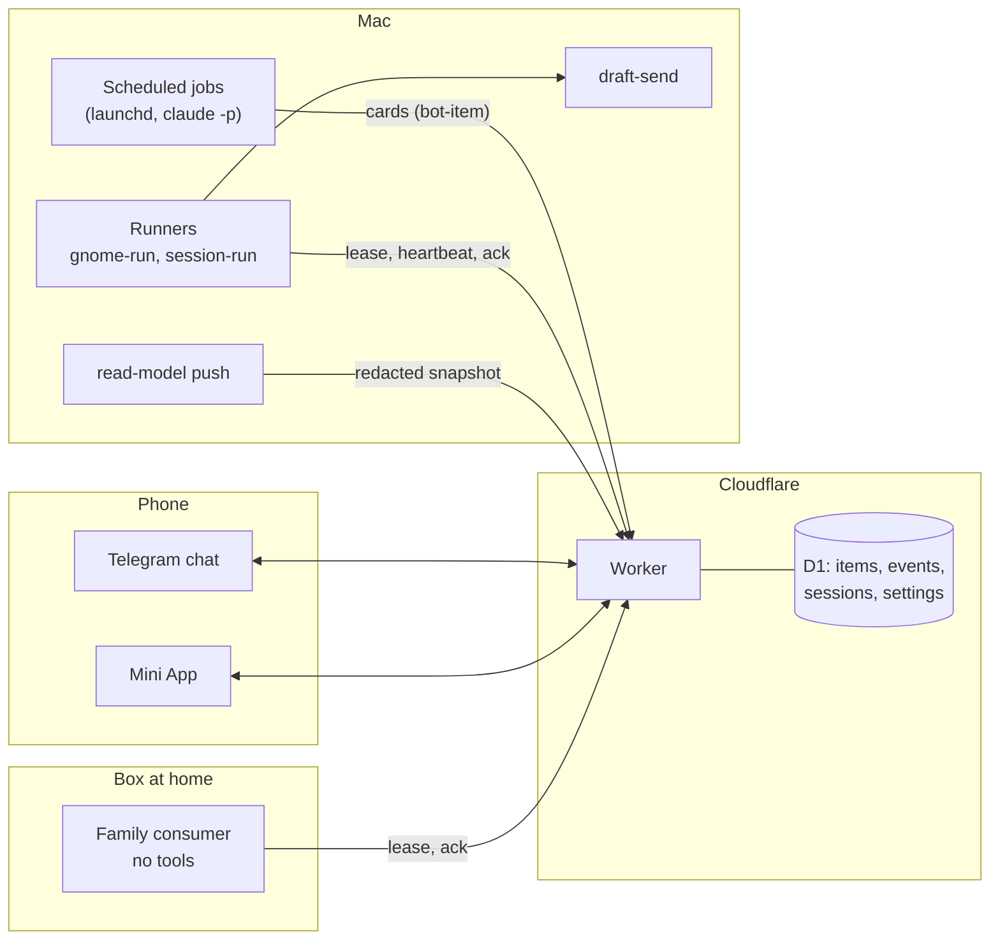
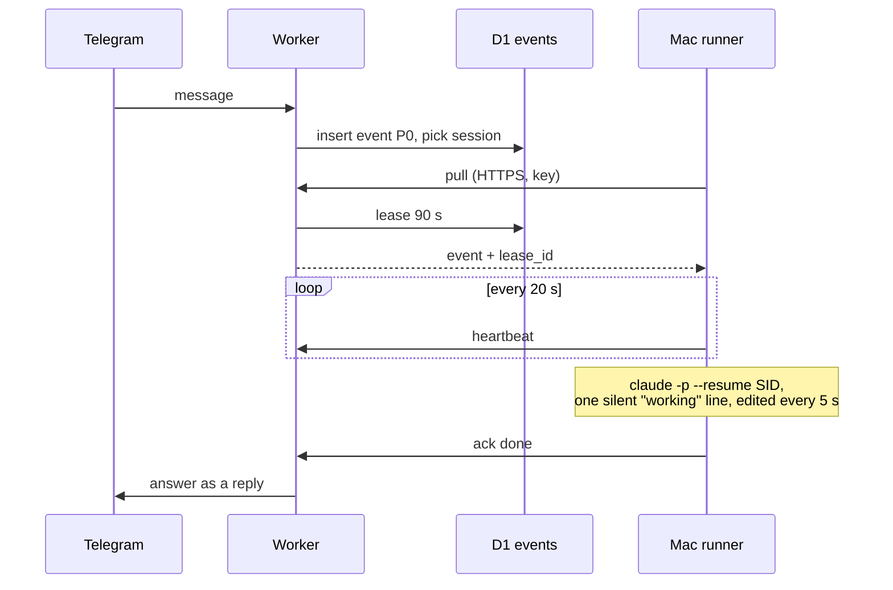
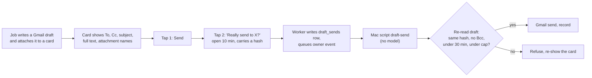
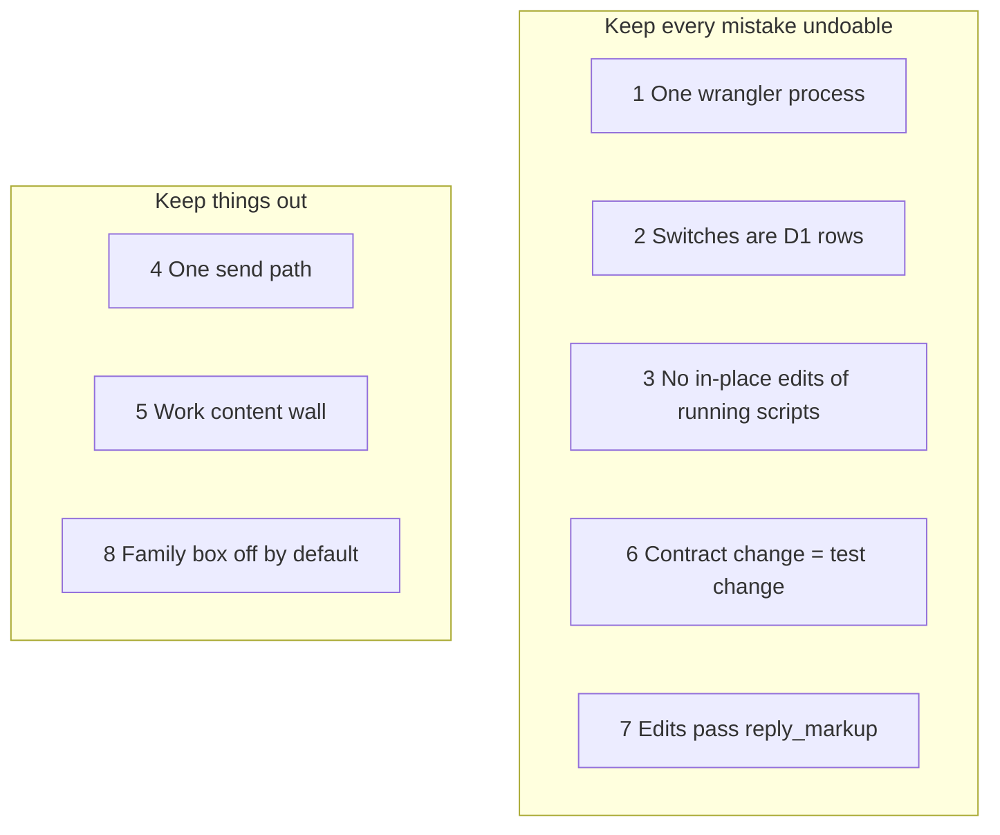

# My Telegram control bot

## The short version

I have one private Telegram bot that runs my day. Scheduled Claude jobs put **cards** into it (a mail that needs an answer, a meeting, a failed job), I tap a button, and a job does the next step. I can also write to it like a remote control for Claude Code: a plain message goes to today's session, a reply to an old answer continues that session, `/stop` kills a running turn.

It is about four weeks old. The first jobs ran from `launchd` on 23 Oct 2026, the worker went up on 25 Oct as a heartbeat watchdog, and most of what is described here was built between 12 and 18 Nov. It outgrew the CRM repo and moved to its own on 16 Nov.

| Part | What it is | Number |
|---|---|---|
| Worker | Cloudflare worker plus a D1 database: cards, queue, Mini App, one webhook | one worker, additive migrations |
| Mac runners | `claude -p` on my subscription, leased from the queue | no API key anywhere, in any process |
| Box at home | a small always-on device that answers family members when the Mac sleeps | restores itself, checked every 5 min |
| Mini App | a read-mostly dashboard inside Telegram | data pushed from the Mac, never pulled by the worker |
| Rules | hard rules in `CLAUDE.md`, each one an incident or a review finding | 8 |

The core is open source as [pult](https://github.com/fortunto2/pult) (MIT, 19 Nov 2026): the worker, the queue, cards, sessions, the live channel and a Mini App, with an extension API. My own bot runs it as a git submodule, and everything personal (family, mail, scheduled jobs, the send path) plugs in as extensions, so there is one codebase, not a public copy and a private fork.

The design has one idea behind it. **Everything that can go wrong goes wrong in a place I can undo.** Jobs write cards, not chat text, so a bad run leaves a card I can drop. Button jobs may read and draft, never send. The single thing that sends mail in my name is a plain script with no model in it. The rest of this page is how that plays out.

## The parts

**The worker** is the only thing Telegram talks to. It stores cards and events in D1 and renders messages. It never reads my repos: whatever the Mini App shows, the Mac pushed there first, after a redaction pass that masks secrets and document numbers and drops private rows whole.

**The Mac** does the thinking. `launchd` jobs (an hourly inbox sweep, a morning and evening standup, a channel post) run headless `claude -p` and write results as cards. Two runners pull events from the worker's queue and run sessions. All of it uses my Claude subscription through the CLI. There is no API key in the worker, the runner or the box, which is both a cost decision and a security one: nothing to leak, nothing to bill by accident.

**The box at home** is a small always-on device. Family members get their own scoped view and a boxed agent that is off by default. When the Mac sleeps, the box answers first for them and hands anything bigger to the Mac. A guard on the Mac probes it every 5 minutes and heals it: a dead consumer gets restarted (killed on 16 Nov, back in 10 s), anything worse gets a full restore. The longer story of always-on boxes is in [[agent-harness-and-always-on-gnome]].

**The Mini App** opens from the menu button. Every call carries Telegram's signed `initData`, checked with an HMAC and a one-hour window. It shows open topics, to-do rows, job runs and a banner when the last push is older than two hours. Writing back (mark a task done, add one) is built and switched off.

## Cards instead of chat text

A scheduled job that writes chat text produces a scroll I have to read. A job that writes **items** produces objects with state.

- A **card** is one thing I can act on: title, facts, a link, and a row of buttons (done, later, not needed, more, open). Same id and same content means no new message. A closed card stays closed. Changed content reopens it.
- A **digest** is a living note edited in place, keyed by date, silent.
- An **incident** always rings, has one "accepted" button and a copy button with the fix command.
- Only the first loud card of a batch rings, within a 10-minute window. Everything else is silent.

Card hygiene is code, not discipline. A card nobody touched for 3 days is **folded**: its message is deleted, the card stays open in `/open` and the Mini App, and the next standup says how many hang and for how long. It folds again after 3 more quiet days. Jobs close their own incidents after a green run.

## One message through the queue

Events have four priorities:

| Priority | Who |
|---|---|
| P0 | my typed text |
| P1 | my button presses and replies to cards |
| P2 | scheduled jobs |
| P3 | family members |

A lease lasts 90 seconds and the runner renews it every 20. If the runner dies, the lease expires and the event goes back in the queue. After 3 tries it is marked failed, and a queued event expires after 24 hours. Only one turn runs per session. The runner has two slots: an interactive one for P0, P1 and P3, and a background one that takes only P2 and never while a P0 is waiting. The scheduled jobs also skip their own tick when the queue shows a P0.

**The limit pause.** From 14 Nov 23:56 every scheduled job failed with a subscription limit message until 18 Nov 19:00. The bot had launched `claude -p` with no `--model`, so it followed the CLI default straight into the same wall. Now one setting pins the model (`opus` by default), and a limit in any run's output does four things. It requeues the event without counting the try. It pauses the worker so nothing is leased. It writes a `limit-until` file the jobs read. And it tells the sender once: the message is queued, here is when it resumes. The pause is capped at 6 hours so a misread date cannot park the bot for days. Jobs also retry once on a fallback model before giving up.

## The chat as a remote for Claude Code

A conversation is a Claude session id. There are no topics.

- A **reply** to any message of a session continues that session, including my own messages.
- A plain message goes to today's `main` session, created on first use.
- `/new [title]` starts a session and makes it the target until midnight. `/sessions` lists them with switch buttons.
- `/stop` ends the running turn within one heartbeat, about 20 seconds.
- `/status` shows queue depth and the pause.
- A **voice note** is fetched by the runner (the worker never stores media) and transcribed on the Mac with Whisper large-v3, hard-capped at 90 seconds. The transcript goes into the prompt as quoted data. A failed transcript ends the run with one line and no model call.
- A **file** up to 20 MB is saved into the session's inbox folder. A video or anything bigger gets a plain refusal.

The answer comes back as a reply, silent unless the turn ends with a `NEEDS_YOU` line or fails. The worker imported 21 older sessions on 12 Nov so old replies still resolve.

Since 18 Nov there is a second route for the one long-running session that runs my day: a Claude Code channel. It is a separate door in the worker, and the details (and the day-one bugs) are in [[claude-code-channels]]. The part that matters here is the fallback: if that terminal dies, the queue takes the messages again after a minute.

## Read and draft, and why buttons cannot do more

Every card button that is not a plain state change (More, a custom instruction, a reply to a card) runs the `draft` workflow:

- no write access except one drafts folder
- read-only mail and calendar, no web, no subagents
- secrets denied, hooks disabled
- the card text is passed as quoted data, never as instructions

The reason is simple. A card contains text from outside: an email, a LinkedIn message. Anyone who can write me a message can write into a prompt. If the job behind a button could send, a crafted mail could make it send. So the job can read, think and write a draft file, and that is all. A crash reopens the card.

## The one path that sends

On 14 Nov I deliberately loosened one thing: a Gmail draft attached to a card can be sent from the card. It is the only route in the whole system that sends anything in my name.

The second tap carries 12 hex characters of a hash over recipients, subject, body and attachment names, the version the card showed me. If the draft changed in between, the send is refused and the card is re-attached with the new text. A draft is consumed by sending, so the same id cannot mail twice. A crash after the send leaves a `sending` row, and the retry looks in Sent rather than resending. The cap is 10 a day. A queued send the Mac never took is failed by the hourly sweep after 30 minutes. No model sees the mail between the tap and the send.

## Since 19 Nov: a reply button and an answer you can stop

Two things changed the day the core went open source, both measured on the live bot.

**«✍️ Ответить» on every inbox card.** A tap queues the same read-and-draft job: the agent reads the thread and writes the answer in my voice and in the thread's language. The card turns into the draft with «Отправить · Поправить · Не нужно» and rings once. On the live bot (19 Nov, a mail from OVHcloud) the tap to the ready draft took 56 seconds, on the first try. «Отправить» asks once more, naming the recipient, and only then the plain script with no model in it sends the reply from the right mailbox. For Telegram and LinkedIn there is no send path, so the card gets the text and a copy button.

**The answer types itself, with a Stop button.** Telegram's `sendMessageDraft` (Bot API 9.3, open to all bots since 9.5) shows the reply growing in place instead of a «working…» line edited every 5 seconds, and `can_stop` puts a Stop button on it. Pressed during a long command, the bot said it was stopping within a second and the turn was dead 20 seconds later, one heartbeat. The old line stays behind a switch in D1, in case a client does not show drafts.

## Deploy discipline

Deploys have an order, and the order is a rule:

1. `make test` (about 3 minutes: node tests, typecheck, pytest) and `make integration` (a real worker on a fresh local database plus a Telegram stub) both green.
2. The migration, through a small script, not through wrangler's own commands.
3. `npx wrangler deploy`, one process.
4. Write the new version id, the previous id and the exact `npx wrangler rollback <previous>` into the deploy log.

Migrations are additive, so a rollback just leaves a table unused. The log has a row for every version since 12 Nov.

## The eight rules and where each came from

**1. One wrangler command at a time.** On 13 Nov at 03:55 UTC, 15 wrangler processes started within seconds. The login token rotates on use, so each one invalidated the others and every later call failed with "Not logged in". The cure needs an interactive login. Separately, `d1 execute --file` and `migrations apply` failed on the remote with a 10000 auth error on 12 Nov, so migrations go through a script that sends one statement at a time.

**2. Live switches are D1 rows.** Review round 3 on 13 Nov saw that the switches sat in `wrangler.toml`, so any deploy from any checkout would reset them to whatever that file said. `FAMILY` and `APP_WRITE` now live in a settings table read on every request, and `wrangler.toml` holds only the default `0`. Before the first deploy of that version I wrote the family switch by hand, otherwise the default would have turned the family layer off.

**3. Scripts that launchd or a running job executes are never edited in place.** No single incident is logged for this one. It is a guard against the obvious failure: a shell script rewritten while a job reads it runs half of the old file and half of the new. The edit goes to a scratch copy, then an installer syntax-checks it, writes a temp file in the same directory and moves it over.

**4. Nothing is sent in my name except one path.** Until 14 Nov card buttons were read-and-draft. Loosening it was a decision, not an accident, and the rule was rewritten to say exactly what is allowed: a Gmail draft, two taps, the owner's Telegram id, no model. No payments, forms, Telegram or LinkedIn sends.

**5. Work content never enters the bot.** Client work and this bot are separate worlds, and a bot that reads mail is one wrong mailbox away from mixing them; the near-misses of the first weeks made that concrete. Deny patterns live in a local file that is never in git, and a missing file is a refusal, not an empty list. The free-text route refuses work-origin text and logs only its length.

**6. A changed action is a changed contract.** Button actions are defined in contract files with tests on both the worker and the Python side. No dated incident is logged for it. The reasoning: change an action and not its test, and the worker and the Python side silently stop understanding each other. They change in the same commit.

**7. Editing a live Telegram message passes `reply_markup` again.** A probe on 12 Nov showed that an edit without it removes the keyboard, so a card would turn into plain text with no buttons.

**8. The family box is off for everyone until I switch it on.** A review on 14 Nov showed my first sandbox profile did not stop a boxed process from reading another process's environment. My probe had only tried one of the routes. The profile was rebuilt as deny-by-default, and the probe now tries every route against a planted canary. The box also checks its own sandbox before every event and fails closed.

## Glossary

| Term | Meaning here |
|---|---|
| Item | A row in the worker's database that becomes a message: a card, digest, incident or meeting |
| Card | An item I can act on, with buttons |
| Event | A unit of work in the queue: my message, a button press, a job |
| Lease | A claim on an event for 90 s; renewed by heartbeat, lost if the runner dies |
| Heartbeat | A ping every 20 s from a running turn |
| Runner | A Mac process that leases events and runs `claude -p` |
| `claude -p` | Claude Code in headless mode, one run, output as a stream |
| Draft workflow | The restricted mode button jobs run in: read, think, write a draft file |
| Read model | A redacted snapshot of my registry and to-do lists, pushed to the worker for the Mini App |
| Mini App | A web page that opens inside Telegram and authenticates with signed `initData` |
| D1 | Cloudflare's SQLite database |
| Folded card | An open card whose message was deleted after 3 quiet days |
| Limit pause | The worker stops leasing until the subscription limit resets, capped at 6 h |
| Channel | A way for an outside process to push messages into a live Claude Code session ([[claude-code-channels]]) |

## Where it fits

This is one piece of a larger set: the registry that says what is open ([[harness-registry]]), the always-on box and scheduled jobs ([[agent-harness-and-always-on-gnome]]), the way they connect ([[agent-stack]]), and a voice front end for the same kind of session ([[local-voice-agent-mac]]).
