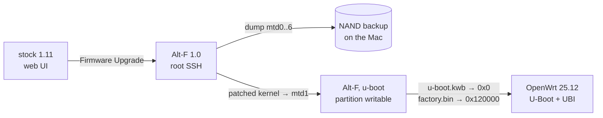

# OpenWrt on a D-Link DNS-320L without a serial cable

## The short version

The D-Link DNS-320L is a two-bay NAS from 2013. Its stock firmware is stuck on SMB1 (2 MB/s from a Mac) and an SSH server modern clients cannot talk to. OpenWrt supports the box officially since 24.10, but the official install starts at a serial console. I did it without one, in an evening, from the web UI and SSH. The whole trick is one renamed word in a device tree.

| Step | What | Risk |
|---|---|---|
| 1 | Pull both disks out | none: the firmware lives in on-board NAND |
| 2 | Flash **Alt-F 1.0** through the stock web UI | low: reflash stock the same way |
| 3 | Dump every NAND partition from Alt-F over SSH | none |
| 4 | Patch Alt-F's kernel so the bootloader partition is writable, write it to the kernel partition, reboot | the one step that needs a serial cable if it goes wrong |
| 5 | Write OpenWrt's U-Boot and UBI image, verify, reboot | same |
| 6 | Put the disks back, assemble the RAID read-only first | none |



## Why the stock firmware had to go

- **SSH is unusable.** The stock server is OpenSSH 5.0 with an `ssh-dss` host key only, which OpenSSH 10 on macOS no longer speaks (paramiko < 4 still does). Worse, every login as `admin` ends in "Your password has expired": the web UI writes the shadow entry with a last-change date of 0, sshd then runs `/usr/bin/passwd`, and the firmware has none. Changing the password in the web UI, fixing the clock, upgrading to 1.11: none of it helps.
- **fun_plug is ignored** by the 1.x firmware, so the classic "drop a script on the volume" route is closed.
- **SMB1 only**, ~2 MB/s writes, and 1.09 still carries SambaCry (CVE-2017-7494).

## Step by step

**1. Disks out.** Note which bay each came from. With no disks there is nothing to lose.

**2. Alt-F.** Download `Alt-F-1.0-DNS-320L-rev-Ax.bin` from SourceForge (the README says tested on rev A1; mine is A3 and it worked). Stock web UI → System Management → Firmware Upgrade. It comes up on DHCP; first web login sets the root password. Settings live in RAM until you save them: `loadsave_settings -sf`. In a non-interactive SSH session `PATH` lacks `/usr/sbin`, so export it.

**3. Back up NAND.** Seven partitions, 128 MB. Pull them as binary (a text-decoding SSH wrapper silently corrupts them) and compare md5 on both ends:

```
mtd0 u-boot 1M | mtd1 uImage 5M | mtd2 ramdisk 5M | mtd3 image 100M
mtd4 mini firmware 10M (MAC in the first 17 bytes) | mtd5 config 5M | mtd6 my-dlink 2M
```

**4. The trick.** `flash_erase /dev/mtd0` fails with *Permission denied*: Alt-F's kernel carries an appended device tree that marks the U-Boot partition `read-only`. The kernel partition (mtd1) is writable. So:

1. take Alt-F's kernel uImage from the mtd1 dump;
2. find the DTB at its end (magic `d00dfeed`, the one containing `dns320`) and replace `read-only\0` with `read-onlx\0`: same length, and the kernel no longer recognises the property;
3. recompute the uImage data CRC32 (header bytes 24-27), then the header CRC32 (bytes 4-7, computed with that field zeroed);
4. `flash_erase /dev/mtd1 0 0; nandwrite -p /dev/mtd1 kernel-rw.uImage`, read back and compare;
5. reboot normally. The stock U-Boot loads the patched kernel; `/sys/class/mtd/mtd0/flags` now reads `0x400` (writeable).

**5. OpenWrt.** OpenWrt's layout is U-Boot at 0, its environment at 0x100000, one `ubi` partition from 0x120000 to 0x6f00000, and the mini-firmware/config/my-dlink partitions unchanged. Under the stock layout that UBI range spans mtd1, mtd2 and mtd3, and `squashfs-factory.bin` is a raw UBI image of ~6.8 MB, so it goes in two pieces:

```sh
flash_erase /dev/mtd0 0 0 && nandwrite -p /dev/mtd0 u-boot.kwb      # from u-boot-dns320l/
flash_erase /dev/mtd1 0 0; flash_erase /dev/mtd2 0 0; flash_erase /dev/mtd3 0 0
nandwrite -p -s 0x20000 /dev/mtd1 factory-part1.bin   # first 0x4e0000 bytes
nandwrite -p /dev/mtd2 factory-part2.bin              # the rest
```

Pad each piece to the 2 KB page with `0xff`, and verify every write with `nanddump | md5sum` before rebooting. One bad block was skipped in mtd3; UBI does not care. On reboot the new U-Boot boots UBI, and on this profile OpenWrt's LAN is a **DHCP client**, so there is no clash with a router on 192.168.1.1.

**6. After.** `apk add mdadm kmod-md-raid1 kmod-fs-ext4 e2fsprogs block-mount samba4-server luci luci-app-samba4 dns320l-mcu smartmontools hd-idle`. The stock RAID 1 is plain Linux md + ext4, each disk a full copy; assemble it read-only first.

## Dead ends, so you skip them

- **kexec.** Alt-F ships `kexec`, and loading OpenWrt's initramfs succeeds, but the box goes silent after `kexec -e`. It also hangs when kexec-ing Alt-F's own kernel, so it is the kexec path on this hardware, not OpenWrt.
- **USB recovery.** The stock U-Boot has a Marvell recovery mode that loads `/multiware.img` from a USB stick, but it is gated by the `enaAutoRecovery` variable, which lives in the read-only mtd0.
- **Flashing OpenWrt from the stock web UI.** `factory.bin` is raw UBI; the stock upgrader only takes D-Link-format images (Alt-F is one).

## Fix for the fan daemon

The `dns320l-mcu` package detaches on its own, procd thinks it died, respawns it, and the second copy fails on `bind` in a crash loop. Run it in the foreground: in `/etc/init.d/dns320l-mcu` change the command to `"$PROG" -f`, and add the file to `/etc/sysupgrade.conf`.

## If it breaks

A box that does not boot after step 4 or 5 needs a USB-TTL adapter (3.3 V) on header J2, 115200 8n1, and `kwboot -b u-boot.kwb /dev/ttyUSB0 -p`: the 320L's boot ROM loads U-Boot over serial even with NAND wiped. The data disks are never at risk, because they are not in the box.

## Glossary

- **NAND / mtd** — the on-board flash chip and the Linux devices for its partitions.
- **U-Boot** — the bootloader in the first megabyte of NAND.
- **Device tree (DTB)** — a binary description of the hardware the kernel reads at boot; here it also declares the flash partitions and which are read-only.
- **UBI** — the volume layer OpenWrt uses on raw NAND; it handles bad blocks and wear itself.
- **Alt-F** — community firmware for D-Link NAS boxes, last released 2017.

Related: [[tools-and-infrastructure]], [[own-searxng-for-agents]].
