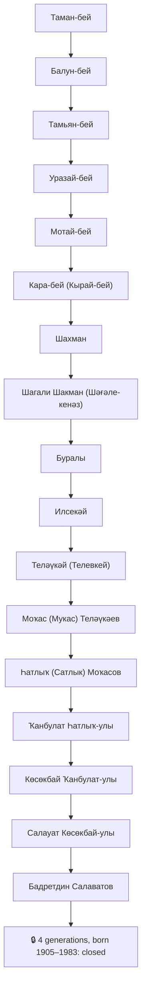

# Genealogy with AI agents: 22 generations, and what stays closed

In September 2026 I started rebuilding my family history with Claude Code. Two months later the tree
holds 222 people. My father's line runs 22 generations, from Taman-bey at the top of a written
shezhere (the Bashkir genealogy of a clan) down to my children. On the way out came two open
datasets with DOIs and source sections for 22 Wikipedia articles about Bashkir villages and clans.

This page is the method: how the folder is set up, where agents do real work, where they make
things up, and the rule I use to decide what goes public. The skills and scripts are in
[fortunto2/shezhere](https://github.com/fortunto2/shezhere). Part of [[genealogy-research]].

## The setup is a folder, not an app

```
family/
  tree.yaml     source of truth: people and father/mother/spouse links
  tree.md       generated from tree.yaml (Mermaid graph + table), never edited by hand
  people/       one file per person, only when there is something to say
  stories/      one finding per file, plus long-running lines (migrations, education, resistance)
  sources/      scans, photos, interview audio, exactly as received
  friends/<x>/  research for friends, kept out of my tree
```

A `CLAUDE.md` in that folder holds the rules. The ones that matter:

- **Every change to people goes into `tree.yaml`**, then a validator runs: duplicate ids, broken
  links, the count of `?` holes. The agent never edits the generated files, so the web version and
  the printed version cannot drift from the data.
- **Every fact names its source** in the note: `[Pamyat Naroda, record id]`, `[told by my
  father, 2026-09-09]`, `[book, appendix 5, row 90]`. A guess is marked as a guess.
- **A version that failed is not deleted.** It stays with `[rejected]`, the date and the reason.
  Otherwise the next agent rediscovers it. Kinship with Salavat Yulaev, the national hero, sits in
  my file as rejected.

YAML rather than GEDCOM on purpose: GEDCOM is the exchange format and nobody edits it by hand. YAML I
can read, diff and fix myself, and it exports to GEDCOM for Gramps or MyHeritage when I need it.

The method lives in a skill (`shezhere`): which archive answers, in what order to search, and the
traps below. That is what turns a general model into someone who knows that in 1816 a Bashkir did
not have a surname yet.

## Where agents do real work

**Reading archives page by page.** For my father's village the agent read the 1917 agricultural
census (52 households) and the revision lists (ревизские сказки, the tax censuses of the Russian
Empire) for 1816 to 1859, household by household. On my mother's side it did something I had not
thought to ask for: the right-hand half of a revision-list spread is the women, and nobody in our
family had read it. The agent found 40 women there, and their patronymics gave 16 ancestor names
from neighbouring villages that the male half never shows.

**Sweeping a database by place, not by surname.** Clerks mangled surnames beyond recognition (one
of ours comes out three different ways in the same database); the district they wrote correctly. So the agent queries by
birthplace and checks completeness against the site's own counter: for one village the export came
to 511 of 511. The same sweep over gwar.mil.ru became a dataset of 20,473 natives of Orsk uyezd in
First World War records.

One trap from that sweep is worth the whole section. In the Pamyat Naroda search API the birthplace
key is `birth_place`. Send `place_birth` and the server ignores it without an error and returns the
whole database. Without the counter check you would think you had your village.

**Running in parallel.** One night in September: eight subagents on different sources, then four
more as fact-checkers over the result. The tree went from 145 to 220 people. The fact-check found
nine errors, including some the agents themselves had made earlier: a founder's son called Nazarbay instead of Kazakbay, an age of
60 read as 80, a patronymic one letter off, two grandsons recorded as sons, and two different men
named Salavat merged into one.

**Interviews.** A recorder, then a local Whisper transcription, then stories and tree edits. One
hour with my parents gave 1,341 segments and one new person in the tree. The audio never leaves the
machine.

**Wikipedia.** Our archive finds are original research until someone prints them, so only printed
sources go into an article. With that rule, 22 articles about villages and clans got sourced
history sections, and one ([Апанды](https://ru.wikipedia.org/wiki/Апанды)) was created from scratch.

## Where they make things up

- **They search for a surname that did not exist yet.** In 1816 a Bashkir was written down by his
  father's name. Salavatovs are the descendants of a man called Salauat, and in every record from
  1914 to 1927 there is no Salavatov at all. You search for the name the surname grew from.
- **They merge people by name.** The printed shezhere has a Shärafetdin, son of Salauat. The agent
  made him the brother of my great-great-grandfather and wrote a neat story: my great-grandfather
  was named after his uncle. Checking the book: that Shärafetdin is in another appendix, another
  village, the son of a different Salauat. Both the link and the story were removed on 13.09.2026.
- **They keep a date that has no source.** A death year "~2019" sat in the tree for my grandfather
  with nothing behind it; removed. Our base said a nearby village was founded in 1928, Wikipedia
  says 1927, and neither has a footnote.
- **They lose people.** The book says Mukas had five sons; we had four.
- **They cannot read a preview.** The metrical books of Muslim parishes are in Turki written in
  Arabic script. At preview resolution the names are mush. At full resolution they read, but a
  word that repeats on every line is a formula, not a name: "Yakub" in the father column turned out
  to be باشقورط, "Bashkort", the estate.
- **They take "nothing found" as an answer.** Every source has a window: years, fonds, a territory.
  FamilySearch never filmed either of our two archives. Pamyat Naroda covers 1939 to 1945. A zero
  is only worth something next to a control query that should hit, and from the same class: a
  Bashkir name, not "Ivanov".

Captchas and logins are always passed by a person, never by the agent.

## My father's line, and where it closes

Three kinds of source meet at one man. The top of the line is a printed shezhere: the book
*Шәғәле Шаһман нәҫеле* (T. G. Shakhmanov, Kumertau, 2007), a table for the villages Yanauyl and
Smak, down to row 123, "Bädretdin, son of Salauat". The bottom is documents: my great-grandfather's
Second World War draft record calls him "son of Badretdin". The joint is one oral fact: on
09.09.2026 my father said Badretdin's father was called Salavat. That identified our documented
Badretdin with row 123, and the chain closed through Mukas, who founded the village of
Bolshemukachevo on the Agidel in the 1740s, and Shagali Shakman, a Tamyan prince of the 16th
century, up to Taman-bey.

This is what the publishing script prints for that line. The names are as they stand in my file,
in Bashkir and Russian:



Tamyan-bey is the eponym of the Tamyan tribe. Badretdin was killed in the Civil War around
1918–1919, on his way home through the forest; he was hard of hearing and may not have heard the
call to stop `[told by my father, 2026-09-09]`.

The last box is four generations, me among them, and my children are not shown at all. They are
closed by the rule, not by mood: my great-grandfather's war record is public on Pamyat Naroda, and
he is still closed here, because his grandchildren are alive.

## What goes public and what does not

The rule: a person appears by name only if born before 1900 or dead for more than 75 years. An
ancestor of an open person is open too, since he is older. Everyone else, the living, their
children, and anyone without dates, folds into one unnamed node.

Seventy-five years is the term for which Russian archives close records that touch personal and
family privacy (Federal Law 125-FZ, article 25). For comparison, the US releases census records
after 72 years and the UK after 100. It is a default I can defend, not a legal opinion.

The rule is a script, `shezhere-public.py`: it walks one line up from a given person, applies the
rule and prints the Mermaid above. Nobody decides by eye who is "old enough", including the agent.
It is the same move as everywhere else in my setup: a mistake is fixed in code, not in a prompt
([[agent-mistake-fix-harness]]).

| Open | Closed |
|---|---|
| names and dates under the rule | living people, their children, anyone without dates |
| printed shezhere, published archive inventories, shelfmarks | 20th-century personal documents, even of the dead: birth and marriage certificates, military IDs, work books (they name the living) |
| derived indexes with a DOI: name, place, archive reference | raw dumps of other people's databases, archive scans in bulk |
| clan haplogroups from public DNA projects | anyone's raw genome |
| method, tools, negative results | a friend's family: their research sits in a separate folder, and they publish it themselves |

## What you can take

**The skills.** [fortunto2/shezhere](https://github.com/fortunto2/shezhere) is a Claude Code plugin
with two skills: `shezhere` (archives, revision lists, metrical books, military databases, search
traps, what to publish) and `dna` (which test, known Bashkir haplogroups, analysing your own
genome). It ships `tree-check.py`, `shezhere-public.py` and an example tree, the open part of the
line above:

```
/plugin marketplace add fortunto2/shezhere
/plugin install shezhere@shezhere
```

**The data**, CC BY 4.0. Each record is a name tied to a place and to the archive shelfmark you
order the document by:

| Repository | What is in it |
|---|---|
| [usergan-1920](https://github.com/fortunto2/usergan-1920) | 2,618 householders of the Usergan canton, 1920 census: 53 villages, 876 surnames. Parser and enrichment scripts included. DOI [10.5281/zenodo.22747578](https://doi.org/10.5281/zenodo.22747578) |
| [orsk-uezd-ww1](https://github.com/fortunto2/orsk-uezd-ww1) | 20,473 natives of Orsk uyezd in First World War records, with RGVIA references, normalised volosts and a gazetteer. The sweep and reconciliation scripts are in `scripts/`. DOI [10.5281/zenodo.23503840](https://doi.org/10.5281/zenodo.23503840) |
| [bashkir-genealogy-data](https://github.com/fortunto2/bashkir-genealogy-data) | the index of all datasets, plus scripts: `obd.py` (OBD Memorial search and scans), `gwar-sweep.py` (First World War), `fs-places-export.py` (FamilySearch place catalogue), `dresden.py` (the Dresden database of Soviet prisoners of war) |

**Sources that answer without a script:** [kitaptar.bashkort.org](https://kitaptar.bashkort.org)
(Bashkir books, including the volumes of «История башкирских родов» and many printed shezhere),
ufagen.ru (the full text of «Материалы по истории Башкирской АССР», 17th–18th century documents),
yandex.ru/archive (OCR search over digitised files of the Orenburg archive), pamyat-naroda.ru and
obd-memorial.ru (the Second World War), ru.openlist.wiki (the repressed).

## If you are starting

1. Record your oldest relatives first. Patronymics of great-grandparents, the local names of
   villages, who moved and why. The archive will wait; they will not.
2. Find the province (губерния) your village belonged to before 1919. Archives are organised by it:
   the south and south-east of Bashkortostan were in Orenburg province, so their papers are not in
   the Bashkir archive at all.
3. Search by place and by given name, not by surname.
4. Revision lists and the 1917 census, then the metrical books. Look for a printed shezhere of your
   clan on kitaptar: it may carry the line back several centuries in one table.
5. Keep one file of truth, a source on every line, and a rule for what you publish.
6. Take a DNA test last, to settle a question the documents have raised.
