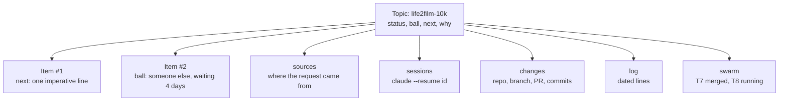
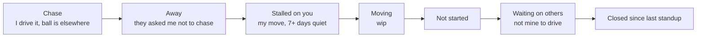
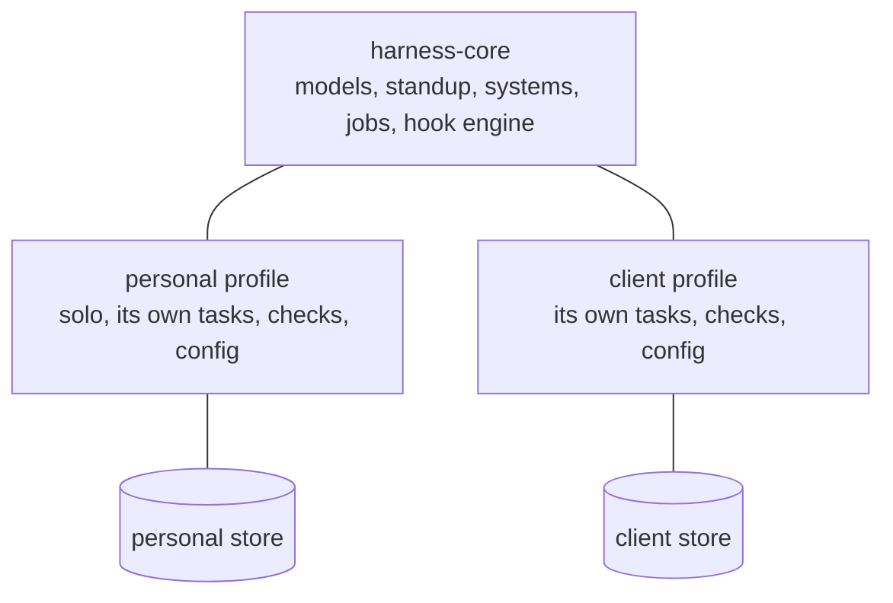

# The registry: one file per open topic, and a core that two profiles share without sharing a byte

*Part 3 of 7 in the series [[agent-stack|How my agent stack fits together]]. Previous: [[agent-harness-and-always-on-gnome|the harness and the always-on box]]. Next: [[solograph-rebuilt-one-binary|the memory engine]].*

An agent forgets everything between sessions, and so do I. The registry is the answer to the second half of that sentence: a plain list of what is open, whose move it is, and the one next action for each thing. The first half is answered by the brain and the search index, covered in other parts. This part is about the list, and about the small Python program (`harness-core`) that reads it, orders it and pushes it into every Claude Code session I open.

## The short version

A **topic** is one JSON file in `tasks/open/`. It has a title, a status, a **ball** (whose move it is: me, or a named person or system), a **next** (one imperative line), a list of **items** inside it, and links to the sessions, commits and notes that belong to it. Everything else in the harness is a way of reading those files: a standup that sorts them, health checks that go stale on a schedule, jobs that run without me, a queue of improvement proposals, and hooks that print a brief at the start of every session.

| Piece | What it is | State on 18 Nov 2026 |
|---|---|---|
| Topic | a file with ball, next, items | 30 open, 10 closed |
| Item | one piece of work inside a topic, `topic#3` | 110 inside open topics |
| Standup | the open list, in the order it needs me | runs by hand and from a 07:30 and 21:30 job |
| Check | something that breaks silently, with a cadence | 19; 11 are one command the tool runs |
| Job | work a machine does, with its resume command and its evidence | 2 defined, one a template |
| Proposal | a harness change that names the incident behind it | the queue exists, nothing is in it |
| Hook | prints the brief into a session | SessionStart, PreCompact, UserPromptSubmit |

The code is about 4,700 lines of Python in `~/startups/shared/harness-core`, with 68 tests that pass in 21 seconds. The registry has existed since 22 October 2026, so on the day I write this it is 27 days old, and the core has 18 commits.

## Why files, and why a ball

A plain task list holds things I intend to do, and much of what rots in it is not mine to do. A review is with a store. A reply is with a person. A build is on a machine. The list shows it as open for three weeks and tells me nothing.

So the central field is not "status", it is **ball**, borrowed from tennis. If the ball is on me, the topic is mine to move. If it is on someone else, the topic records the day it left my court (`waiting_since`), and from then on it ages in the open. The invariant is written once, in the model: `waiting_since` is set exactly when the ball is not mine, so no command can express it differently.

Three more fields keep it honest. `owner` is whose result it is, `driver` is who keeps it moving, and these differ more often than you would think: when someone else owns a result and I drive it, the topic is flagged `needs_watch`, because waiting is not forgetting. `parents` points at the goal a topic serves, so `task why <topic>` walks up to the root goal and I can paste that chain into a subagent's brief. And `extra="forbid"` on every model means a typo in a hand edit fails loudly instead of quietly corrupting the file.

One file per topic and not a database: a bad write damages one topic, two sessions rarely touch the same file, and an agent can read the whole registry with `ls` and `cat`. In my profile the whole `tasks/` folder is gitignored, because it holds my day, so a topic's history is its own dated log, not git. Closed topics go to `tasks/done/YYYY-MM/`, and the folder name is the input of the month report.

## The standup

`solo standup` prints what is open, already in the order it needs attention. The order is the point.

**Chase** is first because each row there is one message to one person, built from the topic's `next`. An agent drafts it, and I send it. **Stalled** is my own backlog that went quiet: either a `next` is missing, so write one, or the topic should be dropped with a reason. The profile adds its own sections: the to-do lists of my business repo and the bottom line of last night's digest. A section that finds nothing prints nothing. Since November the skill that runs the standup also reads the brain's morning report when there is one ([[company-brain]]).

The work-in-progress limit is 3 in my profile, and the standup says so when it is exceeded, because nothing moves when everything is open. An item with no `next` is a theme, not a task.

## Checks: the things that break while I am not looking

Some failures are silent: a nightly job that exits 0 and sends nothing, an index that stopped refreshing, a number on a dashboard that stopped matching its source. `checks.json` is the inventory of what could go quiet, each with a cadence. On 18 Nov 2026 it holds 19 checks: 10 weekly, 6 daily, 3 monthly. `solo systems due` lists the overdue ones, most important first.

A check that needs judgment is dispatched to its own session or subagent, because a long diagnostic would otherwise eat the overview. The tool only records that it ran and what it said, so "daily" becomes a fact instead of an intention. A check that is one shell command carries it as `run`, and `systems run` executes it: non-zero exit means it found something, and the last line of stdout is the note. 11 of the 19 are like that.

Each run is its own small file under `check-runs/YYYY-MM/`, named by UTC time, check id and runner. Two sessions can record at once without rewriting a shared file. There are 93 of them across October and November. One rule: an `ok` verdict has to carry numbers. "Looks fine" is refused unless forced.

## Jobs: work without a person, and how to tell it worked

A topic is something a person moves. A **job** is something a machine runs, and the model records two things that were missing the day it mattered. The first is `resume`, the single command that continues an unfinished job. On 26 October an upload queue gave up in a network gap and three agents died on a DNS outage, and each got restarted by hand from my memory. The second is `evidence`, how a run is judged. A job's exit code is not a verdict: a digest that ran with no traffic and reached no channel exited 0. The evidence is a command or a log pattern that a person would accept.

Honest numbers: the personal profile defines two jobs, a daily release monitor and a template for upload queues. Most of the unattended work (the 07:00 digest, the standups, the inbox sweep) is scheduled by launchd and described in the profile's README, not modelled as a `Job` yet.

## Proposals: a harness change must name its incident

An assistant that suggests improvements freely becomes noise, and one that forgets a rejection proposes it forever. So `improve add` takes `--why` (the failure it prevents) and `--evidence` (what happened). Decisions are remembered: a declined proposal, with the reason, is never surfaced again. The hook nudges about queued proposals. The personal profile has no proposals file yet: the mechanism is built, and nothing has been queued.

## Hooks: the brief in every session

A registry nobody reads is a graveyard. Hooks are what make the agent read it. A Claude Code hook is a program the CLI runs at fixed moments, and its output is added to the model's context. The core ships the engine, and the profile supplies its own words:

- **SessionStart and PreCompact** print the brief: how many topics are open, the watch-flagged ones first, then wip, then the oldest untouched (8 lines by default, then "+N more"), plus any overdue checks, queued proposals, unattended jobs that need a hand, and whether the standup has run today.
- **UserPromptSubmit** matches the prompt against existing topics by keyword and points at the closest one, so a new request becomes an item on an old topic and not a duplicate. It also refuses to mistake a background-task notification for me asking for something.

The hook imports only a stdlib module (`lite`), never the pydantic model: the code's own note puts pydantic at about 126 ms, and this runs at every session start. It never fails loudly, because a broken hook must not break a session.

The handoff rule is one line: before ending a session that touched a topic, update its `next` and leave a note. The next session starts from the brief and not from a re-explanation.

## One core, two profiles

The mechanics of all this do not care whose registry it is. So the code lives once, in `harness-core`, and a **profile** is a directory with the names: a config file (owner, paths, thresholds, words that identify no topic), the `tasks/` folders, `checks.json`, the hook text and a dispatcher script on PATH. I run two: my personal one, and one for a client engagement. The core does not know either name.

The only link between core and profile is one environment variable, `HARNESS_ROOT`, set by the dispatcher before anything is imported. The failure that would make a shared core worse than two copies is a write landing in the other profile's files, so there is a test for exactly that: it builds two throwaway profiles, adds a topic to one and stamps the standup in the other, and asserts that neither saw the other's registry, state or config. It is one of the 68.

## A topic id as the link between systems

When swarm arrived (see [[project-swarm]]), the question was where a coding task's state should live. The answer was not a shared database. A topic id (`life2film-10k`, or one item, `life2film-10k#3`) is the key that a swarm task, a captured note and a commit all carry. swarm owns the task's state, the registry owns why the work exists and whose move it is, and the brain owns what was learned.

The registry keeps a read model of its swarm tasks, `Topic.swarm` (`T7 -> merged`). It is written two ways, both under one lock and both idempotent: an `on_status` hook on every transition, and an hourly reconcile from swarm's own list, so a lost hook costs an hour and never a wrong record. It is log-only: a swarm event never touches a topic's summary or an item note, which are a person's words. `task show` then prints the topic with its swarm tasks and the captures that name it. The reasoning for the whole split is in [[company-brain]], item 5 of "Building one on a wiki".

## What is not built

- **Proposals are empty.** See above: the queue works and I do not use it.
- **Jobs are barely used.** Two definitions, one a template. The launchd loop is not modelled in the registry.
- **No ranking by value.** The standup orders by whose move and how stale, not by what matters. That part is mine.
- **The registry does not see the 6-crm to-do lists as topics.** They stay yaml, read through an adapter, on purpose: copying them into the registry would give two truths.
- **Only 27 days of history.** The numbers above describe a month, not a habit.

## Glossary

| Term | Meaning |
|---|---|
| Topic | one unit of work: a JSON file with ball, next, items |
| Item | a piece of work inside a topic, addressed `topic#n` |
| Ball | whose move it is now; `me`, or a person or system |
| Next | one imperative line: what the next move is |
| Driver / owner | who keeps it moving / whose result it is |
| Watch-flagged | the ball is elsewhere and I drive it: waiting, not forgetting |
| Profile | the directory with a harness's names and stores; the core has none |
| Check | a recurring health test with a cadence and a recorded run |
| Job | machine work with a `resume` command and `evidence` |
| Hook | a program Claude Code runs at session start or on each prompt |
| Read model | a copy of another system's state, never edited by hand |

## Connections

- [[agent-stack]]: the map of the whole series
- [[agent-harness-and-always-on-gnome]]: the harness around the registry, and the box it runs on
- [[project-swarm]]: the task queue that reports into topics
- [[company-brain]]: the notes and nightly loop that name a topic
- [[solograph-rebuilt-one-binary]]: the search the brief points to, next in the series
