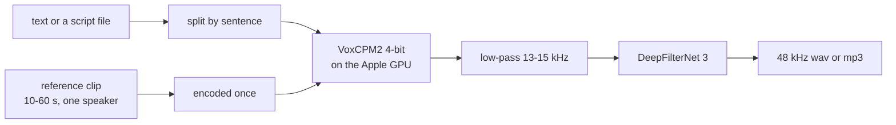
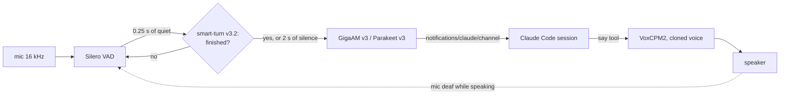

# A local voice for the agent: voice cloning on a Mac, and talking to Claude Code with nothing uploaded

## The short version

Two skills in [solo-factory](https://github.com/fortunto2/solo-factory), both running on an
Apple-silicon Mac through [mlx-audio](https://github.com/Blaizzy/mlx-audio), with no text, voice
or recording leaving the machine:

- **`solo:tts`** turns text into speech in a cloned voice. A 25-second clip is enough; the clone
  then speaks English, Turkish and Russian cleanly, Russian with stress you can control.
- **`solo:talk`** makes a Claude Code session something you talk to. A local process hears you,
  decides when you have finished, writes down what you said, and pushes it into the session as a
  [[claude-code-channels|channel]] event; the session answers out loud in the cloned voice
  and can use every tool it has while you talk.

| Measured on an M5 MacBook, 32 GB | |
|---|---|
| Clone quality | clean in en, tr, ru from a 25 s phone clip and a 27 s mic test (read back by Whisper almost word for word) |
| Speed of the default model | 0.56-0.75 s of compute per second of speech, peak 5.9 GB |
| End of your sentence → text in the session | **0.50-0.54 s** |
| Agent's `say` → first sound | 1.0-1.6 s local; 0.66 s with Cartesia as the mouth |
| What it costs | nothing per call; models are Apache-2.0 / MIT |

Install: `claude plugin marketplace add https://github.com/fortunto2/solo-factory` and
`claude plugin install solo@solo --scope user`, or `npx skills add fortunto2/solo-factory --all` for
other agents. Then ask «озвучь» / "clone my voice" or «давай голосом» / "talk to me".

## Part 1: speech in a cloned voice (`solo:tts`)

Three models earned a place, out of the forty that mlx-audio ships, and a fourth was tested and not adopted:

| Model | Peak RAM | Speed (RTF) | Use it for |
|---|---|---|---|
| VoxCPM2 4-bit (default) | 5.2-5.9 GB | 0.56-0.75 | the best clones; 30 languages; 48 kHz |
| ZONOS3-Mini | 2.6-3.8 GB | 0.17-0.29 | fast drafts, only with a same-language reference |
| Shtorm-VoxCPM2-RU (converted once to MLX 4-bit) | 5.5 GB | as VoxCPM2 | Russian where stress changes the word: `зам+ок` / `з+амок` |
| KittenTTS 2 (1.7B ternary, `kittenml[mlx]`, 21.11.2026) | 8.3-9.1 GB | 0.83-1.1 (busy machine) | not adopted: 20 languages, 100+ built-in voices, `[emotion]` tags; 24 kHz |

### KittenTTS 2 against VoxCPM2 (21.11.2026)

KittenTTS 2 came out with a headline of "4 MB TTS". That is the Pico model, eight languages and no
cloning; the one that clones a voice is the 1.7B ternary model, and that is the one measured here.

| | KittenTTS 2 (MLX) | VoxCPM2 4-bit |
|---|---|---|
| Peak memory | 8.3-9.1 GB | 4.6-5.9 GB |
| Sample rate | 24 kHz | 48 kHz |
| Load, warm (first) | 9.9 s (277 s, 1 GB download) | 1.5-3.7 s |
| RTF, load average 24-38 | 0.83-1.1 | 0.94-1.39 |
| Read back verbatim or near, 5 lines | 5/5 | 5/5 |
| Speaking pace | 1.1-1.6x slower | baseline |

Verdict: VoxCPM2 stays the default and KittenTTS 2 is not added. The weights are 0.5 GB but the
running process peaks at 9 GB, so the "fits anywhere" promise does not hold for the cloning model.
The tiny Pico/Nano/Mini models are a different question (an iOS app bundle), not tested here.

Listen for yourself: both engines cloned the same 27-second English mic test of my voice, and read
lines they had never heard. VoxCPM2 output went through the skill's default clean-up (low-pass +
DeepFilterNet); KittenTTS 2 is raw.

Russian: «Всем привет, с возвращением на канал. Сегодня покажу, как я монтирую фильм о путешествии
за один вечер…»

VoxCPM2 4-bit:
<audio controls preload="none" src="/images/posts/local-voice-agent-mac/voxcpm2-ru1.mp3"></audio>

KittenTTS 2:
<audio controls preload="none" src="/images/posts/local-voice-agent-mac/kitten-ru1.mp3"></audio>

English: "Hi everyone, welcome back to the channel. Today I will show you how I cut a travel film in
one evening…"

VoxCPM2 4-bit:
<audio controls preload="none" src="/images/posts/local-voice-agent-mac/voxcpm2-en1.mp3"></audio>

KittenTTS 2:
<audio controls preload="none" src="/images/posts/local-voice-agent-mac/kitten-en1.mp3"></audio>

Turkish: "Herkese merhaba, kanala tekrar hoş geldiniz…"

VoxCPM2 4-bit:
<audio controls preload="none" src="/images/posts/local-voice-agent-mac/voxcpm2-tr1.mp3"></audio>

KittenTTS 2:
<audio controls preload="none" src="/images/posts/local-voice-agent-mac/kitten-tr1.mp3"></audio>

KittenTTS 2 extras, no cloning: the built-in voice `Bruno`, and a line with an `[excited]` tag (whether
the emotion is audible is yours to judge):
<audio controls preload="none" src="/images/posts/local-voice-agent-mac/kitten-builtin-Bruno-en2.mp3"></audio>
<audio controls preload="none" src="/images/posts/local-voice-agent-mac/kitten-emotion-en.mp3"></audio>

KittenTTS 2 on the same Rustam clip and five lines (ru x2, en x2, tr x1): all five read back
verbatim or near (GigaAM, Parakeet, Whisper for Turkish), the same as VoxCPM2, so there is no quality
gap to measure. It loses on cost: 8.3-9.1 GB peak against 4.6-5.9 GB, 24 kHz against 48 kHz, a 1 GB
download (277 s the first time), a 9.9 s load against 1.5-3.7 s, and it speaks 1.1-1.6x slower
because it copies the reference's pace. RTF was taken with the laptop at load average 24-38, so it
says "similar", not "faster". It needs its own dependencies (torch, transformers). Where it may win,
untested by ear: a built-in voice with no reference, and expression tags (`[excited]` is accepted).

RTF is seconds of compute per second of speech, on an idle machine. With other ML jobs running it
rose to 1.2-1.9, and once to 6 when the laptop swapped, so the skill stops itself below 15% free
memory and runs one model at a time.

**The reference clip decides more than the model does.**

- Its room comes along. A phone clip with a noise floor at -52 dB gave clones at -50 dB; after
  cleaning the reference first, -58 to -63 dB.
- Its pauses come along too, in ZONOS3: a halting mic test made speech twice as slow, and the
  Russian line came out as noise until the silences were cut. VoxCPM2 read the same clip normally.
- The language does not have to match. An English clip gave clean Russian and Turkish in VoxCPM2.
  ZONOS3 garbles a line whose language differs from its reference ("Hello there." from a Turkish
  clip came out as "Ah, yeah. Ee Ee Ee…").
- Steady tones from the microphone (lines at 2.7, 3.5 and 5.3 kHz here) survive every cleaner.
  Only a better recording removes them.

**Three bugs that sounded like a bad model.**

1. **8-bit audio from an innocent ffmpeg line.** I joined clips with `anullsrc` silence and the
   `concat` filter. lavfi hands `anullsrc` in as `pcm_u8`, concat negotiates the whole graph down
   to it, and the output had 170 distinct sample levels in ten seconds: a -46 dB hiss over clips
   that were -71 dB. Join in numpy and encode once.
2. **VoxCPM2 hisses on its own**: a flat band from 16 to 20 kHz and a bed between words that the
   reference does not have. More diffusion steps do not fix it (in the 4-bit build the audio
   decoder is full precision anyway). A cosine low-pass at 13-15 kHz plus DeepFilterNet 3 does,
   about 2 seconds per clip.
3. **Russian stress is guessed, and the guess can change the words.** Base VoxCPM2 read «и с парой»
   as «из пары» in both voices. The stress-mark fine-tune with `+` before the stressed vowel read it
   right. Whisper cannot check stress (it writes «замок» either way), so a read-back proves the
   words and only ears prove the accent.

**Consent.** Clone only a voice whose owner agreed, and only for what they agreed to: consent for
an assistant is not consent for a public video. Other people's clips stay on the machine, never on
a shared cloud GPU.

## Part 2: a voice conversation with the session (`solo:talk`)

The brain is the Claude Code session itself, not a small local model, so the conversation can
read files, run commands and check the calendar while you talk. Everything around it is one
process on the Mac:

**When have I finished?** A fixed pause is the usual answer, and the wrong one: wait 1.2 seconds
and every reply feels slow; wait 0.3 and every breath mid-sentence cuts you off. smart-turn v3.2
(pipecat, BSD-2, 8 MB, 23 languages) listens to the intonation of the last 8 seconds and says
whether the turn sounds finished. It runs after only 0.25 s of quiet, about 40 ms per call, and
was right on 11 of 12 labelled real recordings. If it says "not finished" and you stay quiet, the
turn ends anyway after 2 seconds and arrives marked `why="hold"`, so the agent knows you may have
stopped mid-thought.

**Which speech-to-text.** For Russian, GigaAM v3 (Sber, MIT): 10.4% word error rate on the Golos
crowd set against 18% for Whisper large-v3 (Sber's figures), with punctuation and capitals. On my
test line it was verbatim. For mixed or other European languages, Parakeet TDT 0.6B v3. Both run
int8 through onnx-asr on the CPU in 250-290 ms per turn. Turkish is not covered by either yet.

**Where the time goes**, from the end of a sentence:

| Step | Time |
|---|---|
| quiet before smart-turn is asked | 0.25 s |
| smart-turn and speech to text | 0.25-0.29 s |
| the session thinks and calls `say` | seconds, depends on the question |
| the first sentence is synthesized and starts playing | 1.0-1.6 s (0.7 s with fewer diffusion steps) |

Everything local takes about half a second at each end; the seconds in the middle are the model
thinking. A pre-rendered «Угу.» plays the moment a finished turn ends, so the wait does not feel
dead.

**Echo, and the price of laptop speakers.** The process knows when it is speaking, so it ignores
the microphone while it speaks and for 0.35 s after: the agent never hears itself, even on the
laptop's own speakers. The price is that you cannot interrupt it. With headphones, `--barge-in`
keeps the mic open and stops the agent's speech the moment you talk.

**Voice is the headline, the screen is the rest.** In the first live session the agent read whole
paragraphs aloud. Asking it to be brief was not enough, so `say` now enforces it: whole sentences up
to 120 characters (about eight seconds) are spoken, the rest is dropped, and the tool result tells
the session how much it cut, so the details go into the text on screen.

**Two ways to start.**

- `talk.sh`: a new session with the voice loaded as a channel (or `talk.sh -c` to bring back the
  current conversation with voice). Ready in 8 seconds warm, about 50 the first time while the
  models download.
- In a session that is already open, say «включи голос»: the agent starts the same process as a
  local HTTP service and listens through the Monitor tool. Channels cannot be added to an open
  session, and this needs no restart. Ready in 18 seconds on a busy machine, 0.75 s lag on a
  finished turn.

## Local or Cartesia for the mouth

The mouth is swappable: `--tts cartesia --cartesia-voice <id>` speaks through Cartesia Sonic 3.6
instead of the local model. Only the agent's text leaves the Mac; my voice is still transcribed
locally. Same five lines, the same cloned voice (cloned in Cartesia from the same consenting
clip), on the M5 with a load average of 5 to 10 from other agents:

| | local VoxCPM2 4-bit | Cartesia sonic-3.6 |
|---|---|---|
| `say` → first audio | 1.0-1.6 s idle; RTF 2.0-2.6 under this load | 0.66 s (first bytes 0.29-0.79 s) |
| ready | 8 s warm, 18 s loaded | 6 s |
| memory of the voice process | the model alone peaks at 5.9 GB | 1.9 GB in all |
| read back by GigaAM / Parakeet, 4 lines | 2 verbatim: «Готово, открытых» dropped, "Done" heard as "Then" | 4 verbatim |
| leaves the Mac | nothing | the agent's text |
| cost | none | API credits |

By ear the Cartesia clips also sounded cleaner, as if recorded at a higher quality. The local
model is not bad in principle: on an idle machine it ran at RTF 0.56-0.75 and read back clean. But
a laptop running a dozen agents is rarely idle, and the API does not care. So Cartesia is the mouth
while the [[cartesia|startup-grant credits]] last, and local stays for offline work and for replies
that should not reach a third party. One thing to check before personal text goes through any
voice API: its data-use setting.

## What did not work

- **A speech-to-speech model as the whole agent.** Haru-4B in 8-bit froze the 32 GB laptop, and
  models of that kind need 10+ GB. They would also replace the session, which is the part that can
  use tools. A cloud GPU is the place to try them; the session as the brain is the better design
  for work anyway.
- **Testing turn detection on synthetic speech.** A TTS line cut mid-sentence read as finished,
  and a finished TTS line read as unfinished (0.07). smart-turn hears human intonation; test it on
  real recordings.
- **An acknowledgement after every pause.** After a mid-thought pause I went on at once, the mic
  was deaf while «угу» played, and the first words of the next sentence were lost. It now plays
  only when smart-turn says the turn is finished.

## Glossary

| Term | Meaning |
|---|---|
| TTS / ASR | text to speech / automatic speech recognition (speech to text) |
| Voice cloning | speaking new text in the voice of a short reference recording |
| RTF | real-time factor: seconds of compute per second of audio; below 1 is faster than real time |
| MLX | Apple's machine-learning framework for the GPU in Apple silicon |
| VAD | voice activity detection: is anyone speaking in this 32 ms frame |
| smart-turn | a small model that hears whether a spoken turn is finished |
| WER | word error rate of a transcript |
| Barge-in | interrupting the agent while it speaks |
| Channel | a Claude Code feature that pushes outside events into an open session ([[claude-code-channels]]) |

## Related

- [[claude-code-channels]]: how channels work, my Telegram bot wired into a live session, a channel for your own product
- [[project-supervox]]: the live room listener, the ears of the first version of this loop
- [[cartesia]]: the hosted voice stack for phone calls, where local is not an option
- [[on-device-ai]]: other models that run on the device
