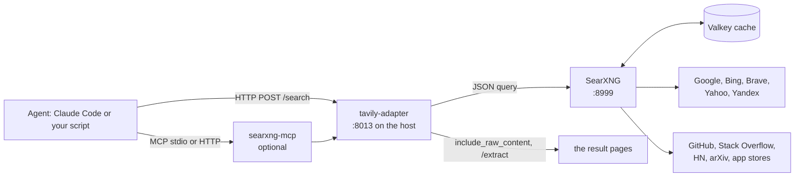
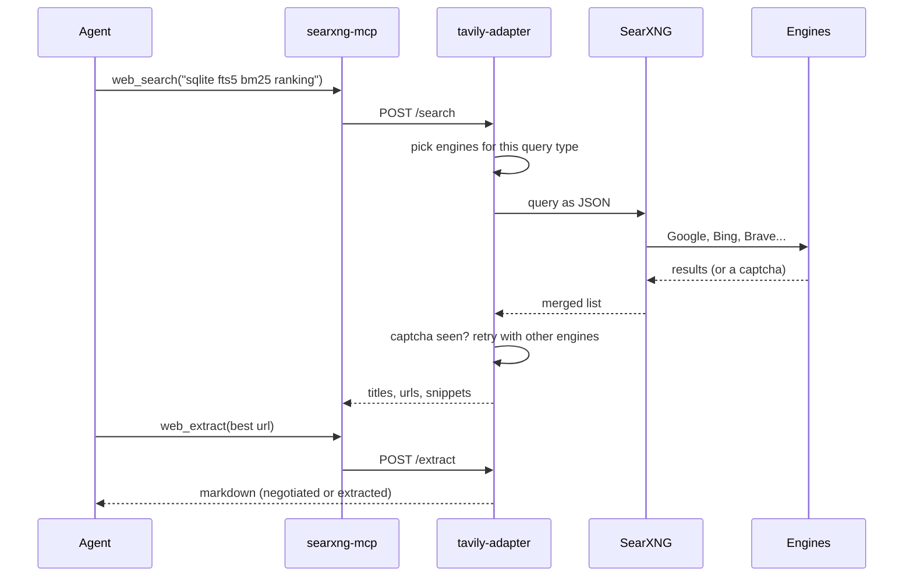
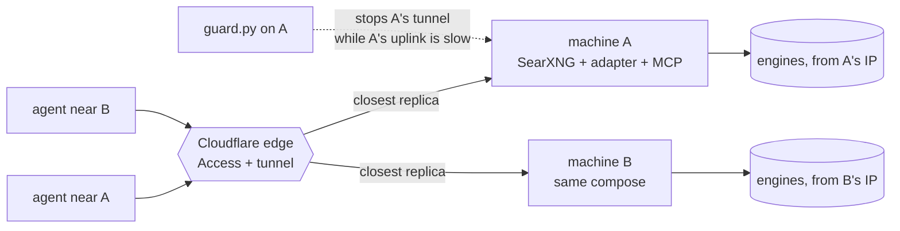

# Your own SearXNG as web search for AI agents

## The short version

An agent that can search the web is much better at everything: it reads the current docs instead of guessing from memory, checks whether a library still exists, finds the issue someone filed last week. The usual way to give it that is a paid search API. The other way is a SearXNG you run yourself, with a small adapter that makes it look like the Tavily API. It costs nothing per query, runs on a laptop, and the agent can also read any result page as clean markdown.

I run this every day. [[agent-harness-and-always-on-gnome]] describes the agents that use it. This post is the setup and what I learned keeping it alive.

| Question | Answer |
|---|---|
| What is it | SearXNG (a meta-search engine) + an adapter with a Tavily-shaped `/search`, plus `/extract` and `/transcript` + Valkey as cache + an optional MCP server |
| Cost | No per-query bill. A machine with Docker, and a normal home internet connection |
| Time to first result | About 10 minutes: clone, copy one config, change one key, `docker compose up` |
| Where to run it | At home. Datacenter IPs get captchas from Google and Bing on the first queries |
| How the agent uses it | As an MCP server (`web_search`, `web_extract`, `youtube_transcript`) or as plain HTTP |
| Biggest trap | A burst of queries. Paced at 10 queries it is fine; 80 in five minutes got an engine suspended for hours |
| Sharing it | Cloudflare Tunnel + Access with service tokens, so a few people or machines can use it without opening a port |

## Why bother

- **No bill per query.** A research session can run hundreds of searches. On a paid API that is a meter running; here it is your own connection.
- **You choose the engines.** Google, Bing, Brave, Yahoo, Yandex, plus the specialist ones: GitHub, Stack Overflow, Hacker News, arXiv, app stores. Which ones are on decides the quality, and you can see why a query failed.
- **The agent reads pages as markdown.** `/extract` asks the site for `text/markdown` first. A site that serves its own markdown gives you authored prose instead of an extraction guess: one site returned 8.3k characters against 51 KB of HTML. When the site has only HTML, the adapter extracts the article and keeps tables.
- **Tavily-shaped.** Anything written for the Tavily API works after you change the base URL.

The cost is that you maintain it. Engines get blocked, ranking drifts, and the machine has to be up. The rest of this post is mostly about that.

## The stack



Four pieces carry the load:

- **SearXNG** does the actual searching and merges results from many engines.
- **The adapter** is a small FastAPI service. `/search` takes a Tavily-style request, picks engines per query type (code questions go to GitHub and Stack Overflow, news to news engines), retries when an engine returns a captcha, and can fetch each result page. `/extract` turns one URL into markdown. `/transcript` returns YouTube captions as text.
- **Valkey** (a Redis fork) is SearXNG's cache.
- **The MCP server** is a thin wrapper over the adapter, so Claude Code sees three tools. It is separate from everything else on purpose: it needs one HTTP library and nothing more, so it keeps starting when other tools break.

## Set it up

You need Docker with compose, and `uv` if you want the MCP server. The repo is [fortunto2/searxng-docker-tavily-adapter](https://github.com/fortunto2/searxng-docker-tavily-adapter), a fork of an adapter by vakovalskii that I extended (engine routing, `/extract`, `/transcript`).

**1. Clone and copy the config.**

```bash
git clone https://github.com/fortunto2/searxng-docker-tavily-adapter.git
cd searxng-docker-tavily-adapter
cp config.example.yaml config.yaml
```

**2. Change the secret key.** `server.secret_key` in `config.yaml` must be a random string of 32 characters or more:

```bash
python3 -c "import secrets; print(secrets.token_hex(32))"
```

One file configures both SearXNG and the adapter. SearXNG's settings sit at the top level, the adapter's under `adapter:`. Leave `json` in `search.formats`: the adapter talks to SearXNG in JSON and nothing works without it.

**3. Start it.**

```bash
docker compose up -d redis searxng tavily-adapter
```

I name the services because the stock compose file also declares an optional extra (a vector search over my own indexed sources) with a build path that only exists on my machines. You do not need it. The Cloudflare and MCP containers sit behind a `cloudflare` profile and stay off unless you ask for them.

**4. Test.** SearXNG answers on port 8999, the adapter on 8013 (it listens on 8000 inside the container):

```bash
curl -f http://localhost:8013/health
curl "http://localhost:8999/search?q=test&format=json"
curl -X POST "http://localhost:8013/search" \
     -H "Content-Type: application/json" \
     -d '{"query": "rust async runtime", "max_results": 3}'
```

If the second call returns results, SearXNG works. If the third fails while the second works, look at `docker compose logs tavily-adapter`.

**5. Use it from code.** The official Tavily client works with a different base URL, and the key is ignored:

```python
from tavily import TavilyClient

client = TavilyClient(api_key="unused", base_url="http://localhost:8013")
client.search(query="rust async runtime", max_results=5, include_raw_content=True)
```

With `include_raw_content` the adapter fetches the top pages and returns up to 2500 characters of text for each. That is slower (the README measured 3 to 5 seconds against 1 to 2) but gives the model context in one call.

## Connect it to Claude Code

The MCP server lives in `searxng_mcp/` in the same repo. It reads the adapter address from `TAVILY_API_URL` (default `http://localhost:8013`) and runs with `uv`:

```bash
claude mcp add searxng --scope user \
  -e TAVILY_API_URL=http://localhost:8013 \
  -- uv run --project ~/projects/searxng-docker-tavily-adapter searxng-mcp
```

The path is wherever you cloned the repo. After a restart the agent has `web_search` (it also takes an `engines` list and `include_raw_content`), `web_extract` (a URL, with `size` of `s`, `m`, `l` or `f` for 5k, 10k, 25k characters or the whole page, paged) and `youtube_transcript`.

User scope matters. A server registered per project means that sessions in other repos have no search.

The same server can run over HTTP instead of stdio: `MCP_TRANSPORT=http` serves it at `/mcp`. You need that only when the agent runs on another machine than the search.

### What one search looks like



## What I learned keeping it alive

**Run it at home, not on a VPS.** Google and Bing put captcha walls in front of datacenter address ranges, so a rented box gets blocked on the first queries. A home connection is the only mitigation that needs no proxy. The price: search is up only while the machine is up. That is fine when the agent runs on the same machine, and it is why the always-on box in [[agent-harness-and-always-on-gnome]] reaches search through a private network back to a home machine, instead of searching from the datacenter.

**Do not hammer it.** On 28 Oct 2026 I ran an eval of about 80 queries in five minutes, and the Google custom-search engine was suspended for hours. Ten queries, paced, is enough to measure anything. SearXNG's default suspension times assume a public instance under abuse: one day after a captcha, seven after a Google reCAPTCHA, fifteen after a Cloudflare one. For one user that is losing Google for a week because of one bad minute. The example config cuts them to 2 to 10 minutes (`search.suspended_times`), so a suspension is a pause.

**Several engines, never one.** Measured on 12 Sep 2026, four engines carried general queries: Google custom search 45%, Google 23%, Bing 23%, Brave 9%. Before that day it was the first alone at 100%, and everything else had been dead without anything saying so. On 28 Oct Google and Brave refused all day; Yahoo and Yandex, which are off by default upstream, were switched on. On 10 documentation queries the expected site was in the top 3 for 7 of 10 before and 10 of 10 after, and first for 3 of 10 before and 8 of 10 after.

**Engines lie about being blocked.** Three examples from my own config:

- **Bing** looked blocked. It was not: it drops the connection mid-request over HTTP/2 under the client's browser impersonation, while plain `wget` in the same container got a 200. The fix is `network: {enable_http2: false}` scoped to that engine. Turning HTTP/2 off globally also fixed it but moved mean latency from 0.9 to 1.6 seconds for everyone.
- **DuckDuckGo** went from captcha to dropping TCP entirely (DNS resolves, connect never completes) after I kept retrying it, and every retry extends the block. It is disabled, not just left out of the defaults. When you retest an engine, assert that it returns results. "No captcha text in the body" is also what an empty body looks like, and I nearly wrote down "the ban lifted" on that evidence.
- **Startpage** was removed upstream, so an entry for it matched nothing and `disabled: false` did nothing. SearXNG's `/config` endpoint lists the engines it really loaded (271 of them in my version).

**Engine lists live in two places.** SearXNG's `config.yaml` says what is enabled. The adapter has its own groups and fallbacks in `engine_selector.py` and `main.py`. A search only reaches an engine if both agree. Remove one in the config only and the adapter keeps calling it and waits for a timeout on every query.

**Probe with plain curl before believing a note that says "blocked".** Nearly everything that looked like a captcha was my own config or the wrong protocol.

### Check your engines

```bash
curl -s "http://localhost:8999/search?q=rust&format=json&engines=bing" | head -c 400
curl -s "http://localhost:8999/config" | head -c 400
```

The first tells you whether one engine answers; the second what is loaded. Test one engine at a time, paced.

## Sharing it with a few people (optional)

If another person or machine should use your search, do not open a port on your router. The compose file has a `cloudflared` container behind the `cloudflare` profile, and the idea is:

1. Create a Cloudflare Tunnel, take its token, and put it in `.env` as `CLOUDFLARE_TUNNEL_TOKEN`.
2. Point the tunnel's public hostname at `http://tavily-adapter:8000` (the MCP container, `http://searxng-mcp:8000`, if you want MCP over HTTP).
3. Start with `docker compose --profile cloudflare up -d`.
4. Put a Cloudflare Access policy in front of the hostname, so a request without credentials never reaches your machine. People log in; scripts and agents present a service token.

The adapter protects the home connection itself. Traffic that arrives through the tunnel counts against `TUNNEL_RPM` (30 requests a minute by default; `0` turns it off), while calls from the same machine are never limited. One person's runaway loop then costs 30 searches a minute, not your IP's reputation.

Egress still leaves from your home IP. The tunnel only brings requests in. The tunnel, Access, SSH and WARP pieces are explained on their own in [[zero-trust-private-network]].

### Logging in instead of handing out tokens

Service tokens work, but each one is a secret you pass around and rotate. For people who use Claude Code there is a simpler route: turn on **Managed OAuth** on the Access application (Zero Trust → Access → Applications → the app → Advanced settings). Access then acts as a standard OAuth server for that hostname, and connecting is one command:

```bash
claude mcp add --transport http search https://search.example.com/mcp
```

Then `/mcp` → `search` → Authenticate. A browser opens, the person logs in with the email your policy allows, and the client keeps a refresh token. I set a 15-minute access token and a two-week grant (the values Cloudflare recommends for agents), allowed clients on `localhost` (that is where Claude Code listens for the callback) and added `https://claude.ai/api/mcp/auth_callback` for the Claude app's custom connectors. Measured on an MCP server behind my Access: a fresh client registers itself, the login returns a code, and `tools/list` and a tool call answer as my email. Service tokens keep working next to it, so scripts and bots without a browser change nothing.

Two traps cost me an hour:

- **A WARP device skipped the OAuth return.** With WARP enrolled, Access recognised the machine, logged it straight into the app page and never sent the browser back to the client with a code. Turning off "authenticate via WARP" for that one application fixed it; the same login then finished with WARP on.
- **`error code: 1010` is not an auth failure.** My first test client was Python's `urllib` with its default `User-Agent`, and Cloudflare's Browser Integrity Check refused it with a 403 that looked exactly like a rejected token. Send any real `User-Agent` and it passes.

One side effect: a request without credentials from a non-browser client now gets `401` with a `WWW-Authenticate` header instead of a redirect to the login page. That is what lets the client discover the login on its own.

## Growing it into a cluster (optional)

Once you share it, one sleeping laptop means no search for everyone. The fix is to run the same compose file with the same tunnel token on a second machine on another home connection. Cloudflare treats them as replicas of one tunnel and sends each request to the closest one that is connected.



Two things the replicas do not do by themselves, and what the repo's `cluster/` directory adds:

- **A connected but slow machine still gets traffic.** `guard.py` runs on the node. After three slow checks in a row (one HTTPS request over 1.5 seconds; a healthy line answers in 0.2 to 0.5) it stops its own tunnel connector, but only while another replica is connected. It starts it again after three good checks, or when it is the last one left.
- **A network switch can leave the connector running with no connection.** Turning a VPN on or off, or moving to new wifi, did that to me for minutes. The guard reads the connector's `/ready` endpoint and restarts it after two such checks.

It earned its keep on the first evening: the laptop sat on hotel wifi with 1.6-second round trips, MCP calls took 4 to 20 seconds, and about a minute after the second machine joined, the guard took the laptop out of the pool. Searches went to the other home connection with nobody changing a URL.

Captchas and suspensions are per machine, because each searches from its own IP. That is a feature: one bad IP does not take everything down.

Joining a machine is two commands, and the only secret it needs is the tunnel token:

```bash
git clone https://github.com/fortunto2/searxng-docker-tavily-adapter && cd searxng-docker-tavily-adapter
security find-generic-password -s search-tunnel -w | cluster/node-up.sh   # Linux: secret-tool lookup …
```

`node-up.sh` writes its own `config.yaml` from the example (a fresh secret, every engine that needs an API key switched off) using the Python inside the SearXNG image, so the machine needs Docker and nothing else. It binds every port to `127.0.0.1`, starts the five containers and waits until they are healthy. On an ARM single-board computer the whole stack took about 313 MB of RAM. Two things that bit me on the way, both handled by the script now: Debian trixie ships Docker as three packages (`docker.io`, `docker-cli`, `docker-compose`), and a config written under a strict `umask` was unreadable to the SearXNG container, so the script sets it to `644` on every run.

Hand the tunnel token only to machines you trust: whoever holds it can add a node to the pool and answer your searches. `cluster/README.md` in the repo has the rest: the guard's thresholds, updating and removing a node.

## Glossary

- **SearXNG**: an open-source meta-search engine. It sends your query to many search engines and merges the answers. No account, no tracking.
- **Tavily**: a paid search API built for LLM agents. Its request and response shape became a common format.
- **Adapter**: a small service that translates one API into another. Here, Tavily-shaped requests into SearXNG queries.
- **MCP (Model Context Protocol)**: the standard way to give an agent tools. The agent starts a server and sees its tools.
- **stdio / streamable HTTP**: the two ways an MCP server can talk. Stdio is a local subprocess; HTTP lets another machine connect.
- **Valkey**: an open-source fork of Redis, used as SearXNG's cache.
- **Residential vs datacenter IP**: the address your home provider gives you versus one from a hosting company. Search engines trust the first and challenge the second.
- **Captcha / suspension**: an engine asks for proof you are human; SearXNG then pauses that engine for a set time.
- **Content negotiation**: the client says which format it prefers (`Accept: text/markdown`) and the site answers in it if it can.
- **Cloudflare Tunnel**: an outbound connection from your machine to Cloudflare, so you can publish a service without opening a port.
- **Cloudflare Access / service token**: a login wall in front of a hostname. A service token is a key pair a script presents instead of logging in.
- **Managed OAuth (Access)**: Access acting as an OAuth server for your hostname, so an MCP client gets a token after a browser login instead of holding a shared secret.
- **WARP**: Cloudflare's device client. An enrolled machine can be recognised by Access without a login page, which is exactly what skipped the OAuth return here.
- **Replica (tunnel)**: another connector running the same tunnel. Cloudflare sends each request to the closest connected one; it does not balance load between them.

Related: [[agent-harness-and-always-on-gnome]], [[infra-two-tools]], [[project-solograph]], [[tools-and-infrastructure]].
