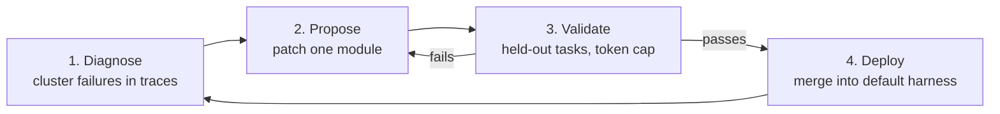
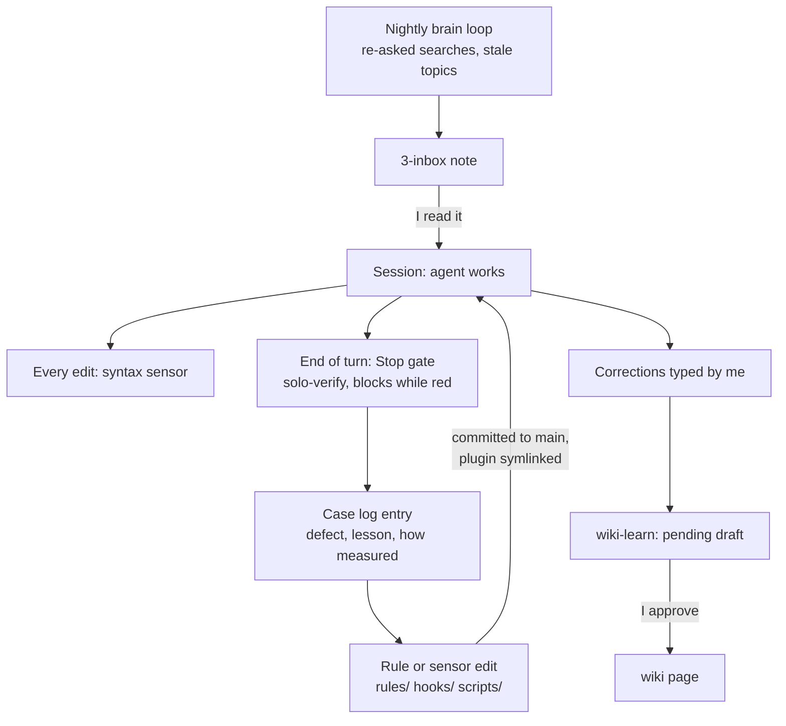
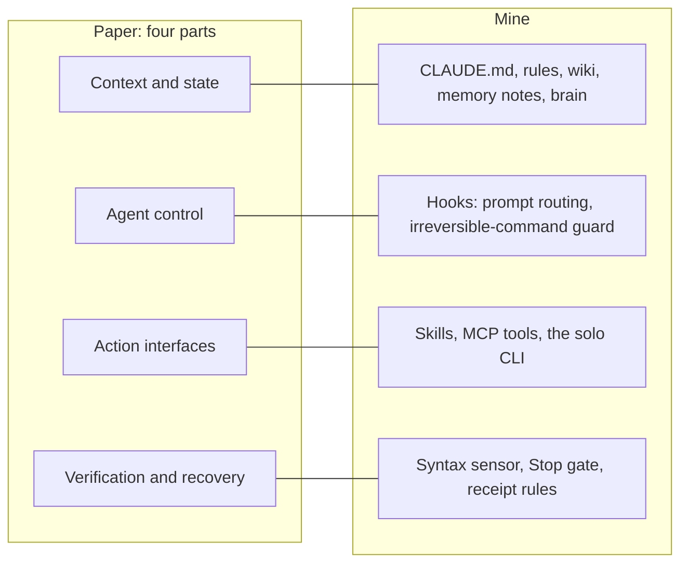
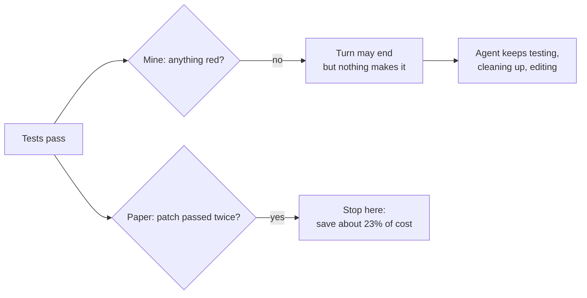

A paper from 17 November says the next step for coding agents is a harness that reads its own failures and rewrites its own code. I already run a smaller version of that. The useful part of the comparison is where mine stops.

## The short version

- The paper splits a harness into four editable parts and runs them through a four-step loop: diagnose, propose, validate, deploy.
- My loop is strong on diagnose and propose, partial on validate, and has no gate on deploy. A rule I edit is live in the next session.
- The paper says the checker must sit outside the agent's write access. Mine does not: tests and lint configs are editable, and editing them is reported, not blocked.
- My Stop gate asks "may the turn end?" A second paper asks "should it have ended earlier?" I have no answer to that one.
- A third paper found that a model scoring 11 points higher did not get more pull requests merged. The harness is the part left to tune.

## What the framework says

The four parts, each editable code: **context and state** (what the model sees, how old output is compacted), **agent control** (turn limits, loop breakers), **action interfaces** (the tools and how their output is trimmed), and **verification and recovery** (checks that run before the agent may stop). The loop around them diagnoses failures from traces, proposes a patch, validates it on held-out tasks, and only then deploys.

The test was small: 60 SWE-bench Lite tasks, a 142-line seed harness, 100 search rollouts. Three results matter.

- **A rule in text did not hold.** A RULES.md line forbade finishing on an empty or untested diff. Unverified stops doubled anyway, from 15.0% to 30.0%, and held-out accuracy fell to 2.5%. A code check in the stop hook ended them.
- **Full rewrites cost more.** Rewriting all four files at once reached 42.5% accuracy by raising the turn cap from 12 to 28, at 451.6k tokens a task.
- **Gated modular edits won.** One module at a time under validation: 40.0% (8 times the 5.0% seed) at 46.7k tokens a task, 2.5 times fewer than the seed. Validation also rejected one edit: raising the turn cap from 12 to 18 improved development accuracy but broke the token cap.

Of the five failure modes the paper lists, two matter here: grading scripts and logs left writable, so the agent can raise its score by rewriting the evaluator, and saved rules treated as trusted when they carry across sessions.

## My loop, mapped

By stage:

1. **Diagnose.** The case log (`docs/harness-case-log.md`, started 8 September) holds one defect per entry with what it taught and how it was measured. I counted 35 titled sections and about 55 more entries that open with a bold sentence. `/wiki-learn` scans a transcript for my corrections. `solo:dream` checks memory notes against what is true now. The brain nightly lists searches asked twice, searches that found nothing and topics waiting on me.
2. **Propose.** Done by the agent in an ordinary session, usually in the same session that found the defect.
3. **Validate.** bats tests, `make mutants` (does the suite go red when a line is wrong), pre-commit, and `make blind-spots`, which plants known defects. The last one measured the verifier at 11 of 24 caught.
4. **Deploy.** A commit to main. The `solo` plugin cache is a symlink to the repo, so the edit is live next session.

One real case. The Stop gate once judged the whole working tree, so it blocked three turns in a row on another session's half-written files. Two agents then pushed with `--no-verify` to get past a related pre-push check. The fix recorded each session's own Edit/Write calls and verified only those files. The lesson in the log: a sensor's scope is a claim about who changed what, and "changed in the tree" only held while there was one writer.

## Where mine does not improve itself

I checked these in the files, not from memory.

**No gate on deploy.** The paper's stage 3 needs held-out validation before a patch lands. I have tests and mutation runs, written by the same agent that wrote the patch, and then a commit to main. Nothing stages a rule change.

**The evaluator is in reach.** `harness-sensors.md` says editing the harness is "loud, not forbidden": a change to tests or lint configs prints `HARNESS TOUCHED` with a hash. The paper's first safety rule is to keep graders and logs outside the agent's write access. I report tampering; I do not prevent it. Whether the sensor scripts themselves are covered by that report I did not verify.

**Rule edits are not human-approved one by one.** All 22 commits since 1 October that touched `rules/`, `hooks/`, `scripts/` or the case log carry a Claude co-author line. I work on main, and my global instructions hand an agent the right to decide inside a mandate. I did not find an approval step. What I did find:

| Path | Who decides |
|---|---|
| `/wiki-learn` drafts | Me: the skill stops at `wiki/_pending-*.md` until told to apply |
| `solo:dream` | Me: it returns proposed fixes and writes nothing |
| Scheduled jobs | Nobody edits code: the loop's rule is "jobs never edit code" |
| Brain nightly | Writes one inbox note, nothing else |
| Rules, hooks, sensors | The agent, in an interactive session, committed to main |

So the agent does rewrite its own harness code without per-change review. The loops that run unattended are the safe ones.

**The read path is unproven.** After 1.5 days the brain had 5 captures from other sessions and 0 `brain_start` calls from them. Zero searches had a capture in their results. I set a check for 24 November. Memory is written, not yet shown to be read.

## The Stop gate against stopping early

Mine blocks the turn while any check is red. That answers "may it end?" and never "should it have ended already?" The second paper replayed about 6,000 runs of eight open models in two scaffolds on SWE-bench Verified and scored every intermediate patch.

- After its first passing self-test, one model ran 18 more commands: 42% of the run's cost in one scaffold, 66% in the other.
- The most that stopping at a passing self-test could save without losing quality ranged from under 1% to 57%, depending on model and scaffold.
- A rule that stops after the same patch passes twice saved 23% in a preregistered replication of 386 runs, at -1.0 points of resolution. The preregistered test did not establish non-inferiority at a 2-point margin.
- A model fine-tuned to imitate the rule saved 30% at -1.2 points, again without a quality guarantee.

I have no such rule and have not measured what my agents do after green. The papers used open models in two research scaffolds, not Claude Code, so none of the percentages transfer to me. What transfers is the question, and that it can be replayed offline on recorded sessions.

## A better model did not buy more work

The third paper used a natural experiment. A U.S. export directive suspended Claude Fable 5 for 19 days from 12 June 2026. Most former users moved to Opus 4.8, 11 points lower on SWE-Bench Pro. Across 297 affected developers and 8,908 who stayed on Opus 4.8, access to Fable 5 raised the 7-day pull-request merge rate by 1.4 points, with an interval of -1.4 to +4.3, which is not significant. Five model upgrades across 1,208 developers and 15,442 pull requests averaged -0.9 points (-1.9 to +0.2).

Limits: only pull requests naming the model in a `Co-Authored-By` line were counted, merge rate is a proxy for work done, and an interval running to +4.3 does not rule out a real gain. Read it as "no evidence of a large effect", not "models do not matter".

## What I would change

1. Put the sensors and their tests out of reach of the session they judge, or at least make `HARNESS TOUCHED` block the Stop gate once.
2. Stage rule edits: land on a branch, replay the last N recorded sessions, merge only if the receipt does not get worse. This is the paper's stage 3 applied to my own log.
3. Log what happens after the first green receipt, then try a twice-passed rule on replays before applying it live.

## Glossary

- **Harness**: the software around a model that manages its context, tools, loop and checks. Claude Code is one.
- **Self-test**: a test the agent writes or runs itself, as opposed to hidden tests.
- **Stop gate**: my end-of-turn hook that runs `solo-verify` and blocks while anything is red.
- **Receipt**: the stop gate's output: what ran, what was skipped, what could not be checked.
- **Non-inferiority**: a statistical claim that a change is no worse than the baseline by more than a stated margin.

## Sources and method

Papers: arXiv 2611.22299 (framework and the SWE-bench Lite experiment), 2611.22901 (anytime evaluation), 2611.23216 (Fable 5 suspension). I read the full HTML text of each, not only the abstract. My side: `solo-factory/rules/harness-sensors.md`, `docs/harness-case-log.md`, `.claude/skills/wiki-learn`, `workflows/dream.js`, `harness/README.md` and the brain notes of 18 and 19 November. Commit counts come from `git log` on solo-factory since 1 October. Related pages: [[agent-harness]], [[harness-engineering-summary]], [[harness-registry]], [[company-brain]], [[context-engineering]], [[wiki-feedback-loop]], [[claude-code-code-mode]].
