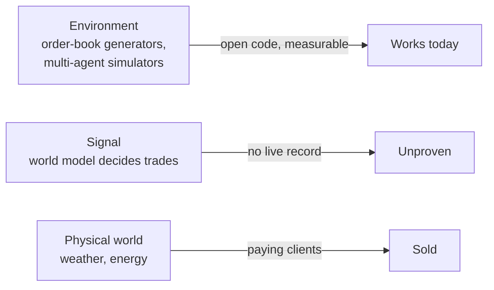
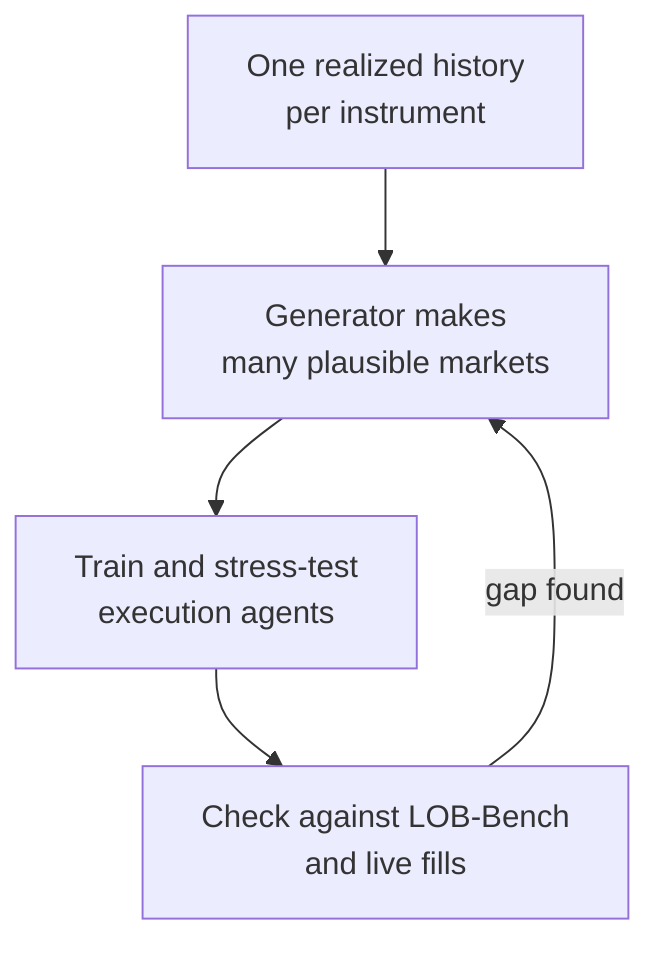

# World models in markets: what is sold today, what is still research

Based on [World Models in Markets: Where Prediction is Already Sold, and Where It Remains Research](https://arliwork.com/blog/) by Dmitry ([ARLI Research](https://arliwork.com/blog/)). We met over dinner in the Bay Area in October, and he sends me good links. His survey is long and well sourced, and every figure below that is not mine comes from it. The blog index is the only public address I have for it, so the link goes there. Read the original for the primary sources, I only use it as a frame for what I measured myself.

## The short version

"World model" means three different things, and the news mixes them into one story.

- **A stand for training and testing.** Models that generate a plausible market, order by order. Open code, open papers, real metrics. This works today.
- **A source of trading signals.** Nobody has shown a sustained live profit. Citadel's Ken Griffin said generative AI raises productivity but does not produce alpha. Dmitry found no public counterexample.
- **A model of the physical world.** Weather, energy. The only layer where people pay, because the physics holds still while the market does not.

His one-line summary, which I agree with: as a stand and a risk tool the idea works, as a source of profit it does not, and the gap between those two is the main fact of the field.

## Sold versus research

| Layer | Who | Evidence | Money |
|---|---|---|---|
| Order-book generators | JPMorgan (TradeFM), Microsoft Research Asia (MarS), Oxford, Tampere | Papers, code, LOB-Bench scores | Research budgets |
| Simulation as a product | Simudyne, data from Databento | Tiers exist, prices closed except data | Banks, on request |
| Trading agents | TradingAgents, FinMem, FinAgent | Backtests only, in rallies | None public |
| Agent benchmarks | StockBench, LiveTradeBench | Live or held-out, sobering | None |
| Weather and energy | Jua (Swiss, $16M seed Feb 2024, $11M Series A Jun 2025) | Client logos, no audited case | Energy traders |
| Internal "world models" at big firms | Citadel Securities, Two Sigma | A project tracker and an agent registry | Cost centers |

The last row is the funniest finding in the survey. Citadel's "world model" flagged 18 of 100 green projects as at risk. It never saw a price.

## What the stand layer really is

A generator is judged by whether it reproduces the market's known statistical habits: heavy tails, volatility clustering, the square-root law of price impact. MarS (Microsoft, trained on 32 billion order tokens) reproduces them. TradeFM (JPMorgan, 524 million parameters, over 9,000 US stocks) transfers to Asia-Pacific markets with moderate loss. A model of only 8.2 million parameters from Oxford reads order-flow imbalance from its state with R2 near 0.59, and its authors say plainly that the state describes the present, not the future.

LOB-Bench is the useful part for anyone checking claims. If a classifier can tell your synthetic book from a real one, the generator fails; a simple baseline is caught at ROC near 1, the best model sits at 0.83. A model with no evaluation protocol is a story, not a model.

The academic result I would keep is from the Market-1T paper (Brown, Chicago, Johns Hopkins; NeurIPS 2026 per Dmitry): across 18 ways of encoding market state, forecast quality and state quality correlate at only -0.19. A model that predicts the next return well can still hold a useless state for planning.

## Why the signal layer stays empty

Dmitry names three walls. None of them is about model size.

1. **Alpha decays.** In a study of 700 institutional portfolios, new-purchase alpha was 36 basis points in month one and zero by month twelve. Success crowds the trade.
2. **Backtests overfit by construction.** Two years of daily data allow roughly seven strategy variants before overfitting is likely. Agents search far more than that.
3. **Costs and capacity.** Simulators rarely model spread, queue position and your own price impact, so agents learn behavior that fails at the broker.

Add a fourth that I find the most honest: a strategy right on 99 percent of days can still shrink if the other 1 percent is large. Hit rate describes the typical day, and risk lives in the tail.

The agent benchmarks agree. StockBench: best of 14 models returned +2.5% over four months with a 15% drawdown, against +0.4% for doing nothing. LiveTradeBench: GPT-4.1 made +6.25% on stocks and lost 33.7% on Polymarket, and success in one market said nothing about the other.

## Where I agree, and what I measured

I agree with most of it, and my own forecasting bot is a small, cheap witness for the part about backtests.

I built `metaculus-bot` for the Metaculus FutureEval tournament, with research from a local SearXNG. On 29 October I ran its backtest on 60 resolved Manifold questions, one arm without search and one with. These are my numbers (`runs/backtest-manifold-claude-20261029-0542/report.md`, lines 1-27), one run, small sample, 72% of the questions resolved Yes:

| Forecaster | Mean Brier (lower is better) |
|---|---|
| Market price at that time | 0.139 |
| Always 50% | 0.250 |
| Claude with search | 0.324 |
| Claude without search | 0.425 |

Claude, with search or without, lost to the crowd and to a coin. Search helped by about 40 log-score points, and the best correction was to shrink the model's confidence hard toward 50% (a logit scale of 0.40). The run logged 746 suspected leaks: pages from after the question date that the date filter could not catch. The model's weights also hold mid-2026 text, so any question that resolved earlier tests memory, not forecasting. That is the "future lies in the weights" problem from the survey, and I hit it before I read it. My repo rule is the same as his conclusion: backtest only on questions resolved after the model's cutoff, and treat the first live tournament as the real test.

Two places I would add to his picture:

- **The crowd is a hard baseline.** In this setup the market price beat every model arm, in a space (prediction markets) where an agent should have its best shot. That fits LiveTradeBench's -33.7%.
- **A cheap verifier changes everything.** My other project, discovery-lab, attacks open math problems where an automatic verifier says right or wrong in seconds. There agents deliver. Trading has no such verifier, because you get one realized path and the market reacts to you. That, more than model quality, explains the split between the two fields.

## Where I disagree, or hold back

- Dmitry ends with a product position: a signed proof record around every agent step (signature, byte fingerprint, human-readable reason, human-set limits). The evidence for it is strong, since in the one live fleet study (14,596 trades) 60 percent of outcome variance came from the operational layer and 72.99 percent of decisions in AStockArena had an audit gap. But the same survey notes that the live data is crypto perpetuals, so I would not carry the percentages to equities. The argument for a record is sound; the numbers are one regime's.
- A signed record proves the bytes, not that the reasoning was right. He says this himself. I would stress it more: the wrong lesson from a beautiful audit trail is trust.
- I have no live-money data, so on the weather layer I can only repeat his split: the funding rounds are fact, the "$1.5 million per gigawatt" is Jua's own claim without a method.

## What I take from it

1. Use order-book generators as a test bench for execution logic. Do not expect them to find a price edge.
2. Any agent number needs two things attached: a post-cutoff test set and the count of variants tried.
3. Log what the agent did and under whose limit, not only what it predicted. This is what my harness already does for code, and the survey shows finance needs it more.

## Glossary

- **World model**: a learned approximation of how an environment changes state when an agent acts, used to plan without touching the real thing.
- **JEPA**: Yann LeCun's family of models that predict an abstract representation of the next observation instead of its pixels.
- **Limit order book (LOB)**: the live list of buy and sell orders at each price. Generators simulate its message stream.
- **Alpha**: return not explained by just holding the market.
- **Brier score**: mean squared error of probability forecasts; 0.25 is what always saying 50% gets on a binary question.
- **Reflexivity**: the forecast changes the thing it forecasts.
- **Implementation shortfall**: the gap between the price when you decided and the price you got.

## Source and credit

All survey figures here come from Dmitry's [World Models in Markets](https://arliwork.com/blog/) at [ARLI Research](https://arliwork.com/blog/); the numbers marked as mine come from `metaculus-bot` runs on 29 October 2026. His blog is just starting and many of his reviews are not public yet.

Related: [[running-production-with-agents-2026]] (the earlier piece of his I built on), [[agent-benchmarks]], [[agent-landscape]].
