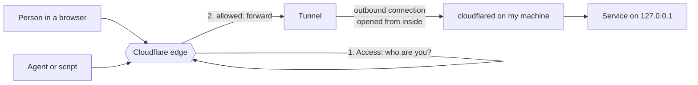
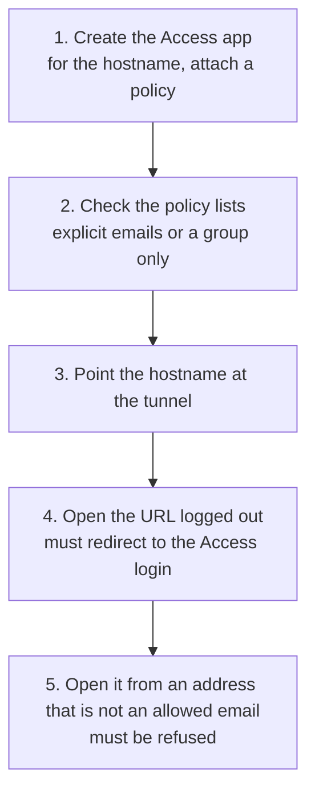
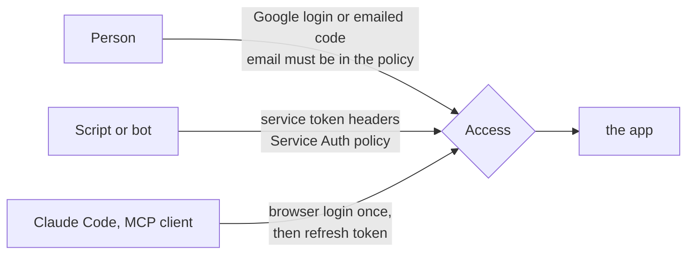
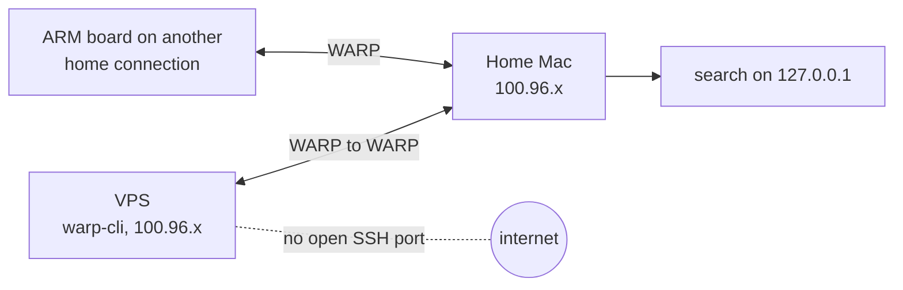

# A private network on Cloudflare Zero Trust instead of a VPN

## The short version

I do not run a VPN. I run four things that together do what a VPN did for me: a tunnel that publishes a service without an open port, a login wall in front of every hostname, SSH that needs no key on the server, and a device client that gives my machines private addresses so they can reach each other. All of it is Cloudflare Zero Trust, on the free plan, from one dashboard and one API token.

It is for a solo builder or a very small team with a few machines at home and a VPS, and a handful of people or agents who need to reach some of them. It replaces port forwarding, a WireGuard hub, shared SSH keys and a pile of basic-auth passwords.

| Question | Answer |
|---|---|
| Cost | $0. The free plan covers up to 50 users ([plans page](https://www.cloudflare.com/plans/zero-trust-services/)); the paid plan is per seat. I am one user plus a few invited emails |
| What you need | A Cloudflare account, a domain on it, `cloudflared` or Docker on each machine |
| What it replaces | Open router ports, a self-hosted VPN, shared keys in `authorized_keys`, shared passwords |
| What it does not give you | A full-mesh network for everyone. Most of what I share is HTTP, and for HTTP no device client is needed |
| Biggest trap | An Access policy that is quietly wider than you think (see "The policy trap") |
| Lock-in | Total. If Cloudflare is down or changes the free plan, this is all down with it |

Two earlier posts use these pieces without explaining them: [[own-searxng-for-agents]] (the search I publish and share) and [[agent-harness-and-always-on-gnome]] (the always-on VPS that reaches my home Mac). This one is the layer underneath.

Everything below is marked. **Measured** means I saw it happen on my own account in October or November 2026. **Docs** means I am repeating Cloudflare's documentation and did not test it myself.

## The pieces and how a request flows



- **Tunnel.** `cloudflared` runs on the machine and opens connections *out* to Cloudflare. Nothing listens on the internet side, so there is no port to forward and no home IP to attack.
- **Access.** An application bound to a hostname. Before a request reaches the tunnel, Access checks a policy: a logged-in email, or a service token. A request that fails never touches my machine.
- **WARP.** The device client. An enrolled machine gets a private address (`100.96.x.x` on mine) and can reach other enrolled machines directly. This is the VPN-shaped piece, and I use it for far less than I expected.

The point of the split is that most sharing is HTTP, which needs only the first two. WARP comes in when I need SSH or a raw TCP port between my own machines.

## Publishing a service so it is never public

The order matters more than any setting. Measured, from how I deploy now:



**Create the Access app before the hostname goes live, never after.** If the DNS record and tunnel route come first, there is a window in which the service is on the internet with no wall. A parked domain of mine drew 51.7k scanner requests in a week (measured), so a bare window is not theoretical. I do this for every new hostname, including a Worker deployed under a new domain.

Other settings that earned their place (all measured, taken from my account's exported config):

- One Access app per hostname, or per path where a hostname serves two things. A tunnel can route `^/mcp` to one container and everything else to another, with one Access app covering both.
- `session_duration` of 24 hours on ordinary web apps, 2 hours on the SSH app (see "SSH without shared keys").
- The tunnel's remote ingress lives in Cloudflare, not in a local file. Containers that serve it have identical names on every machine, so the same compose file runs anywhere.
- Back up the Access config (apps, policies, groups, tokens) to JSON before every change. I restore from the dump, not from memory. I made several of these on 4 and 5 November.

### The policy trap

An Access policy is a list of *includes*, and the includes are OR'd. I had an app whose policy had a good list of emails and, as a second include, "login method: one-time PIN". Anyone with an email address passes that. The same goes for "login method: Google" or `*@*`: it means any Google account on earth. I found and closed it on 4 November 2026 while setting up sharing for the first time (measured).

The rule I keep now: **includes are explicit emails or groups, nothing else.** If a method restriction is wanted, it goes in *require*, which is AND'd. A group (`me`, plus a second one with invited people) lets me add a person once and have it apply to every app that group guards.

After any change, I open each shared URL logged out and confirm it redirects to the login, then confirm the private ones refuse an invited email.

## People and agents



**People** open a link, log in with Google or a code sent to their email, and get a session. No device client, no account in my team. I do not enroll another person's laptop or phone into my WARP team: their whole traffic and DNS would land in my logs. If someone needs a device client for their own machines, it goes into their own team. The one exception is a small box that runs jobs, with a split tunnel that keeps everything else out (see "Machines talking privately").

**Scripts and bots** use a *service token*: a client id and secret sent as `CF-Access-Client-Id` and `CF-Access-Client-Secret` headers. The policy that accepts it must have the *Service Auth* action, and the token has to be listed in it (docs; the shape is `non_identity` in the API, which I read in my exported policies). The token goes to its owner outside chat and outside git, and the agent keeps it in a Keychain. Mine are valid one year. Revoking a person means deleting their email from the group, revoking their tokens, and revoking their sessions in the Users list.

**MCP clients** are the third case, and the nicest. Turn on Managed OAuth for the Access app and a person connects with one command and a browser login, with no secret to pass around:

```bash
claude mcp add --transport http search https://search.example.com/mcp
```

My settings (measured): dynamic client registration on, loopback callbacks plus the Claude app's callback allowed, access token 15 minutes, grant 336 hours (two weeks). Service tokens kept working next to it.

Three traps, all measured:

- **A WARP device skipped the OAuth return.** Access recognised the enrolled Mac, logged it straight into the app page, and never sent the browser back to the client with a code. I switched off "authenticate via WARP" for that one app and the same login finished with WARP on.
- **`error code: 1010` looks like a refusal and is not.** A Python client sending the default `Python-urllib` User-Agent was blocked by Cloudflare's Browser Integrity Check, with a 403 that looked like a rejected token. Setting any real User-Agent fixed it. Neither Access nor my service was involved.
- **WARP hides every test.** From a WARP-enrolled Mac, Access passes silently, so "it works for me" proves nothing. A test without a token returned a 422 that I first read as a bug. I test as a stranger from a machine that is not enrolled, or with WARP off.

A side effect of OAuth being on: a non-browser client with no credentials now gets `401` and a `WWW-Authenticate` header instead of a redirect to a login page. That header is how a client discovers the login by itself.

## SSH without shared keys

The usual setup: everyone's public key in `authorized_keys`, forever. Mine: nobody has a key on the server.

Access can sit in front of an SSH hostname in two ways, and I use both from a tunnel hostname that points at `ssh://localhost:22` on the machine:

- **Browser-rendered SSH.** The Access app is of type ssh with browser rendering on. A person opens the hostname, logs in with their email, and gets a terminal in the tab. Nothing to install.
- **A short-lived certificate.** Access issues a certificate signed by its own CA after the login. The server's `sshd` trusts that CA's public key (`TrustedUserCAKeys`), and a principals file per Linux user maps email local parts to the account: two of my addresses map to my one user. A new person means their email in a group, a Linux user and one principals file. No key is handed over, and the certificate is ephemeral (Cloudflare's docs call them short-lived; I did not time the lifetime).

Measured constraints worth copying:

- **Session duration 2 hours on that app.** A browser tab holding a sudo shell is a root shell on a screen that someone may leave open. I keep it short on purpose.
- **Passwords and root login are refused over the tunnel** with a drop-in `sshd_config.d` file. On the machine's own LAN they still work, and I did not touch that on a device that is not mine.
- The newer Access for Infrastructure method, which adds per-target and per-username rules and command logging, exists and needs WARP on the client side ([Cloudflare docs](https://developers.cloudflare.com/cloudflare-one/networks/connectors/cloudflare-tunnel/use-cases/ssh/ssh-infrastructure-access/)). I have not moved to it.

One more thing that cost me time, measured: after opening the SSH host in a browser, two other hostnames on the same IPs answered **HTTP 421**. The SSH host used a wildcard certificate and the others had their own, so the browser reused the open connection for the wrong hostname and Cloudflare refused it. A new window fixes it. The structural fix, if it keeps happening, is to put the SSH host on another zone.

## Machines talking privately

When HTTP is not enough, WARP does the VPN part.



What I run (measured):

- `warp-cli` on a VPS, enrolled into the same team as my Mac. The VPS gets a `100.96.x.x` address, and SSH to it needs no open port on the public interface. The VPS reaches a service on my home Mac at its private address and the traffic leaves the Mac, not the datacenter.
- That is the reason to do it: search engines give captchas to datacenter IPs, so the VPS asks the home machine, which has a residential address. The cost is that it works only while the Mac is awake (the details are in [[agent-harness-and-always-on-gnome]]). A laptop that was asleep made SSH to it hang until the timeout.
- An ARM board on another home connection is enrolled the same way, for light jobs that should leave from that home's IP. Its profile uses a split tunnel in **Include** mode with only `100.96.0.0/12`. The rest of the internet goes out through that home's router (the trace showed `warp=off`), so none of its browsing lands in my logs. DNS still goes through my Gateway.
- For machine-to-machine traffic to work, two settings must be on account-wide. **Gateway proxy for TCP** (set by API for me), and the dashboard toggle "Allow all Cloudflare One traffic to reach enrolled devices". The second one I could not find in the API or Terraform, so it is a click.
- Enrolling a headless box: `warp-cli registration new <team>`, open `https://<team>.cloudflareaccess.com/warp` in a browser anywhere, copy the token from the success page and run `warp-cli registration token "com.cloudflare.warp://…"`.

A machine's owner can cut access on their own box with `warp-cli registration delete`. That is a feature of a shared setup, not a bug.

## Traps, in one list

- **Toggling WARP on a Mac with a running tunnel kills the tunnel.** I ran `warp-cli connect` on a Mac that also ran `cloudflared`. Its QUIC connections dropped, requests got 530s, and it did not recover for more than three minutes (measured). I restarted the connector, then taught a small watchdog to restart it when the connector's `/ready` endpoint reports no connections. Same lesson for any network switch.
- **Docker published ports ignore the host firewall.** `ports: "8081:8081"` opens the port on the public interface even with `ufw` on, because Docker writes its own iptables rules. Bind to `127.0.0.1:8081:8081` (Docker's documented behavior; I bind everything to loopback and let the tunnel be the only way in).
- **Tunnel replicas are not a load balancer.** Run the same token on two machines and Cloudflare sends each request to the closest connected one, with a retry on a failed connection. It does not steer away from a slow machine (measured, see the cluster section of [[own-searxng-for-agents]]).
- **Rate limit what comes through the tunnel.** A runaway loop from an invited agent reaches your home IP. I cap tunnel traffic at 30 requests a minute in the service itself and 20 calls a minute per caller on a Worker.
- **A tunnel token is a key to the pool.** Whoever holds it can join a machine to your tunnel and answer your requests. Hand it only to machines you trust.
- **Policy OR, again.** See "The policy trap".

## What this does not do

- It is not a mesh for everyone. Each person who needs a private address needs WARP and a seat, and I enroll only my own devices.
- It is not independent. The free plan, the 50-user cap and the features can change. If Cloudflare goes down or I leave it, every hostname, tunnel and login described here goes away at once. Exporting the config to JSON (above) gives me the shape to rebuild, not a portable setup.
- Uptime is the uptime of your machines. A home Mac that sleeps is a host that is gone.
- The one-person scale is the case I measured. I did not test it with dozens of users or with device posture rules.

## Glossary

- **Cloudflare Zero Trust**: Cloudflare's suite for access control and private networking. The free plan covers up to 50 users.
- **Tunnel (`cloudflared`)**: a daemon that opens outbound connections from your machine to Cloudflare so a hostname can reach a local service with no open port.
- **Access**: the login wall in front of a hostname. It evaluates a policy before forwarding the request.
- **Access application / policy / group**: the app binds a hostname, the policy says who is allowed, the group is a reusable list of identities.
- **Include / Require**: policy rule types. Includes are OR'd, requires are AND'd.
- **Service token**: a client id and secret that a script sends as headers instead of logging in.
- **Service Auth policy**: a policy action that accepts a service token rather than a person. In the API it appears as `non_identity`.
- **Managed OAuth**: Access acting as an OAuth server for a hostname, so an MCP client obtains a token after a browser login.
- **WARP / Cloudflare One Client**: the device client. An enrolled device gets a private address and can be recognised by Access.
- **Gateway**: Cloudflare's filtering and proxy layer for traffic that comes through WARP. Its TCP proxy must be on for device-to-device traffic.
- **Split tunnel (Include / Exclude)**: which destinations go through WARP. Include mode sends only the listed ranges.
- **WARP-to-WARP**: enrolled devices reaching each other by their private addresses.
- **Short-lived certificate**: an SSH certificate that Access signs after a login and that expires quickly, replacing a long-lived key.
- **Principal (SSH)**: the name a certificate carries. A principals file on the server maps it to a Linux user.
- **Browser rendering**: an SSH session shown as a terminal in a web page.
- **Browser Integrity Check**: Cloudflare's filter that refuses requests with suspicious headers, such as a default scripting-library User-Agent. It answers `error code: 1010`.
- **Replica (tunnel)**: another connector running the same tunnel.

Related: [[own-searxng-for-agents]], [[agent-harness-and-always-on-gnome]], [[tools-and-infrastructure]].
